# InPost von Halsky — User Guide (PrestaShop)

> 🇵🇱 Wersja polska: [quick-start.md](./quick-start.md)

`inpostvonhalsky` · PrestaShop 8.x · PHP 8.1 · v 1.0.0

> **This guide walks you through the minimum required** to publish your first offer and start receiving orders from InPost von Halsky, and then through day-to-day work with the module. In the PrestaShop admin the module appears as **InPost von Halsky**; the whole module back office is also available in Polish.

## Table of Contents

- [EAN — when required, when optional](#ean--when-required-when-optional)
- [Cron does all the work for you](#cron-does-all-the-work-for-you)
- [Prerequisites](#prerequisites)
- [Installing and updating the module](#installing-and-updating-the-module)
1. [Verify the installation](#1-verify-the-installation)
2. [InPost API connection and offer settings](#2-inpost-api-connection-and-offer-settings)
   - [Default product field mapping](#default-product-field-mapping)
   - [Offer defaults and GPSR](#offer-defaults-and-gpsr)
   - [InPost prices](#inpost-prices)
   - [Productization — auto-fill offer data](#productization--auto-fill-offer-data-from-the-inpost-catalogue)
   - [Production environment — changing API URLs](#production-environment--changing-api-urls)
3. [Categories and attributes](#3-categories-and-attributes)
   - [Category mapping](#category-mapping)
   - [Assistant: shop → InPost](#assistant-shop--inpost)
   - [Attribute value sources](#attribute-value-sources)
   - [Feature or attribute?](#feature-or-attribute)
   - [Attribute assistant](#attribute-assistant)
4. [Publishing an offer](#4-publishing-an-offer)
   - [Products with combinations (variants)](#products-with-combinations-variants)
   - [Changing the category of an offer](#changing-the-category-of-an-offer)
   - [Offer list and deleting offers](#offer-list-and-deleting-offers)
   - [Bulk attribute edit](#bulk-attribute-edit)
   - [Offer price and bulk price change](#offer-price-and-bulk-price-change)
   - [Offer attachments](#offer-attachments)
5. [Receiving orders](#5-receiving-orders)
   - [Invoice details and addresses](#invoice-details-and-addresses)
   - [InPost payment](#inpost-payment)
6. [Offer statuses — what next](#6-offer-statuses--what-next)
7. [Integration status and background jobs](#7-integration-status-and-background-jobs)
8. [Common problems](#8-common-problems)
9. [Cron jobs — schedule](#9-cron-jobs--schedule)
10. [Additional settings](#10-additional-settings)
- [Waybills — Compatibility with the ShipX module](#waybills--compatibility-with-the-shipx-module)

---

## EAN — when required, when optional

Providing an EAN is not always mandatory. An offer can be listed in two ways:

- by providing an **EAN**, **or**
- by providing **brand + manufacturer product number (MPN)** together.

If an EAN is provided, the module validates it: digits only, length **8 (EAN-8), 12 (UPC-A) or 13 (EAN-13)**, and a valid (modulo 10) check digit. The EAN is also used by [Productization](#productization--auto-fill-offer-data-from-the-inpost-catalogue) to fill offer data from the InPost catalogue.

> **Combinations.** The offer of a variant (e.g. a T-shirt in size M) uses **only the combination's own EAN** — the product EAN is not copied, because InPost does not allow changing an EAN once set on an offer and every variant needs a different one. A variant without an EAN needs a brand and an MPN.

> **Where the module takes the MPN, EAN and brand from** — set in [Default product field mapping](#default-product-field-mapping) (by default: the product's *MPN*, *EAN-13* and *Brand (manufacturer)* fields).

---

## Cron does all the work for you

Once configured, all synchronisation with InPost runs automatically — categories, offer statuses, orders, changes of prices, stock and attribute values. **The only manual work is: configuring the connection and mapping categories and attributes** — after that, listing offers and keeping them up to date is fully automatic.

Changes of prices, stock, combinations, features and images on the PrestaShop product are detected **immediately** (via product hooks), which flag the related offers for re-sync; the change is then sent to InPost by cron. Right before an offer is sent, the module reads its price and stock from PrestaShop once more, so InPost never gets stale data (e.g. after a purchase in your shop).

### How cron works in this module

All synchronisation is handled by **a single dispatcher command**:

```
php bin/console inpost:cron:run
```

This command is run **every minute** by the system cron (or by the PrestaShop CronJobs module). The frequency of each job is enforced **inside the module** — the dispatcher runs a job only when its interval has passed. Jobs never run in parallel (per-job lock), and every run can be followed live in the [Background jobs](#7-integration-status-and-background-jobs) panel.

### Default sync frequencies

| Categories | Offer events (statuses) | Order import | Order events | Changed offers | Commands (async) |
|------------|-------------------------|--------------|--------------|----------------|------------------|
| daily 02:00 | every 20 min | every 10 min | every 15 min | every 10 min | every 3 min |

> **New orders arrive through events.** The order events job creates the shop order for a new accepted InPost order right away (this can be switched off) — no need to wait for the order import. Details: [Receiving orders](#5-receiving-orders).

---

## Flow

**1 Verify → 2 API configuration → 3 Categories and attributes → 4 Publish an offer → 5 Orders**

Ongoing: **7 Integration status** shows whether everything works and what needs attention.

---

## Prerequisites

- PrestaShop 8.x
- PHP 8.1
- The module installed and enabled
- A system cron running `php bin/console inpost:cron:run` (every minute) **or** the PrestaShop CronJobs module
- Client ID + Client Secret from InPost
- **PLN** currency and VAT tax rules on products (InPost sells in PLN; a product without a tax rule is sent to InPost with 0% VAT — the status panel warns about such offers)

---

## Installing and updating the module

Install the module like any other PrestaShop module — choose one of the methods:

### Method A — via the admin panel (recommended)

1. Download **`inpostvonhalsky-x.y.z.zip`** from [GitHub Releases](https://github.com/InPost-VonHalsky/InPost-vonHalsky-PrestaShop/releases) (*Assets* section). The package already contains the Composer dependencies (the `vendor/` directory). Do not use **Code → Download ZIP** — that file has no dependencies.
2. In the admin go to **Modules → Module Manager**.
3. Click **"Upload a module"** (top right) and drop or select the `.zip`. PrestaShop unpacks and installs the module automatically.
4. After installation click **"Configure"** next to **InPost von Halsky**.

### Method B — manually (file upload / FTP)

1. Unpack the module directory to `modules/inpostvonhalsky/` of your PrestaShop installation (via FTP/SFTP or directly on the server).
2. Install the Composer dependencies in the module directory:
   ```bash
   composer install --no-dev --optimize-autoloader
   ```
3. In the admin go to **Modules → Module Manager**, find **InPost von Halsky**, click **Install**, then **Configure**.

> **Composer dependencies.** A ready `.zip` package should already contain `vendor/`. When installing straight from the repository, run `composer install` in the module directory **before** installing in the admin — otherwise the module does not start (no autoloader).

### Updating to a new version

Upload the new `.zip` the same way (Method A) or replace the files (Method B), then click **Upgrade** next to the module in **Modules → Module Manager**. The upgrade runs the database scripts if the new version has any; they are additive only — existing offers, mappings and orders keep working unchanged. Until the upgrade is run, the [status panel](#7-integration-status-and-background-jobs) shows a **Module version** item with the version difference.

> Technical details (repository, InPost SDK, file permissions): [README.md](../README.md). Full list of changes: [CHANGELOG.md](../CHANGELOG.md).

After installation continue with [1 Verify the installation](#1-verify-the-installation).

---

## 1 Verify the installation

After a successful installation a new **InPost von Halsky** item appears in the PrestaShop admin menu (**Sell** group) with the sub-items:

- **Status** — [integration status](#7-integration-status-and-background-jobs): what works and what needs attention
- **Offers** — offer list, creating and editing offers
- **Orders** — orders from InPost
- **Category Mapping** — InPost categories and attributes, mapping assistants
- **Configuration** — the module configuration page

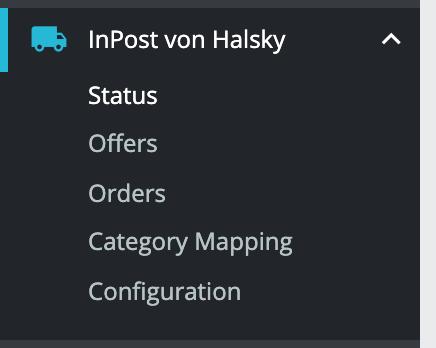

> **Bulk listing** starts from the product list in the catalogue (bulk action **"List on InPost"**), and the **Attribute assistant** from the header of the **Category Mapping** page.

> **Cron is required.** Without a working cron (`inpost:cron:run`) no automatic synchronisation runs. The **Status** page shows when cron last ran.

---

## 2 InPost API connection and offer settings

Open the module configuration page:

**InPost von Halsky → Configuration** (or **Modules → Module Manager → InPost von Halsky → Configure**).

The configuration page is split into groups shown in the side navigation: **Connection**, **Synchronization**, **Offers & Products**, **Shipping & Payment**, **Emails**. Each panel has its own **Save** button.

### Where to get credentials (Client ID / Client Secret)

You generate the **Client ID** and **Client Secret** yourself in the **InPost Merchant Portal**: **[Merchant Portal](https://account.inpost-group.com/auth?client_id=merchant-portal&nrc=1)**. A step-by-step guide is in the **[InPost API documentation](https://inpsa-api-portal.inpost-group.com/#)** — click **docs configuration**.

In short: log in to the Merchant Portal, create a new set of credentials (an OAuth2 client), enter the address shown on the module configuration page as the **Redirect URI** (see the note below), then copy the generated **Client ID** and **Client Secret** to the module.

In the **Connection** group, **API Settings** panel:

1. Enter the **Client ID** and **Client Secret** generated in the Merchant Portal. For security reasons the Client Secret is never shown again — leave it empty if you do not want to change it. Click **Save** before using the connection buttons.
2. Check the **API URL** and **Authorization Service URL** — by default they point to the **staging** environment. In production replace them with the production addresses (see below).
3. Click **Connect with OAuth2** — starts the OAuth2 flow. Once connected the panel shows a green **"OAuth2 Connected"** message and a **Disconnect OAuth2** button.
4. Click **Refresh Organizations List** — fetches the organizations from the InPost API.
5. Select the **Organization** you list offers for.
6. Click **Test Connection** — verifies the token and the endpoints. A green message = ready to work.
7. **If the test is not successful** — check the **Client ID / Client Secret**, make sure the **API URLs** point to the right environment (staging/production), and connect again. See also [Common problems](#8-common-problems).

> **OAuth2 Redirect URI.** The panel shows the ready **OAuth2 Redirect URI** `https://your-shop/module/inpostvonhalsky/callback`. Copy it with **Copy** and paste it as the Redirect URI in the Merchant Portal — it must be **identical**, otherwise the OAuth2 login fails.

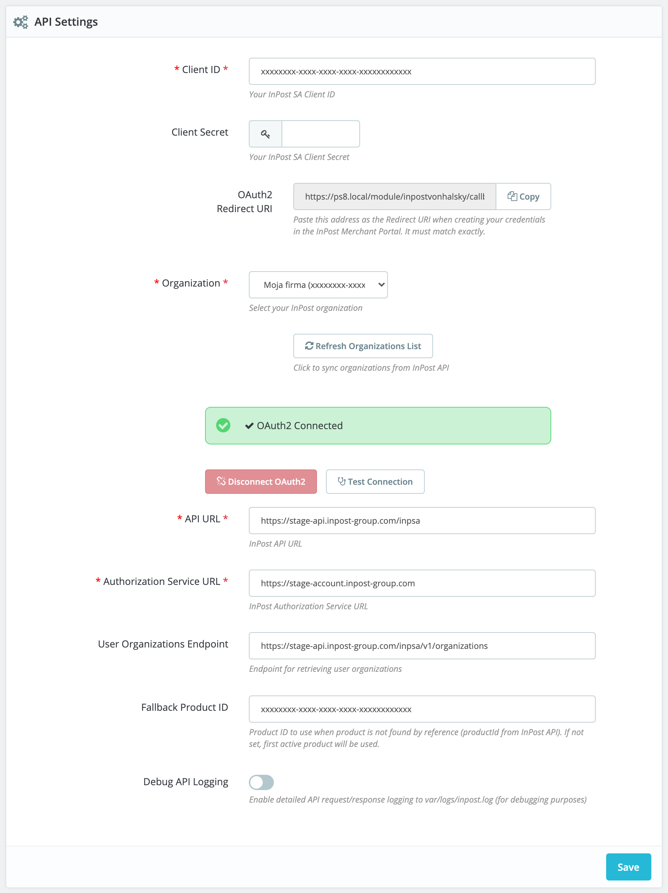

| Field | Default value (staging) |
|-------|-------------------------|
| API URL | `https://stage-api.inpost-group.com/inpsa` |
| Authorization Service URL | `https://stage-account.inpost-group.com` |
| User Organizations Endpoint | *(optional — endpoint of the user's organizations)* |

> **Fallback Product ID** and **Debug API Logging** are optional. The fallback product (product reference) is used on the order when an order line matches no shop product. Debug logging writes API requests and responses to `var/logs/inpost.log` (diagnostics).

### Default product field mapping

In the **Offers & Products** group, the **Default product field mapping** panel sets which PrestaShop data fills the product fields of **new** offers. Each field is chosen from a list — a product field or a feature. Existing offers do not change.

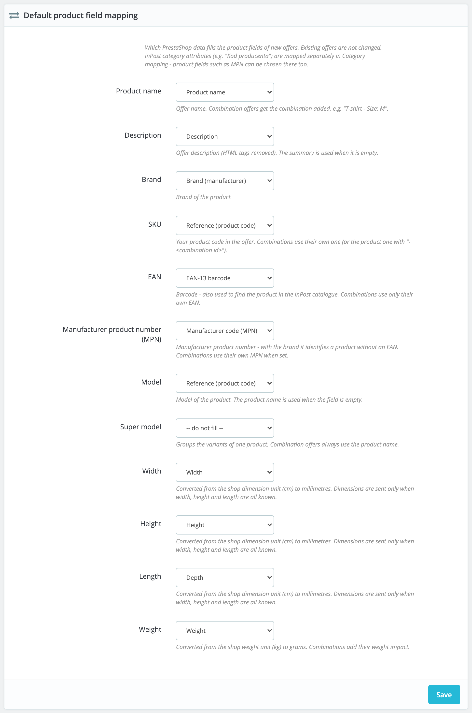

| Offer field | Default source | Notes |
|-------------|----------------|-------|
| Product name | Product name | Combination offers get the combination appended, e.g. "T-shirt - Size: M" |
| Description | Description | Without HTML tags; summary when empty |
| Brand | Brand (manufacturer) | |
| SKU | Reference | Combinations use their own reference, or the product reference with `-<combination id>` |
| EAN | EAN-13 barcode | Combinations — their own EAN only |
| Manufacturer part number (MPN) | MPN | Combinations — their own MPN when set |
| Model | Reference | Product name when empty |
| Super model (variant group) | *do not fill* | Combination offers always get the product name (groups the variants of one product) |
| Width / Height / Length | Width / Height / Depth | Converted from the shop units to mm; sent only when all three are known |
| Weight | Weight | Converted to grams; combinations add their weight impact |
| Delivery days | *do not fill* | A feature with a number of days, e.g. "3" or "2-3 dni" (the largest number is used). Applied on every send, also to existing offers without their own value |

> **Delivery days** — order: the value typed on the offer → the feature chosen in this mapping → **Default delivery days** from the *Offer Defaults* panel. When none of them gives a number, nothing is sent.

> **InPost category attributes** (e.g. "Kod producenta", "Size", "Child age") are mapped separately — in [Category Mapping](#attribute-value-sources).

### Offer defaults and GPSR

The **Offer Defaults** panel holds the **Default Return Policy**, **Default Complaint Policy** and **Default delivery days** — used when an offer has none of its own (delivery days: see [Default product field mapping](#default-product-field-mapping)).

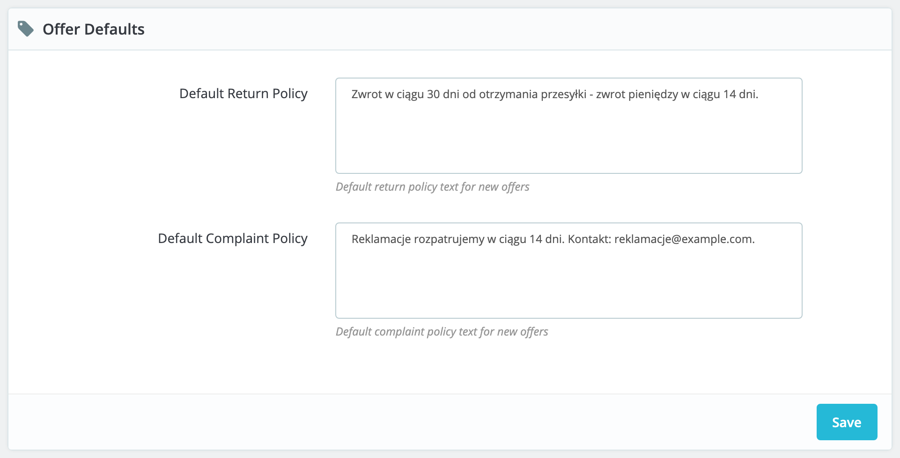

The same group contains the **GPSR & Manufacturer Details (global defaults)** panel — manufacturer data and GPSR information used when an offer has none of its own. Fill it once instead of in every offer: manufacturer name and address, e-mail, phone (E.164), 2-letter country code, CE marking, batch number, safety information, and the **Product does not require GPSR info** switch (default: exempt).

### InPost prices

In the **Offers & Products** group, the **InPost prices** panel sets which price the module sends to InPost. **Prices in your shop do not change.** Prices are gross, in PLN.

An offer price is built in three steps:

1. **Base price** — the price for the chosen **customer group** (its specific prices, catalog price rules and group reduction), or the regular shop price when no group is chosen.
2. **Price change (%)** — the base price plus or minus a percentage (e.g. `5` = 5% more expensive than in the shop, `-5` = 5% cheaper; from -90 to 500).
3. **Rounding** — *None*, *Up to ,99* (104.20 → 104.99) or *To whole zloty* (104.49 → 104.00).

| Setting | Default | Notes |
|---------|---------|-------|
| **Customer group of the InPost prices** | *none: the shop price* | Create a group (e.g. "InPost") with no customers and set the InPost prices for it in Catalog (specific prices or catalog price rules). Products without such a price get the regular price |
| **Price change (%)** | 0 | |
| **Rounding** | None | Applied after the price change |

Example: shop price 100.00, +5%, rounding to ,99 → InPost price 105.99.

- By default (no group, 0%, no rounding) the InPost prices are the shop prices.
- After the settings are saved **all offers are recalculated** (the first batch right away, the rest by the offer sync cron) and only the offers whose price changed are sent to InPost.
- An offer with a **manual price** (set on the offer or with **Set price** on the offer list — see [Offer price and bulk price change](#offer-price-and-bulk-price-change)) keeps it — these settings do not apply to it.
- A specific price or catalog price rule saved in PrestaShop updates the InPost price of the offers concerned. Cart prices (InPost order import) and prices of one customer are ignored.

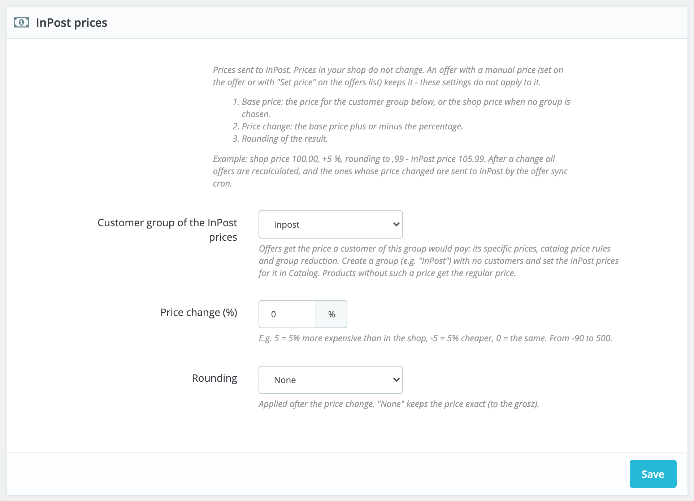

#### Customer group as the InPost price list — step by step

Here the customer group is only a **price list**: you assign no customers to it, and the module prices the offers as if a customer of this group was buying. Regular shop customers see none of it.

**1. Create the group** — **Shop Parameters → Customer Settings**, **Groups** tab (top of the page) → **Add new group**.

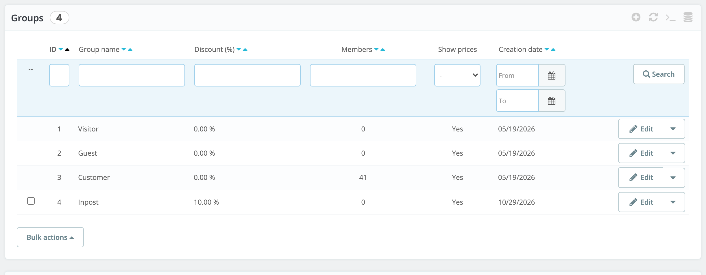

- **Name**: e.g. "InPost".
- **Discount** (%): a discount on **all** products in InPost (e.g. `10` = everything 10% cheaper than in the shop). Leave `0` if you set prices for selected products only.
- **Price display method**, **Show prices**: irrelevant for the module — it always calculates the gross price.

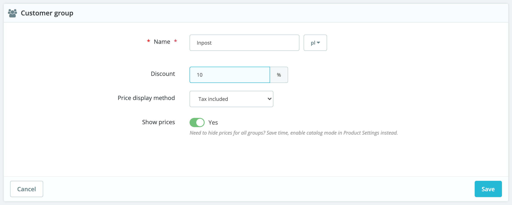

**2. Choose the group in the module** — **InPost prices** panel → **Customer group of the InPost prices** → *InPost* → **Save**. The offers are recalculated right away.

**3. (Optional) Prices for selected products** — **Catalog → Products** → product → **Pricing** tab → **Specific prices** → **Add a specific price**:

- under **Conditions** choose the **InPost** group (and the combination, if the price is for one of them),
- under **Impact on price** set a **discount** (amount or %) or turn on **Set specific price** → **Retail price (tax excl.)**,
- optionally from–to dates (a time-limited promotion).

> **Note — tax excluded.** The **Retail price (tax excl.)** of a specific price is entered **without VAT**. For 99.00 PLN gross in InPost at 23% VAT enter 80.49. (The manual price of an offer in the module is entered **gross**.)

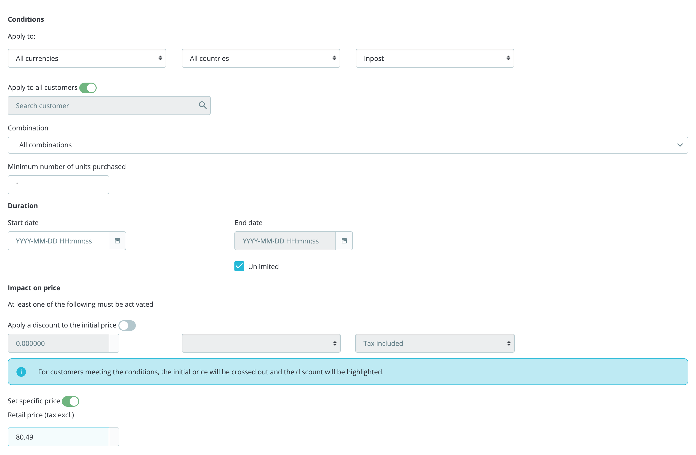

**4. (Optional) A rule for the whole catalogue** — **Catalog → Discounts → Catalog Price Rules → Add new**: name, **Group: InPost**, **Reduction** (e.g. 10 %), optionally from–to dates. In PrestaShop 8.2 the rule applies to the whole catalogue (the form has no conditions such as categories) — use specific prices for selected products.

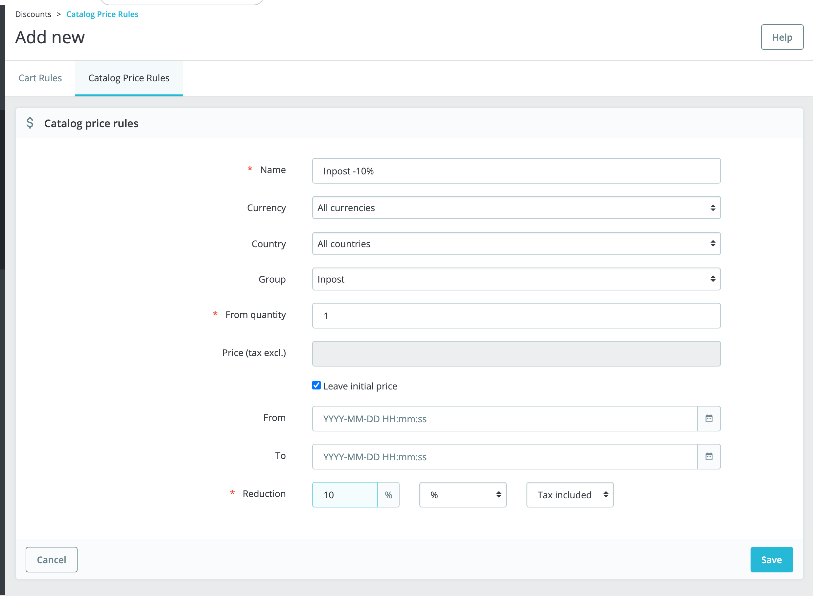

**How a product is priced with the group chosen:**

| Product | Setting in PrestaShop | InPost price |
|---------|-----------------------|--------------|
| A | specific price for the InPost group: retail price 80.49 tax excl. | 99.00 PLN gross |
| B | specific price for the InPost group: −10% | shop price −10% |
| C | nothing for the InPost group | **regular shop price** (with the group discount, if set) |
| D | promotion for **All groups** | the promotion applies in InPost too |

The **Price change (%)** and **Rounding** of the InPost prices panel are applied on top. A manual price on the offer takes precedence over all of the above.

### Productization — auto-fill offer data from the InPost catalogue

**Productization** fills offer fields and category attributes with data from the InPost product catalogue, based on the product **EAN** (`/hints` endpoint). It works for single offers and for bulk listing.

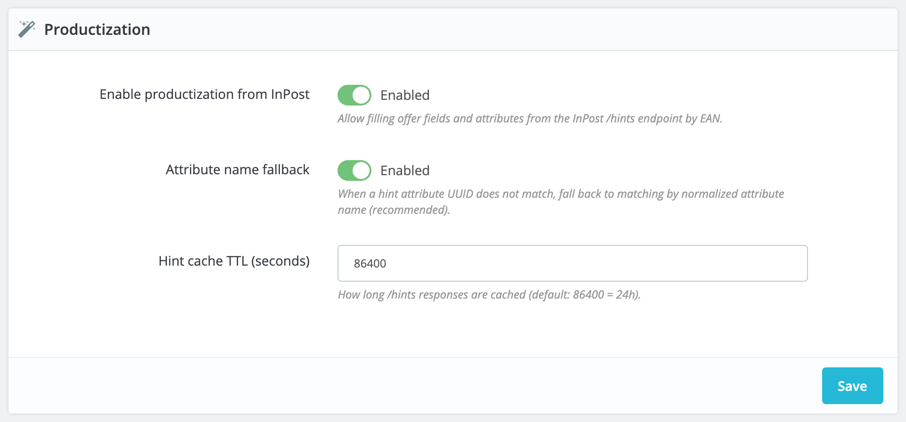

#### Enabling and disabling Productization

The **Enable productization from InPost** switch in the **Productization** panel:

- **Off (default)** — offer fields are filled only from PrestaShop data (product field mapping and attribute sources). Enable it deliberately if you want to use the InPost catalogue.
- **On** — when an offer is created the module queries the InPost API by the product EAN and fills **empty** fields: name, brand, model, description, dimensions and category attributes. Values can be edited before sending.

> **Order of attribute value sources:** first the [PrestaShop source](#attribute-value-sources) (feature / attribute / product field), then the InPost catalogue suggestion (only for attributes still empty), finally manual entry.

#### Attribute name fallback

**Attribute name fallback** (on by default) controls how attributes returned by `/hints` are matched to the attributes of the chosen InPost category:

- **On (recommended)** — by **UUID** first, then by **normalised name** (e.g. "Colour", "Type"). `/hints` often returns attributes from a different catalogue space than the offer's category — the name fallback still fills the values.
- **Off** — UUID matching only.

**Hint cache TTL (seconds)** — how long `/hints` responses are cached (default `86400` = 24 h). Hits and "no result" are cached; transient API errors are not.

#### The Productization picker on the offer form

With the feature on, the offer form has a **Fill from InPost catalogue** button:

1. The module searches the InPost catalogue by **EAN** (by name if there is none).
2. It lists the matches (name, brand, EAN, number of attributes).
3. Choosing one fills the **empty** offer fields and category attributes (tick **Overwrite existing values** to overwrite filled ones).
4. The offer stays a draft — nothing is sent to InPost automatically.

> **Automatic category mapping.** If the product has no mapped InPost category yet and the catalogue match points to a synchronised category, the module creates the category mapping automatically when the drafts are created.

### Production environment — changing API URLs

By default the module points to the InPost **staging** environment. Before going live, replace the API addresses in **API Settings**.

| Field | Staging (default) | Production |
|-------|-------------------|------------|
| API URL | `https://stage-api.inpost-group.com/inpsa` | `https://api.inpost-group.com/inpsa` |
| Authorization Service URL | `https://stage-account.inpost-group.com` | `https://account.inpost-group.com` |

**Switching to production:**

1. Replace both URLs with the production addresses.
2. Click **Save**.
3. Click **Connect with OAuth2** — a new OAuth2 flow for production.
4. Click **Refresh Organizations List** and select the production organization (it may differ from staging).
5. Click **Test Connection**.
6. Switch off **Image Test Override** if it was on (the status panel reminds you).

> **Note:** the OAuth2 token belongs to an environment — connect again after changing the URLs. Confirm the exact production addresses with InPost.

---

## 3 Categories and attributes

InPost has its own category tree, and every lowest-level (leaf) category has its own set of **attributes** (e.g. "Size", "Colour", "Material", "Child age"), some of them required. Cron fetches categories and attributes automatically (by default daily at 02:00). Your part is to:

1. tell which InPost category each shop category corresponds to ([Category mapping](#category-mapping), helped by the [assistant](#assistant-shop--inpost)),
2. tell where in PrestaShop the value of each InPost attribute comes from ([Attribute value sources](#attribute-value-sources), helped by the [attribute assistant](#attribute-assistant)).

After that, offers fill themselves.

### Category mapping

**InPost von Halsky → Category Mapping** — **InPost tree** view

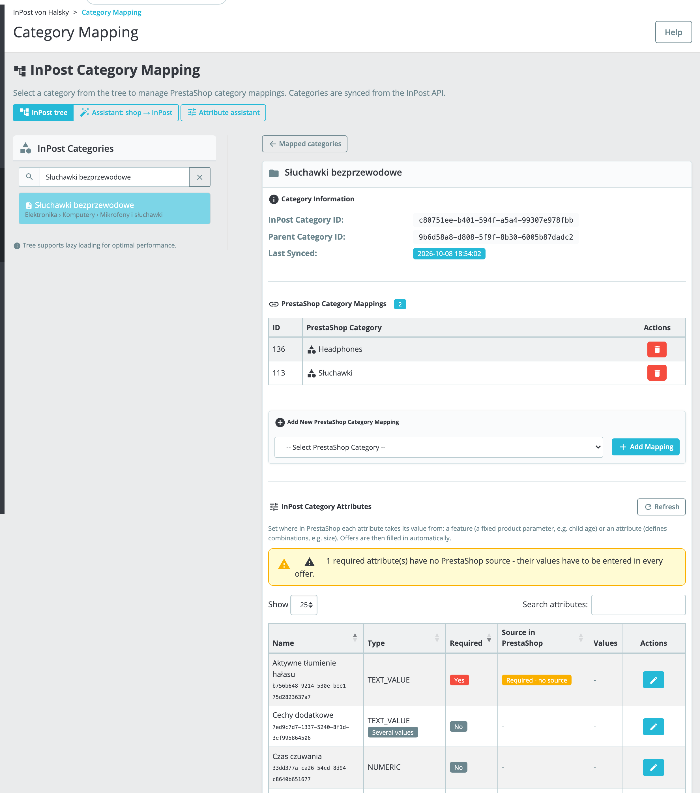

1. **Find the InPost category** — in the tree (left panel, loaded lazily) or with the search above it (min. 2 characters; results show the full path). **Only leaf categories have attributes** — only they can be mapped.
2. **Click the category** → details panel: **Category Information**, **PrestaShop Category Mappings** and **InPost Category Attributes**.
3. In **Add New PrestaShop Category Mapping** pick a shop category and click **Add Mapping**. One InPost category can have **several** PrestaShop categories.
4. Set the attribute sources (**InPost Category Attributes** section) — see [below](#attribute-value-sources).

> **Direction and cardinality:** each PrestaShop category points to **exactly one** InPost category, but one InPost category can be the target of **many** PrestaShop categories. The offer category follows the **product's default category**.

> **Orphaned categories.** When an InPost category no longer exists in the API, mappings to it are flagged **orphaned** — InPost rejects offers using them. Re-map to an active category (existing offers — with [Change category](#changing-the-category-of-an-offer)).

### Assistant: shop → InPost

The **Assistant: shop → InPost** view (switch above the tree) lists **your shop's** categories with suggested InPost categories — based on the category name, its path and the names of its products (Polish word forms and PL/EN synonyms included).

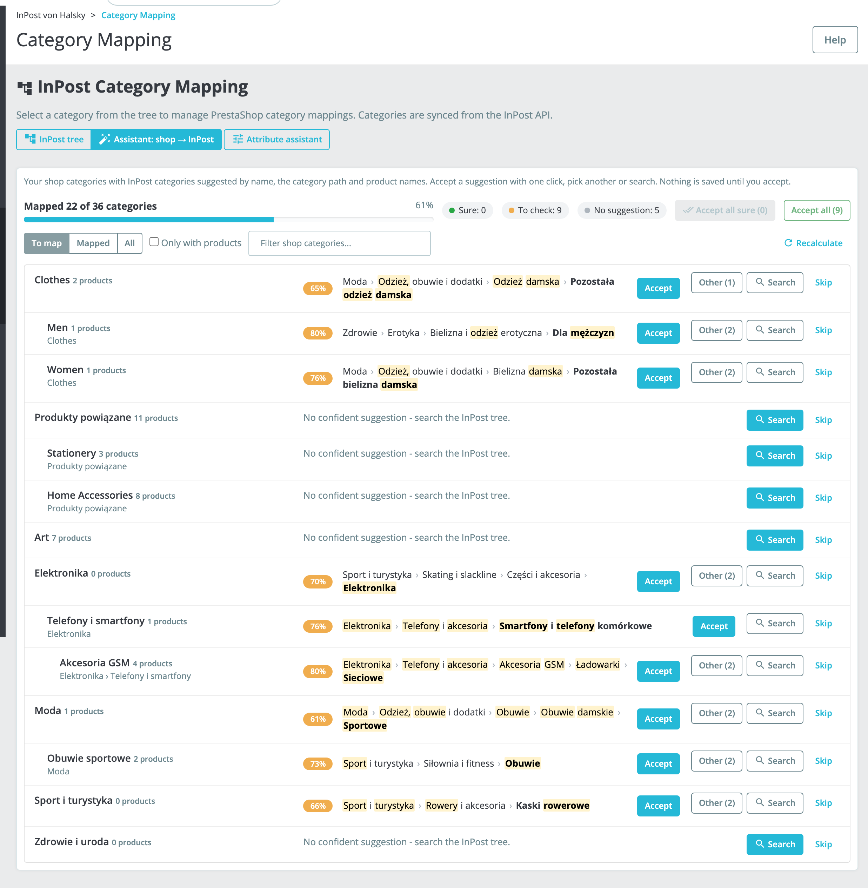

- Each suggestion has a match score: **sure** (≥ 85%), **to check** (60–84%) or no suggestion.
- **Accept** saves the mapping, **Other** shows further proposals, **Search** opens the InPost category search, **Skip** hides the category.
- **Accept all sure** maps all sure suggestions at once; **Accept all** — also those to check.
- Filters: **To map / Mapped / All**, **Only with products**, search by name.

> **Nothing is saved until you accept.** `php bin/console inpost:mapping:suggest` checks the suggestions from the command line.

### Attribute value sources

In the category details panel, **InPost Category Attributes** section, you tell for each InPost attribute **where in PrestaShop its value comes from**. The table shows each attribute's type, whether it is required, the **Source in PrestaShop** and the dictionary value coverage (e.g. "12/15 matched"). The warning above the table counts **required attributes without a source** — their values would have to be entered in every offer.

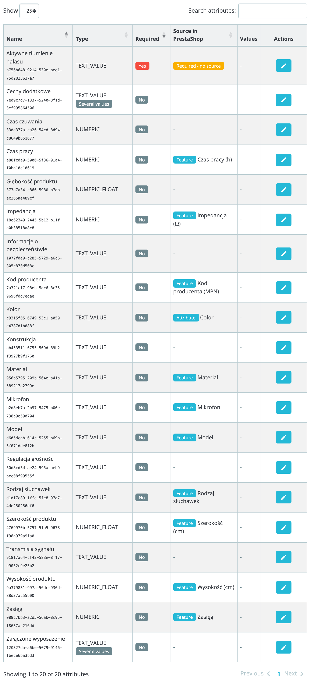

Click the edit icon of an attribute — the **Value source** dialog opens:

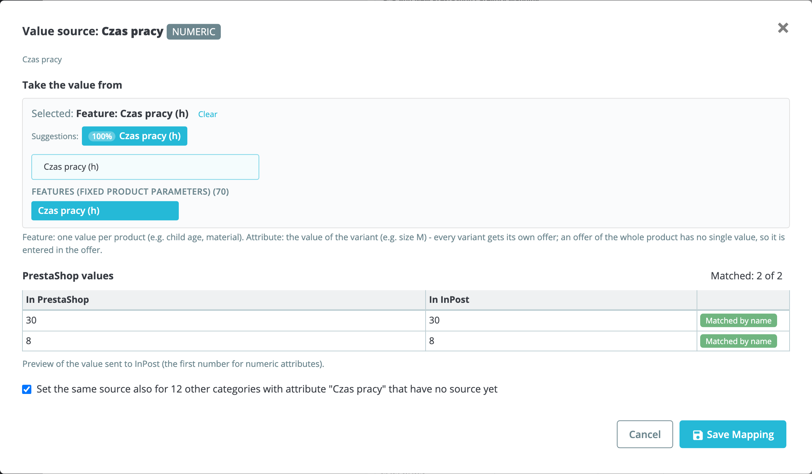

1. **Take the value from** — choose the source from the list (with a filter):
   - **Features (fixed product parameters)** — e.g. child age, material, capacity,
   - **Attributes (combinations)** — e.g. size, colour — the value of the offer's variant,
   - **Product fields** — built-in fields: reference, MPN, EAN, UPC, ISBN, supplier reference, brand, name, weight, width, height, depth (e.g. "Kod producenta" ← MPN).
2. **Suggestions** — sources with a similar name (with a score, e.g. 100%); a source with the same name is selected straight away (**Suggestion** message — save to confirm).
3. **PrestaShop values** — preview of how the shop values reach InPost. For numeric attributes the first number in the text is taken (e.g. "5 years" → `5`, "approx. 3 kg" → `3`); a value without a number is marked **Not valid**.
4. **Set the same source also for … other categories with attribute "…"** — the same attribute (e.g. "Size") exists in many InPost categories; the ticked box sets the same source wherever there is no source yet.
5. **Save Mapping**.

**Dictionary attributes** (type *DICTIONARY*) accept only values from the InPost list. The dialog shows each shop value next to the InPost option:

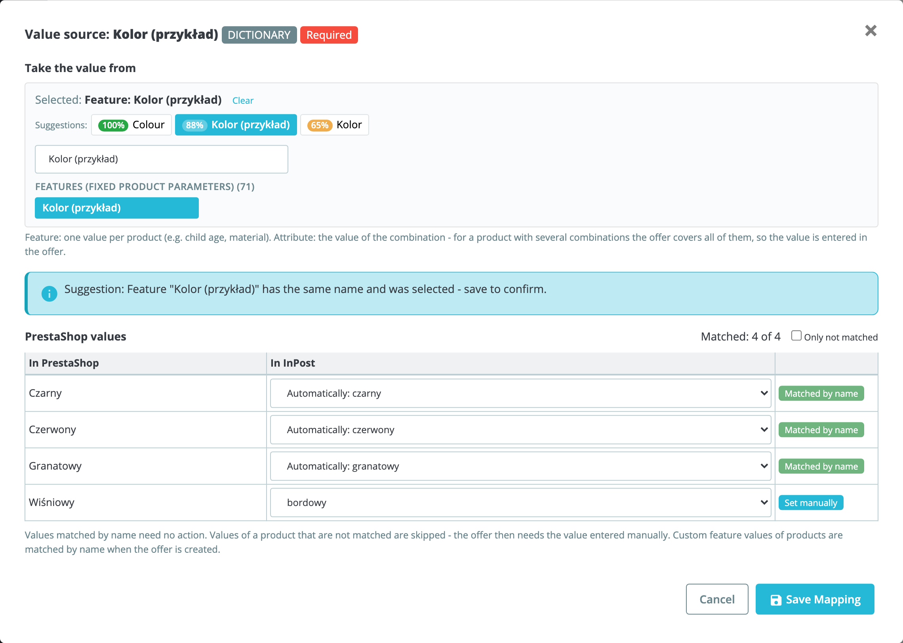

- **Matched by name** — the shop value matches an InPost option (case-insensitive) — nothing to do,
- **Set manually** — choose the InPost option for a value whose name differs (e.g. "Wiśniowy" → "bordowy"),
- **Not matched** — the value is skipped in the offer (the **Only not matched** filter shows just these).

Custom feature values of products are matched by name when the offer is created. Dictionary options withdrawn by InPost are no longer offered or accepted.

> **What happens next:** when an offer is created (single or bulk) the values of mapped attributes fill themselves. When you change a product feature or combination, the module updates these values in the offers and sends the change to InPost — **values typed into the offer by hand are never overwritten**.

> **No category mapping = no offer.** Attribute mapping is optional, but a required attribute without a value is a **validation error** — the offer is not sent until the value is filled in.

### Feature or attribute?

- **Feature** — a parameter the product has **one** of: child age, material, power. A simple product (no combinations) with child age "5 years" → map the InPost attribute "Child age" to the **feature**.
- **Attribute (combinations)** — what the **variants** differ in: size, colour. A T-shirt in 5 sizes is one PrestaShop product with 5 combinations; map the InPost attribute "Size" to the **"Size" attribute group**, and each variant becomes a [separate offer](#products-with-combinations-variants) with its own value.

> An offer of the **whole product** with combinations (all variants at once) gets no combination attribute value — the form explains next to such a field that the value has to be entered by hand.

### Attribute assistant

**Category Mapping → Attribute assistant** — the InPost attributes of **all** mapped categories in one place, grouped by name ("Colour" from 5 categories is one row). For each, the assistant proposes a shop feature, attribute or product field (comparing names and values).

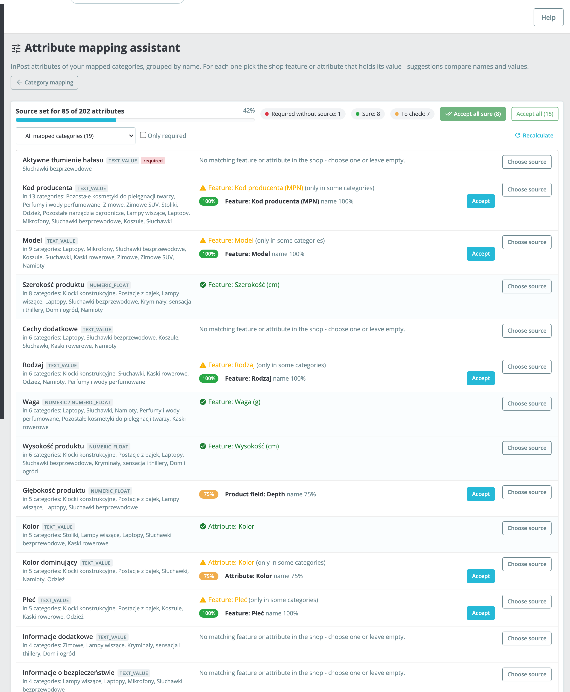

- **Accept** sets the suggested source in all categories with that attribute; **Choose source** — manual choice.
- **Accept all sure** / **Accept all** — in bulk.
- Filters: category, **Only required**. The progress bar shows how many attributes already have a source.

---

## 4 Publishing an offer

There are two ways to create offers. **Path A (bulk)** is faster — drafts are created automatically from the PrestaShop product data.

### Path A — bulk listing from the product list ("List on InPost")

*Recommended.*

1. **Catalog → Products** — tick the products to list.
2. From **Bulk actions** choose **"List on InPost"**. The wizard opens.

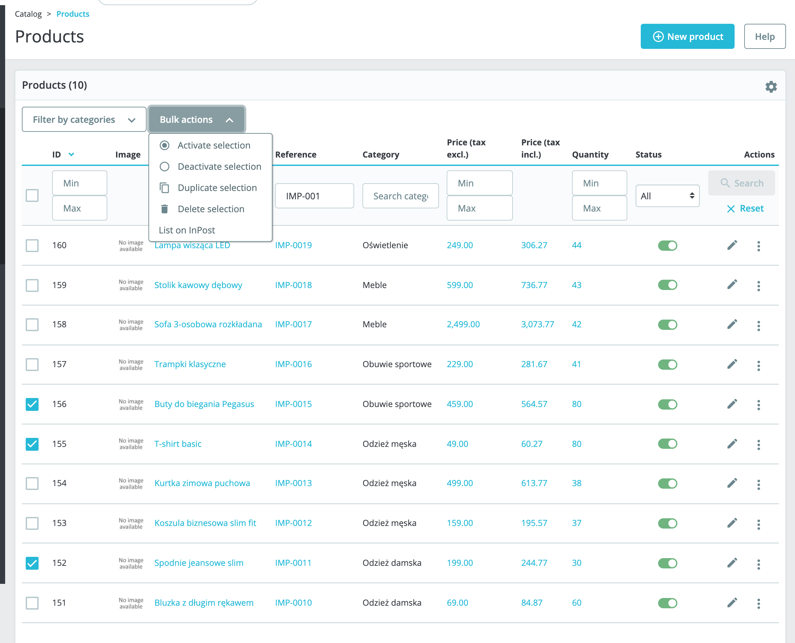

3. The wizard **checks the selected products right away** and lists them with checkboxes. Each product (a product with combinations — each variant separately) gets a status:
   - **ready** — will be listed,
   - **warning** — will be listed despite gaps (reasons in *Details*),
   - **blocked** — skipped.
   Variants with an EAN and stock are **ticked by default**; the checkbox in the product row ticks all its variants. Untick anything you do not want to list. **Check again** repeats the check (e.g. after fixing a product in the catalogue).
4. **Create drafts for the selected products** — the module creates **DRAFT** offers in batches (25 by default), each in its own transaction (one error never stops the rest). The results can be copied as CSV.
5. **Publish created offers to InPost** — a separate step publishes the created drafts.

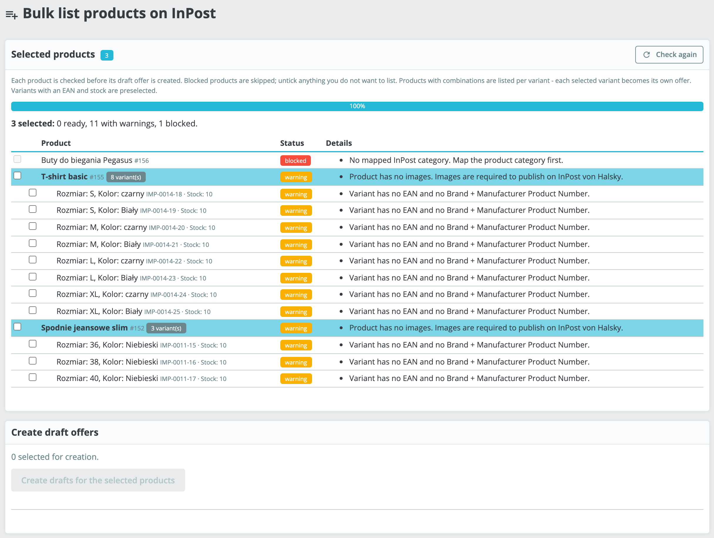

#### Check rules

**Block** the offer (*blocked*):

- **An offer for this product / variant already exists.**
- **The product has an active offer covering all its combinations** — the variants can be listed separately only after it is closed (one stock is never sold by two offers).
- **No mapped InPost category.** *Exception:* with Productization on and an EAN match to a synchronised category — the category is mapped automatically when the drafts are created.

**Only warn** (*warning* — the offer is still created):

- the mapped category is orphaned,
- the product has no images (required to publish),
- the product / variant has no EAN and no brand with manufacturer part number (MPN),
- the variant is out of stock,
- **required InPost attributes without a value from PrestaShop** (list of names) — fill them in the draft or map them to features.

### Path B — creating a single offer manually

**InPost von Halsky → Offers → Create New Offer**

Choose the product in the search field (by name, reference or EAN — min. 2 characters). Typing a **variant's own reference or EAN** opens that variant directly; a product with combinations first shows the [variant list](#products-with-combinations-variants).

The offer form has tabs:

| Tab | Contents |
|-----|----------|
| **Offer Details** | Organization, product (and variant — with **Change variant**), category as "shop category → InPost category" with the full path, validation status, **Mark as Draft**, publication status |
| **Product Details** | Name, description, SKU, EAN, brand, model, super model, manufacturer part number (MPN), **dimensions (mm) and weight (g)**, price and stock (read-only — always from PrestaShop) |
| **GPSR and Manufacturer Details** | Manufacturer data and GPSR information (global defaults when empty) |
| **Policies & Shipping** | Shipping time (days), product URL, return and complaint policy (empty = defaults from the configuration) |
| **InPost Attributes** | Attribute fields of the chosen InPost category — with where each value comes from |
| **Events** | Offer event history (after sending to InPost) |

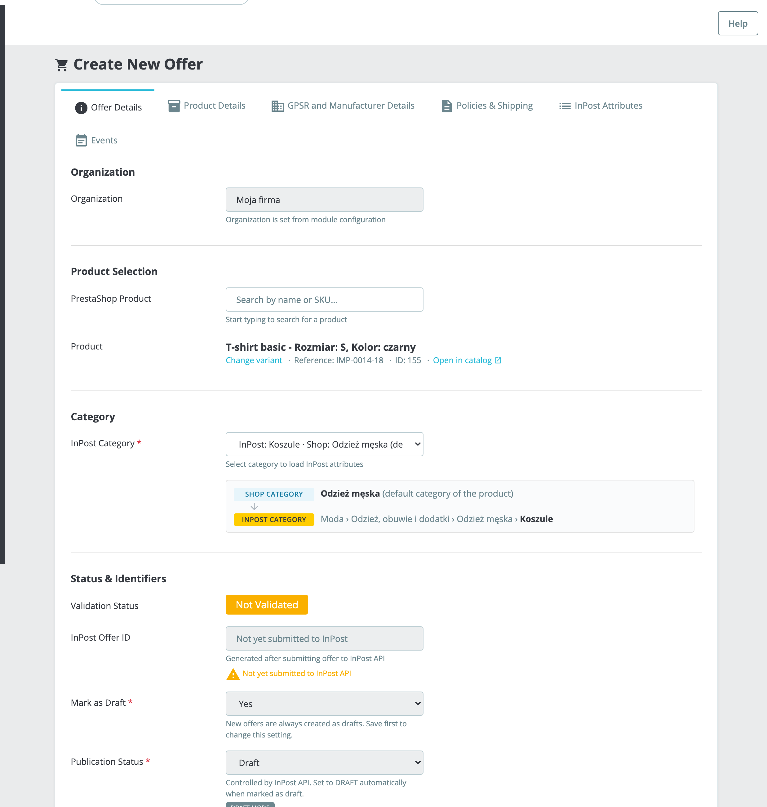

**"InPost Attributes" tab.** Under each field the module tells where the value comes from or why it is missing:

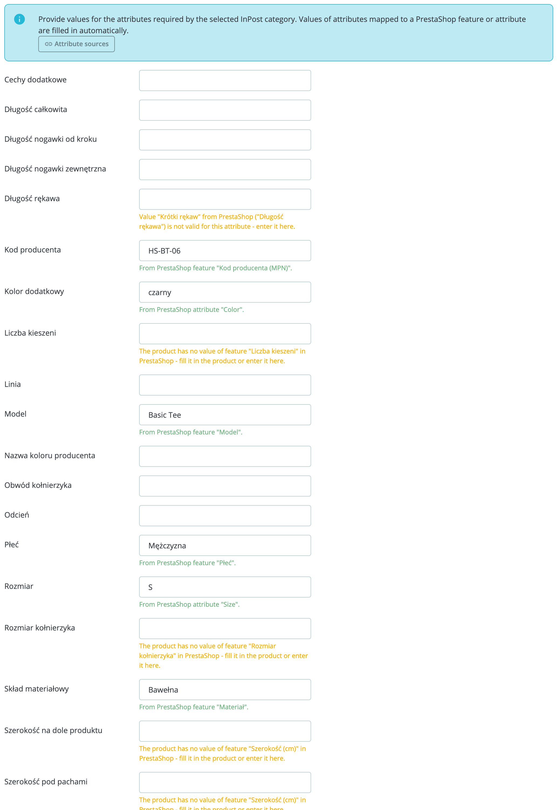

- green: **From PrestaShop feature "…"** / **From PrestaShop attribute "…"** — value from the mapping,
- orange: the product has no value of that feature, the value is not in the InPost list or not valid for the attribute (e.g. text in a numeric field) — complete the product or enter the value,
- attribute without a source: if required — a note that the source can be set in Category Mapping (**Attribute sources** opens the mapping of this category),
- a value from an InPost suggestion or typed in by hand — labelled as such.

Dictionary attributes that accept several values have a multi-select. On an existing offer, **Read again from PrestaShop** refreshes the values from the mapping (values entered by hand are kept) — save the offer to keep them.

> **How "Mark as Draft" works**
> - **Yes (draft)** — the offer exists only locally and is not sent to InPost. New offers are **always** created as drafts (the switch becomes active after the first save).
> - **No** — after saving, the offer is flagged for sync and sent to InPost by the `offer_sync` cron.

### Products with combinations (variants)

Each combination of a product can be a **separate InPost offer** with its own stock, price (with the combination impact), SKU, EAN, MPN, combination images and attribute values (e.g. size "M"). The offer name is "Product - Size: M", and the product name is sent to InPost as *superModel* — it groups the variants of one product.

Choosing a product with combinations (Offers → Create New Offer) shows **one page with all its variants**:

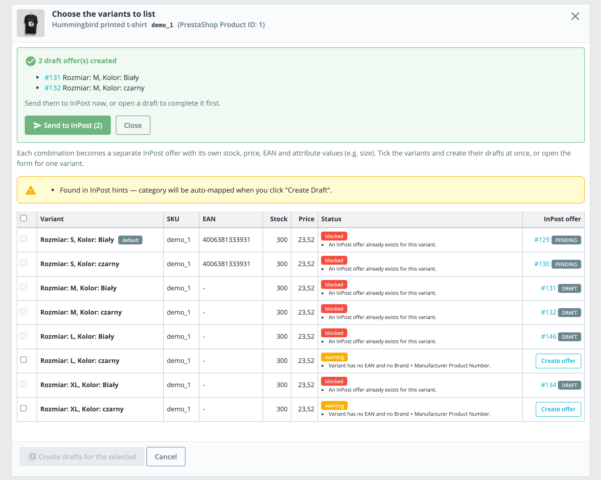

- The table shows every variant: SKU, EAN, stock, price, **status** (ready / warning / blocked with reasons) and the existing offer (link).
- Tick the variants (by default — those with an EAN and stock; **select all** in the header) and click **Create drafts for the selected** — the drafts are created right there.
- Afterwards a panel lists the new drafts: **Send to InPost (N)** sends them at once, **Close** goes back to the offer list. An offer that cannot be sent (e.g. a required attribute is missing) stays a draft and the reason is shown.
- **Create offer** next to a variant opens the form for that variant only.
- At the bottom: **One offer for the whole product instead** — not recommended: buyers cannot choose a variant, and the offer shares the total stock of all combinations.
- **X** in the top right corner closes the page.

> **One stock is never sold twice.** An active whole-product offer blocks variant offers and the other way round; a second offer for the same variant cannot be created.

> **Stock, price and orders per variant.** A change of a combination's stock or price updates only that variant's offer. Deleting a combination in PrestaShop sets the stock of its offer to 0 (the offer list shows "Variant deleted in PrestaShop"). An order from InPost goes to the right combination.

### Sending an offer to InPost

| "Send to InPost" button | Bulk wizard / variant page | Automatically by cron |
|-------------------------|----------------------------|-----------------------|
| In the offer form — save, then click **Send to InPost**. | **Publish created offers to InPost** in the wizard, or **Send to InPost (N)** after creating variant drafts. | The `offer_sync` cron sends offers with "Mark as Draft" off (flagged for sync). |

Before sending, the module validates the offer (required attributes, EAN, manufacturer data, VAT among others). Creating an offer in InPost is **asynchronous** — see [Command Status](#command-status--offer-send-command-status).

### Updating a published offer

Prices, stock, features and images are changed **in the PrestaShop catalogue**, and the module propagates them automatically:

| What | Where | How it reaches InPost |
|------|-------|-----------------------|
| **Price / stock** | Catalogue → product (or its combination) | The hook flags the offer (the variant's offer) for sync → `offer_sync` cron; price and stock are re-read right before sending |
| **Features / combinations** | Catalogue → product | Attribute values from the mapping are updated (values typed in by hand are kept) |
| **Images** | Catalogue → product → images | The offer is flagged for re-sync (a variant's offer — the combination images) |
| **Other offer fields** | **InPost von Halsky → Offers → edit** | Saving with "Mark as Draft" off flags the offer for sync |

> Images must be reachable over **HTTPS** — InPost rejects HTTP images. On test environments use **Image Test Override** (see [Additional settings](#10-additional-settings)).

### Changing the category of an offer

An existing offer can be moved to another InPost category: on the offer edit page click **Change category** next to the category.

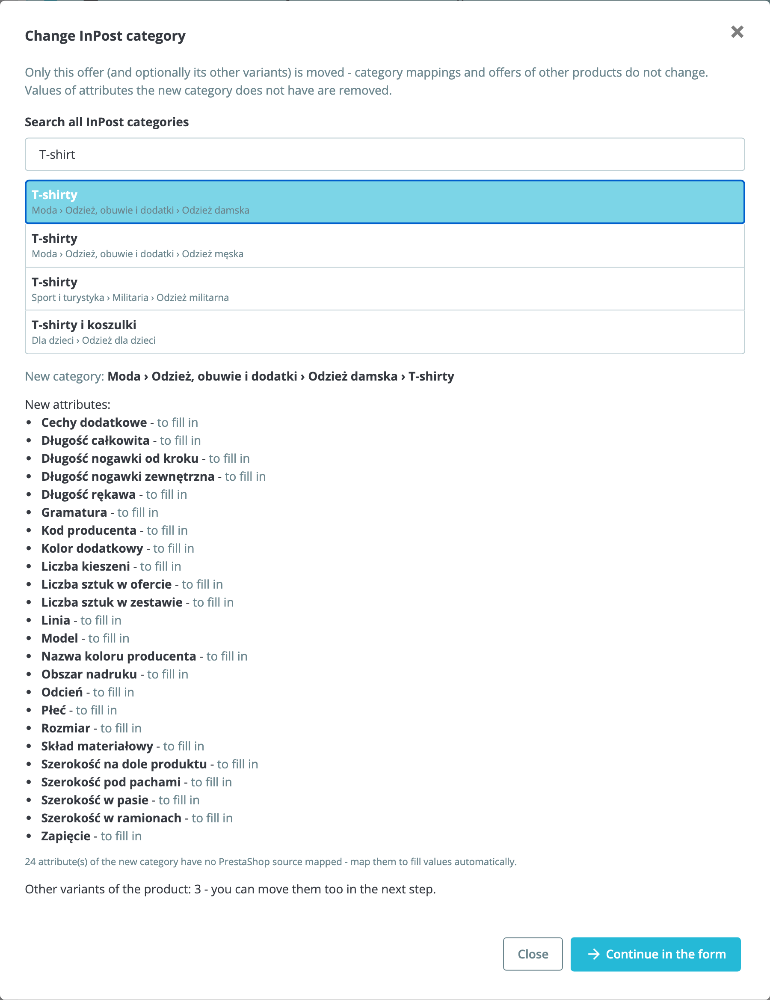

1. Search for the category (all active leaf categories — linked to the product's categories or found by name).
2. The dialog shows what happens to the attributes: values **removed** (the new category does not have them), **kept** and **new** attributes (prefilled from PrestaShop / the InPost catalogue or still to fill in).
3. **Continue in the form** — the form shows the offer in the new category; the change is saved only with **Update Offer** — until then nothing changes.
4. Optional in the form: **Move the other variants of this product too** (their attributes are filled automatically; a variant with a required value missing is not sent until completed) and **Also link the shop category "…" to the new InPost category** (the product's default category; affects only offers created later — offers of other products do not change).

> Not possible while the offer waits for the InPost review result (PENDING). When InPost has already rejected it in validation (a PENDING offer with validation errors, e.g. `CATEGORY_INCORRECT`), the category can be changed — the rejection is shown in the **InPost Validation Errors** list. Category mappings and offers of other products do not change; the change is written to the PrestaShop log.

### Offer list and deleting offers

**InPost von Halsky → Offers** — the offer list with status and InPost category filters, search (product name, SKU, EAN) and the number of offers per page (20 / 50 / 100). Actions on the ticked offers — **Close selected**, **Reopen selected**, **Delete selected**, [edit attributes](#bulk-attribute-edit) and [Set price](#offer-price-and-bulk-price-change) — return to the list with the same filters. The close and reopen buttons count and send only the ticked offers with a matching status (published and sold-out offers can be closed, closed offers reopened) and stay disabled otherwise. Variant offers show "PS Product #… · variant: …".

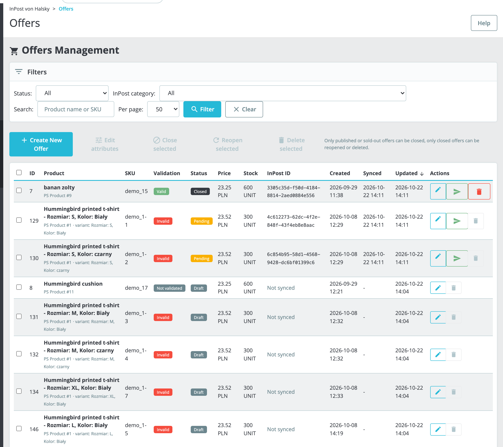

**Deleting.** Only **closed (CLOSED) offers** can be deleted — with the row button, several at once with **Delete selected**, or with **Delete** on the offer edit page. The delete button of any other offer is disabled and bulk delete skips such offers. This includes drafts and ERROR_NOT_CREATED offers.

**A closed offer that exists in InPost** — InPost does not allow deleting offers, so it is deleted **from the module only**: in InPost it stays closed, and its stock and price are no longer updated. The confirmation says so; each such deletion is logged with the InPost offer id.

> **Want to stop selling?** **Close** the offer first, then delete it. Orders of a deleted offer still reach the right product.

### Bulk attribute edit

Changes the values of InPost category attributes (e.g. "Długość blatu", "Kod producenta", "Kolor") on many offers at once — without opening every offer. One run can change several attributes, each with its own operation, and set their PrestaShop source right away.

#### Step 1 — tick the offers

1. **InPost von Halsky → Offers**. Narrow the list with the filters: **InPost category**, **Status**, **Search** (name, SKU, EAN) and **Per page** (20 / 50 / 100).
2. Tick the offers in the first column (the header checkbox ticks the whole page). Offers of different categories can be mixed.
3. Click **Edit attributes (N)** — N is the number of ticked offers.

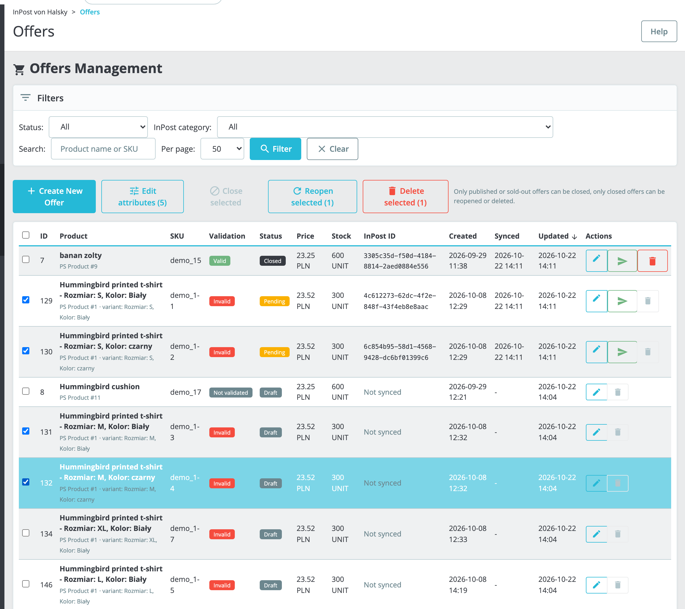

> At once: up to **200 offers** and up to **20 attributes**.

#### Step 2 — pick the attributes and operations

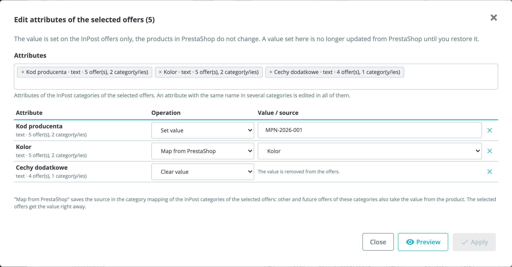

In **Attributes** pick one or more attributes (the field has a search). The list holds the attributes of the InPost categories of the ticked offers; each shows its type (*list*, *number*, *whole number*, *text*, *link*, *date*), in how many offers and categories it is used and whether it is **required**.

> InPost defines an attribute separately in every category. An attribute with **the same name and type** in several categories (e.g. "Kod producenta") is one entry in the list and changes in all those categories. The same name with another type is a separate entry.

Every attribute picked gets a row with its own **operation** (✕ removes the row):

| Operation | What it does | What you give |
|---|---|---|
| **Set value** | Puts the same value on all the offers. The value becomes *manual* — the PrestaShop sync no longer overwrites it. | A field matching the type: the InPost list of values (several for multi-value attributes — they replace the current ones), whole number, number (comma or dot), link, date, text (up to 1024 characters). |
| **Clear value** | Removes the value from the offers; the attribute disappears from the offer in InPost. An empty *manual* value stays in the module, so the PrestaShop sync does not fill it again. | — (not available for required attributes) |
| **Restore from PrestaShop** | Removes the manual value — the offer takes the value from the source mapped for the category again (feature / attribute / product field). | — |
| **Map from PrestaShop** | Saves the source in the **InPost category mapping** of the ticked offers and puts the value from their products on the offers right away (as a value *from PrestaShop*). | A source from the list: **Features**, **Attributes**, **Product fields** (e.g. MPN, EAN, weight). The source the categories share, or one matched by name, is preselected. |

> **Map from PrestaShop changes the category mapping**, not only the ticked offers: the other and future offers of these InPost categories use the source too (the same setting as in [Attribute value sources](#attribute-value-sources)). Dictionary values are matched by name; PrestaShop values are assigned to InPost list values by hand in the source dialog of **Category Mapping**.

**Set or map?** *Set* — when the value is the same for the ticked offers (e.g. "Materiał blatu: dąb" for a whole series). *Map* — when the value differs per product and is kept in PrestaShop (MPN, variant colour, dimensions).

#### Step 3 — preview

**Preview** shows what the changes do — nothing is saved yet.

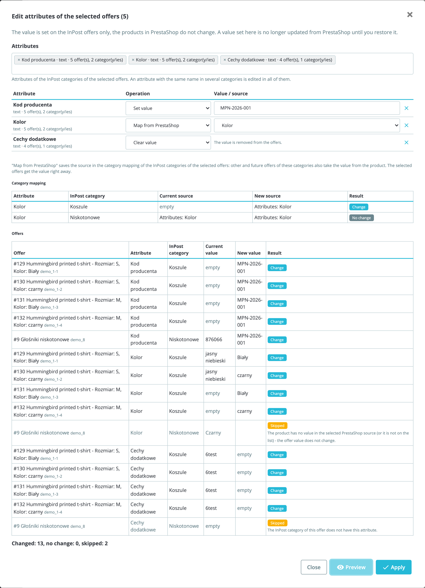

- **Category mapping** (only with *Map from PrestaShop*) — the current and the new source for every InPost category. The source shows its kind (*Features*, *Attributes*, *Product fields*), as names can repeat — e.g. a feature and a product field both called "Kod producenta (MPN)".
- **Offers** — a row for every offer and attribute: the current value (marked *from PrestaShop* when it comes from the mapping), the new value and the result: **Change**, **No change** or **Skipped** with the reason.

| Reason for skipping | What to do |
|---|---|
| The offer is being reviewed by InPost | Wait for the review to end. Offers rejected in validation (PENDING with errors) can be edited. |
| The InPost category of this offer does not have this attribute | Nothing — the offer does not need it. |
| The value "…" is not on the list of this category | Value lists differ between categories — edit those offers separately with a value from their list. |
| The value "…" is not valid for this attribute | E.g. text in a number field — correct the value. |
| This attribute takes only one value in the category of this offer | Pick one value. |
| The attribute is required — it cannot be cleared | Set another value instead of clearing. |
| No PrestaShop source is mapped for this attribute | Use *Map from PrestaShop* instead of *Restore*. |
| The product has no value in the selected source | The category mapping is saved anyway and the offer keeps its current value. Fill in the product in PrestaShop and use **Restore from PrestaShop** on those offers. |
| The offer has no InPost category | Set the category in the offer form. |

Below the table: *Changed / no change / skipped*. Any change in the form clears the preview — **Apply** is enabled only after a preview with at least one change.

#### Step 4 — apply

1. **Apply** asks for a confirmation (number of changes and of mappings changed). Everything is checked again when saving.
2. The offer list reloads with the same filters and tells how many values changed in how many offers, how many offers will be sent to InPost, in how many category attributes the source was saved and how many offers were skipped.
3. Offers that exist in InPost are sent by the offer sync cron within a few minutes (see [Sending an offer to InPost](#sending-an-offer-to-inpost)); InPost may review the offer again. **Drafts** change in the module only — they reach InPost when published.

> **No undo.** Every operation is written to the PrestaShop log (**Advanced Parameters → Logs**: attribute, operation, offers, mappings changed). Undo a manual value with **Restore from PrestaShop** or by setting the previous value again. Products in PrestaShop never change.

### Offer price and bulk price change

The price sent to InPost comes from the [InPost prices](#inpost-prices) settings (shop or customer group price, percentage change, rounding). For one offer or for many offers at once you can set it by hand. **Prices in the shop do not change.**

**On the offer form** — the **InPost price** field:

- **Automatic - from the shop** — the price from the module settings; the form shows the **Price in the shop** and the **Current InPost price**,
- **Manual** — you type the **Manual price (gross)** (an amount greater than 0, e.g. 99.99). It is sent as it is — price changes in the shop and the module's price settings do not apply to it until you go back to the automatic price.

A price change reaches InPost with the next offer sync.

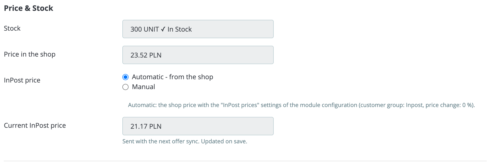

**On the offer list** — tick the offers and click **Set price**. The dialog offers three operations:

| Operation | Effect |
|-----------|--------|
| **Manual price - the same for all offers** | All ticked offers get the typed gross price |
| **Manual price - the shop price of each offer changed by a percentage** | The shop price of each offer ± a percentage (e.g. `5` or `-3.5`), saved as a manual price |
| **Automatic price - from the shop with the price settings of the module** | Back to the automatic price |

The preview shows the **current** and **new price** of every offer (or why it is skipped, e.g. the product no longer exists in PrestaShop); the confirmation states the number of offers, and offers already in InPost are sent there within a few minutes. In the price column offers with a manual price are marked "manual", and when the price differs from the shop price "shop: …" is shown too.

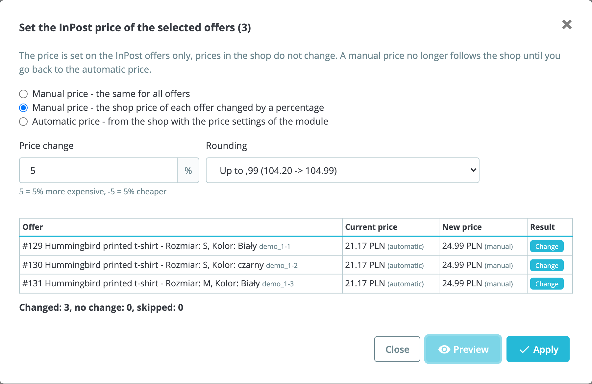

### Offer attachments

The **Attachments** tab of the offer form adds documents shown with the offer in InPost: user manuals, energy labels, certificates, safety information and others. Allowed files are **PDF, JPG or PNG up to 10 MB** (images must be at least 50×50 px and 1 kB).

1. Choose the **Attachment type**: *User manual*, *Assembly instructions*, *Energy label*, *Product label*, *Certificate*, *Product specification sheet*, *Warranty card*, *Size chart*, *Document (e.g. safety information)* or *Other*.
2. Add the file: **Own file** (from your computer) or **PrestaShop file** — one of the files attached to the product in **Catalog → Files**.
3. Click **Add file**. The file appears in the list with its status.

| Status | Meaning |
|--------|---------|
| **Waiting** | The file waits in the queue (e.g. the offer does not exist in InPost yet) |
| **Sending...** | InPost is processing the file |
| **In InPost** | The file is attached to the offer |
| **Error** | The reason returned by InPost or by validation — fix the file and use **Send again** |
| **Removing...** | The file is being removed in InPost |

- **Drafts:** added files wait and are sent automatically once the offer is created in InPost.
- **Removing** an attachment removes it from the offer in InPost too. If InPost cannot remove it yet (e.g. the upload is still running), the removal is retried automatically.
- An offer cannot have two attachments with the same file name (InPost would replace the first) — rename the file or remove the other one.
- The queue, the upload checks and the removal retries are handled by the `offer_attachment_sync` cron job (every 3 min).
- Diagnostics: `inpost:offer:attachments <offer_id>` shows the module's attachments next to InPost's; `--sync` processes the queue, `--add=FILE --type=TYPE` adds a file, `--remove=ID` removes one.

> Files uploaded from the computer are stored in the shop's `download/inpostvonhalsky/` directory. The upload size limit can be lower than 10 MB when the server's PHP configuration restricts it (`upload_max_filesize`, `post_max_size`).

---

## 5 Receiving orders

**InPost von Halsky → Orders**

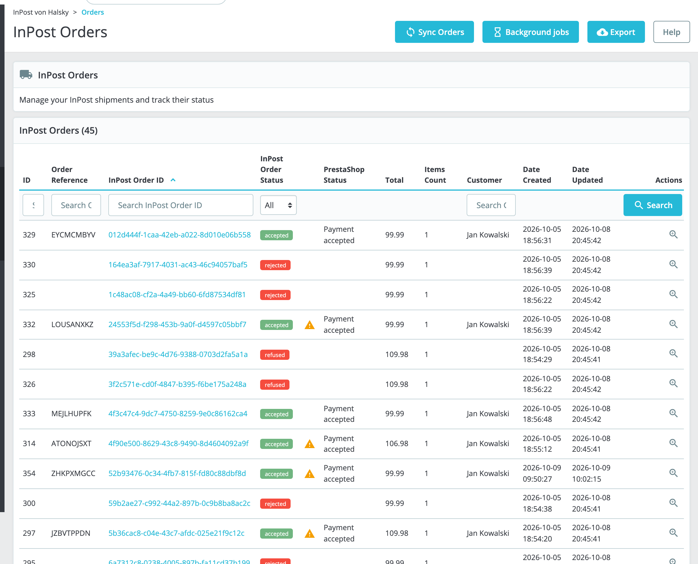

**How orders reach the shop:**

- **Order events** (every 15 min by default) — each run reads all events since the previous one and syncs the orders they mention right away. A new accepted order gets its shop order within one interval; an order cancelled / refused / rejected in InPost cancels the shop order. **Create orders from events** (on by default) — when off, events only refresh orders already imported, and new orders wait for the order import.
- **Order import** (every 10 min by default) — incremental: reads orders changed in InPost since the last complete run; the whole history once a day as a safety net; each run retries up to 10 orders that still have no shop order. **Import range**: *Continuous* (default) or *Fixed window* — always the orders changed in the last N days (default 30), old orders are never imported.
- **Sync Orders** runs the import manually (about 25 s; the next click or cron does the rest). The manual import and cron never run at the same time. **Background jobs** shows the progress.

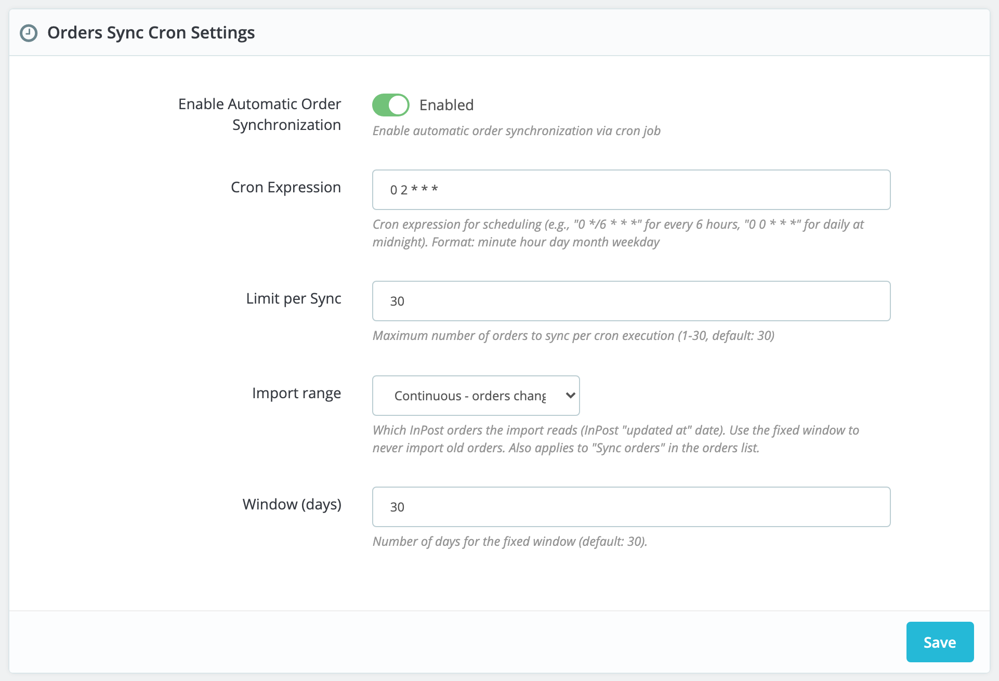

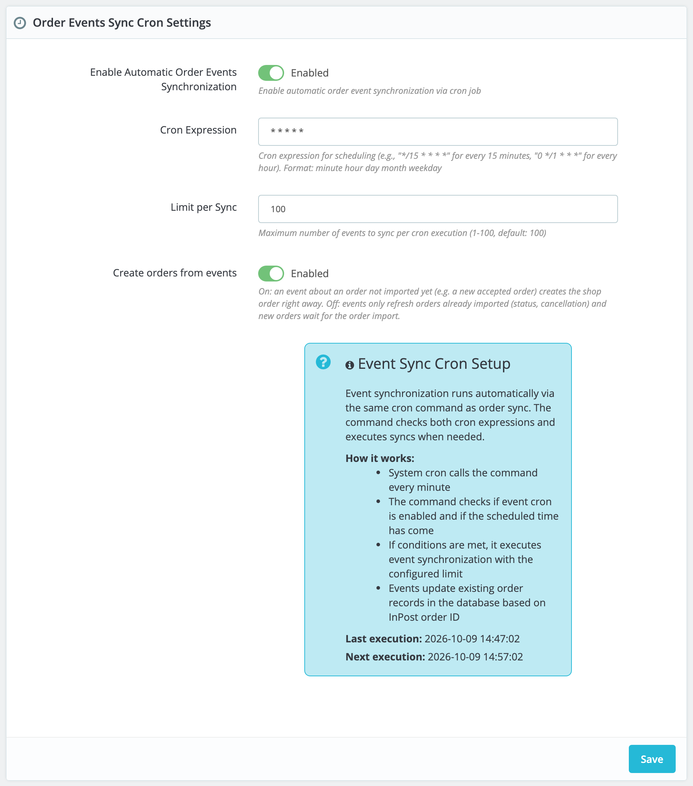

### Order list columns

| Column | Description |
|--------|-------------|
| ID | Internal id |
| Order Reference | PrestaShop order reference |
| InPost Order ID | Order id in InPost (link to the details) |
| InPost order status | Status in InPost |
| PrestaShop status | Shop order status; a **warning icon** with an explanation when the order is not in PLN, has lines without VAT, products not found in the shop, or a total different from InPost |
| Total / Items | Value and number of items |
| Customer | Buyer |
| Date Created / Updated | Dates |

Toolbar: **Sync Orders**, **Background jobs**, **Export** (CSV). The magnifier in a row opens the details.

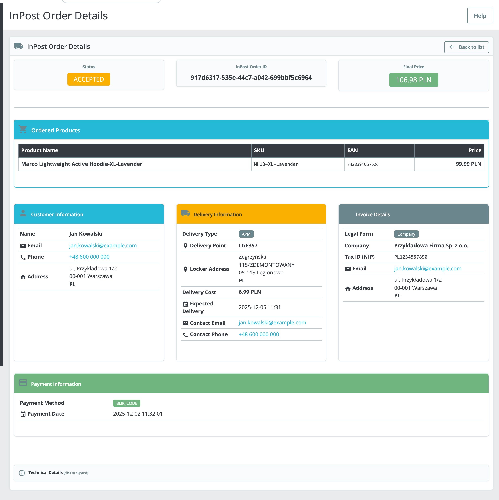

The details show the ordered products, customer data, **delivery** (locker / courier, pickup point, address, cost, expected date), **Invoice Details** (when the buyer asked for an invoice) and the payment.

> **How the PrestaShop order is created.**
> - **Products and variants** — an order line is matched in this order: by the module's offer, by the offer `externalId` (`ps_product_{id}` or `ps_product_{id}_{combination}`), by the combination's own reference, by the product reference. A line that matches nothing goes to the fallback product, and such lines are listed in the private order note.
> - **Prices** — exactly as in InPost (including the **InPost delivery price** as the order shipping), so the shop order total matches InPost. The order is created also when stock is 0 (it is already paid).
> - **States** — InPost statuses are mapped to PrestaShop order states (paid, shipped, delivered, cancelled).
> - The reason why a shop order was not created is recorded and shown in the status panel and background jobs.

### Invoice details and addresses

- **The delivery address is never the invoice address.**
- When the buyer asked for an invoice, the order gets a separate **"InPost Invoice"** address with the company name, **tax id (NIP)** (with the country prefix when given) and invoice address — the PrestaShop invoice is issued to the company. The invoice e-mail goes to the private order note.
- Without invoice details the invoice address is the customer address from InPost (**"InPost Customer"** address).
- The flat number of InPost addresses goes to the second address line.
- An order whose delivery or invoice address cannot be created is not created (clear error, retried on the next run).

### InPost payment

Orders from InPost are recorded with the hidden **"InPost von Halsky"** payment method — never offered at the shop checkout and independent of your payment modules. The order and the invoice show how the buyer paid: "InPost - BLIK", "InPost - Card", "InPost - Google Pay", "InPost - Apple Pay", "InPost - Pay by link", "InPost - Shopping limit", "InPost - Deferred payment", "InPost - Cash on delivery". The InPost payment id is stored as the transaction id.

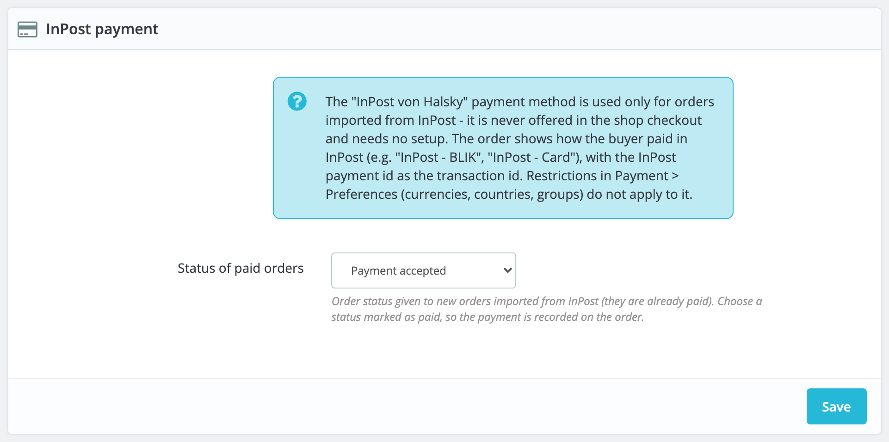

- **Status of paid orders** (**Shipping & Payment** group) — the status of new orders from InPost (default *Payment accepted*).
- **Cash on delivery** orders get *Awaiting Cash On Delivery validation* (no payment recorded).

> **Suppressing customer e-mails.** InPost notifies the buyer itself. To stop PrestaShop from sending duplicate e-mails, turn on **Suppress customer emails for InPost orders** (**Emails** group) — see [Additional settings](#10-additional-settings).

---

## 6 Offer statuses — what next

| Status | Meaning | Next step |
|--------|---------|-----------|
| **DRAFT** | Local offer, not synchronised | Complete the fields and switch "Mark as Draft" off, or click **Send to InPost** |
| **PENDING** | Sent to InPost; InPost is creating / reviewing the offer | Wait — the event cron and the command poller update the status |
| **PUBLISHED** | Visible to buyers | Update prices / stock in PrestaShop — cron sends the changes |
| **REJECTED** | Rejected by InPost moderation / validation | Open the offer → check the **InPost validation errors** → fix → send again |
| **SOLDOUT** | Stock = 0 | Add stock in PrestaShop — cron updates the offer |
| **CLOSED** | Closed | **Reopen Offer** to sell again |
| **ERROR_NOT_CREATED** | Creating the offer failed despite retries | Fix the data and send again (see Command Status) |

> **Validation status** is separate from the offer status: the offer list and form show whether the offer is **Valid** / **Invalid** (local validation before sending — e.g. required attributes) and the validation errors returned by InPost.

### Closing and reopening an offer (Close / Reopen)

- **Close Offer** — for a **PUBLISHED** or **SOLDOUT** offer. Sends the close request to the API; the status is refreshed from the API.
- **Reopen Offer** — for a **CLOSED** offer. Sells again without creating a new offer.

Both buttons are on the offer form and require the offer to have been sent to InPost. On the offer list the same actions work in bulk (**Close selected**, **Reopen selected**). Only a closed offer can be deleted (see [Offer list and deleting offers](#offer-list-and-deleting-offers)).

### Command Status — offer-send command status

Creating an offer in InPost is **asynchronous**: after sending, the module stores the command id and follows it until it ends:

| Command Status | Meaning |
|----------------|---------|
| **PENDING** | Command sent — InPost is still processing it |
| **SUCCESS** | InPost confirmed the offer — its status updates automatically |
| **FAILURE** | InPost rejected the command — the offer was **not created**; the reason is stored on the offer |

#### Automatic retries

The **pending_command_sync** job (every 3 min by default) follows PENDING commands. On **FAILURE** it clears the ids (the offer does not exist), increases the attempt counter and sends the command again — at most **3 times** (**Max Create Retries**). Transient (network/HTTP) errors do not use up attempts. Offers with a permanent API error (e.g. invalid data) are not re-sent on every cron run — editing or sending manually resumes them.

#### The ERROR_NOT_CREATED status

After the last attempt the offer gets **ERROR_NOT_CREATED**. It stays in PrestaShop and needs your action:

1. Check the reason (error field on the offer, status panel, `var/logs/inpost.log`). Most often: images not reachable over **HTTPS**, field values too long, incomplete manufacturer address.
2. Fix the offer data.
3. Send again (or switch "Mark as Draft" off and save).

---

## 7 Integration status and background jobs

**InPost von Halsky → Status** — one page that tells whether the integration works and what to fix. It never calls the InPost API (local data only).

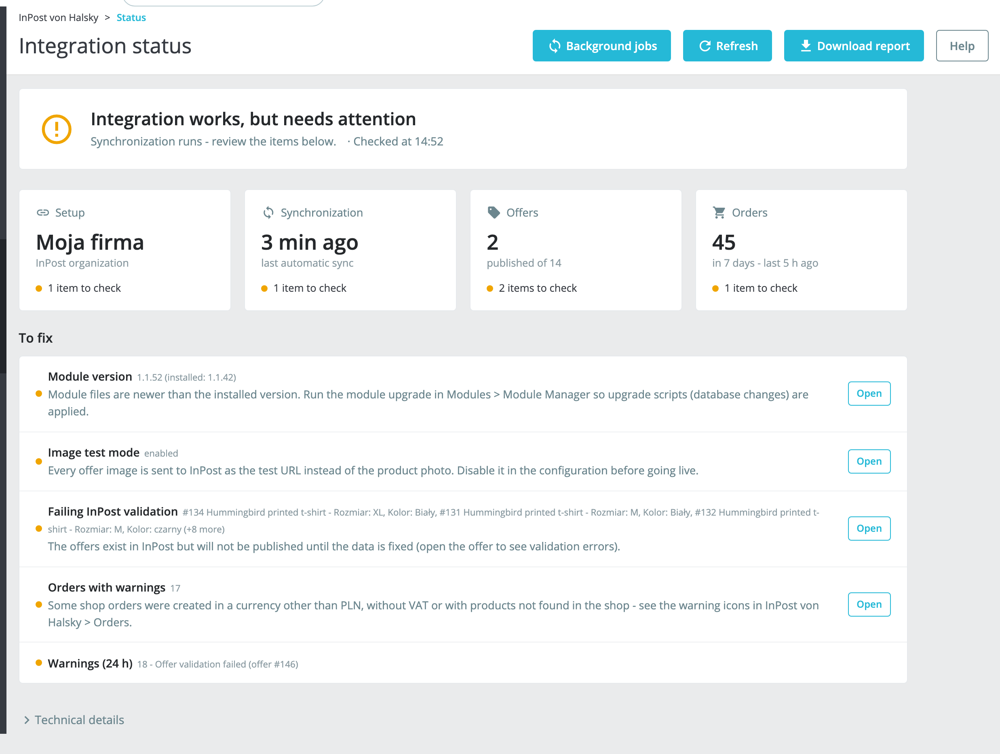

- **Banner** — overall state (works / needs attention / not working).
- **Tiles** — configuration (organization), synchronisation (last cron run), offers (published / all), orders (7 days).
- **To fix** — specific items with an **Open** button, e.g.: module version mismatch (run the upgrade), image test override on, offers failing InPost validation, orders with warnings (currency, VAT, products not found), warnings of the last 24 h.
- **Technical details** (expandable) — environment (versions, PHP extensions, SSL), InPost connection, job schedule (last/next run, duration, result), categories and attributes, offers, events, orders, most frequent errors.
- **Download report** — exports the snapshot as JSON (no passwords or tokens) for support.

Module errors and warnings are also stored in an **error journal** (30 days) — the panel counts and groups them.

**Background jobs** (button on the status page and on the order list) shows every cron job live: progress (processed / total), elapsed time, estimated time left, created orders, errors and the last error, the result of the last run and the next run.

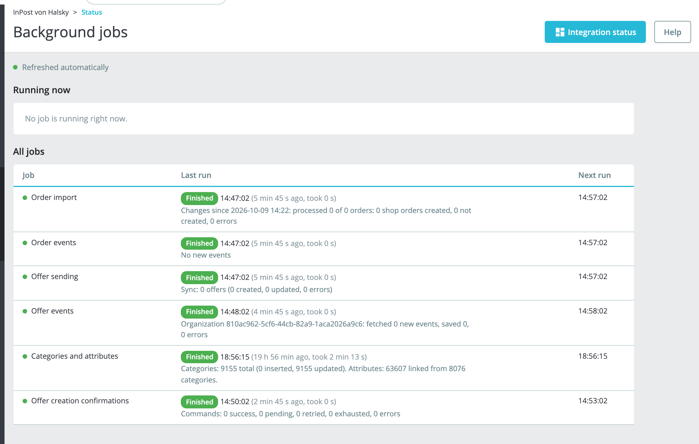

> A running order import and the order events job can be **stopped** from this panel (after the current order). A job killed half-way is shown as "not responding". For shell-only access (e.g. Rancher) use `scripts/ivh-rescue.php` (status, stop / start the order import, clear `ps_log`).

---

## 8 Common problems

Start with the **[Status](#7-integration-status-and-background-jobs)** page — most problems are listed there with a button to the place that needs fixing.

| Problem | Solution |
|---------|----------|
| "No valid access token" / no connection | Configuration → API Settings → check Client ID / Secret → connect again |
| No categories in the offer form | Wait for the category cron (02:00 by default) or check that cron runs; the product needs a mapped **default** category |
| Offers / orders do not appear or update | Check that `inpost:cron:run` runs every minute (Status → Synchronisation, Background jobs) |
| Invalid offer — "Required attribute … has no value" | Set the attribute source in Category Mapping or enter the value in the *InPost Attributes* tab |
| A PrestaShop attribute value does not reach the offer | The *InPost Attributes* tab shows the reason: no feature value, a value outside the InPost list (match it in the source dialog) or a product with combinations in a whole-product offer |
| Offer rejected (REJECTED) | Offers → edit → InPost validation errors |
| Offer ERROR_NOT_CREATED | Check the reason on the offer / `var/logs/inpost.log`; most often HTTP instead of HTTPS images or fields too long |
| An InPost order has no shop order | Status / Background jobs show the reason (e.g. a product not available for order); the import retries such orders |
| The module reports a version mismatch | Modules → Module Manager → **Upgrade** next to InPost von Halsky |
| Configuration changes have no effect | Clear the PrestaShop cache (Advanced Parameters → Performance → Clear cache) |
| InPost von Halsky menu not visible | Check the employee profile permissions and that the module is installed and enabled |

### Module logs

| Log | Contents |
|-----|----------|
| **Status** page (error journal, 30 days) | Grouped module errors and warnings |
| `var/logs/inpost.log` | API details with **Debug API Logging** on |
| Advanced Parameters → Logs (`ps_log`) | Hook and cron errors, deletions of offers that exist in InPost, offer category changes, suppressed e-mails |
| `var/logs/*-YYYY-MM-DD.log` | Standard PrestaShop application logs |

---

## 9 Cron jobs — schedule

Job schedules are set in the module configuration, **Synchronization** group (each panel shows the last and next run). All jobs are started by the single `inpost:cron:run` command, run every minute.

| Job (key) | Default schedule | What it does |
|-----------|------------------|--------------|
| `category_sync` | daily 02:00 | Fetches the category and attribute tree (with dictionary options) from the InPost API; deactivates orphaned categories |
| `offer_event_sync` | every 20 min | Fetches offer events and refreshes their statuses and validation from the API |
| `offer_sync` | every 10 min | Sends offers changed locally (prices, stock, images, attributes) to the InPost API |
| `order_sync` | every 10 min | Incremental import of InPost orders and creating them in PrestaShop |
| `order_event_sync` | every 15 min | Order events: new orders, status changes, cancellations |
| `pending_command_sync` | every 3 min | Completes the asynchronous offer-create commands (SUCCESS/FAILURE, retries) |
| `offer_attachment_sync` | every 3 min | Sends queued offer attachments, checks the uploads and retries failed removals |

### System cron configuration

Add to the system crontab (recommended — every minute):

```bash
* * * * * cd /path/to/prestashop && php bin/console inpost:cron:run >> /var/log/inpost-cron.log 2>&1
```

Alternatively use the PrestaShop **CronJobs** module — the module handles the `actionCronJob` hook and runs `inpost:cron:run` internally.

> **Manual runs / diagnostics:**
> - `inpost:categories:sync` — full category and attribute sync
> - `inpost:offer:sync` — fetch offer statuses from the API
> - `inpost:offer-events:sync` — offer event sync
> - `inpost:orders:sync` — order import from the API
> - `inpost:command:sync` — diagnostics/completion of asynchronous commands
> - `inpost:offer:attachments` — offer attachments (overview, `--sync`, `--add`, `--remove`)
> - `inpost:mapping:suggest` — category mapping suggestions (`-a` — attributes, `-s "phrase"` — search)
> - `inpost:cron:run --status` — job overview (enabled, interval, last/next run), without running anything

---

## 10 Additional settings

### Bulk Listing (Offers & Products group)

**Enable bulk listing from product grid** (on by default) adds the "List on InPost" action to the product list; **Batch size** (25 by default) is the number of products / variants processed in one batch.

### Image Test Override (Offers & Products group)

For tests only: replaces every offer image URL with a fixed public address so InPost can fetch images when the shop is not publicly reachable (e.g. behind a VPN). Off by default; the status panel reminds you when it is on.

### Suppressing customer e-mails (Emails group)

The **Customer Emails** panel suppresses selected PrestaShop e-mails for orders from InPost (InPost notifies the buyer itself):

- **Suppress customer emails for InPost orders** — main switch (off by default).
- **Email types to suppress** — order confirmation, status change, shipping/tracking, credit slip, order message, virtual product (default: confirmation, status change, shipping, credit slip).
- **Log suppressed emails** — a log entry for every suppressed e-mail (on by default).

---

## Waybills — Compatibility with the ShipX module

The **Shipping & Payment** settings connect InPost von Halsky orders with the **InPost ShipX** shipping module (`inpostshipping`), which generates InPost shipments and labels.

**"InPost ShipX integration" panel**
- **Enable ShipX integration** — for accepted InPost orders the module creates ShipX **shipment records** and prepares the data needed for the shipment: recipient **e-mail, address and phone** (for a locker also the pickup point id).
- **Auto-create shipment on order acceptance** — when on, the process is **fully automatic**: the module creates the ShipX shipment with its label right away. When off (but the integration is on) — only a **draft record** is created, which you complete in the ShipX module.
- **Default parcel size** — ShipX template (*Small = size A*, *Medium = B*, *Large = C*, *X-Large*) for shipments from orders. Default *Small*.

> Automatic creation uses the **default sender and sending method (locker / courier / point)** configured in the **ShipX** module.

**"Shipping mapping (InPost von Halsky → ShipX)" panel** — which ShipX carrier to use:
- **Locker (Paczkomat) delivery → carrier**,
- **Courier delivery → carrier**.

> The payment method of InPost orders is described in [InPost payment](#inpost-payment) (the former "Payment mapping" setting was removed in 1.1.37).

> **ShipX module required.** The integration works when the **InPost ShipX (`inpostshipping`)** module is installed and its carriers are configured. It is verified with **`inpostshipping` version 2.16.2**. For ShipX itself see the InPost documentation: **[InPost documentation — PrestaShop](https://dokumentacja-inpost.atlassian.net/wiki/spaces/PL/pages/61669420/PrestaShop+1.7)**.
