# InPost von Halsky — Instrukcja (PrestaShop)

> 🇬🇧 English version: [quick-start.en.md](./quick-start.en.md)

`inpostvonhalsky` · PrestaShop 8.x · PHP 8.1 · v 1.0.0

> **Ten przewodnik przeprowadzi Cię przez minimum wymagane** do opublikowania pierwszej oferty i rozpoczęcia odbierania zamówień z InPost von Halsky, a potem przez codzienną pracę z modułem. W panelu PrestaShop moduł występuje pod nazwą **InPost von Halsky**; cały panel modułu jest po polsku (w nawiasach podajemy angielskie nazwy dla paneli w języku angielskim).

## Spis treści

- [EAN — kiedy wymagany, kiedy opcjonalny](#ean--kiedy-wymagany-kiedy-opcjonalny)
- [Cron robi całą pracę za Ciebie](#cron-robi-całą-pracę-za-ciebie)
- [Wymagania wstępne](#wymagania-wstępne)
- [Instalacja i aktualizacja modułu](#instalacja-i-aktualizacja-modułu)
1. [Weryfikacja instalacji](#1-weryfikacja-instalacji)
2. [Połączenie z API InPost i ustawienia ofert](#2-połączenie-z-api-inpost-i-ustawienia-ofert)
   - [Domyślne mapowanie pól produktu](#domyślne-mapowanie-pól-produktu)
   - [Domyślne ustawienia ofert i GPSR](#domyślne-ustawienia-ofert-i-gpsr)
   - [Ceny w InPost](#ceny-w-inpost)
   - [Productization — automatyczne uzupełnianie danych oferty](#productization--automatyczne-uzupełnianie-danych-oferty-z-katalogu-inpost)
   - [Środowisko produkcyjne — zmiana URL-i API](#środowisko-produkcyjne--zmiana-url-i-api)
3. [Kategorie i atrybuty](#3-kategorie-i-atrybuty)
   - [Mapowanie kategorii](#mapowanie-kategorii)
   - [Asystent: sklep → InPost](#asystent-sklep--inpost)
   - [Źródła wartości atrybutów](#źródła-wartości-atrybutów)
   - [Cecha czy atrybut?](#cecha-czy-atrybut)
   - [Asystent atrybutów](#asystent-atrybutów)
4. [Publikacja oferty](#4-publikacja-oferty)
   - [Produkty z kombinacjami (warianty)](#produkty-z-kombinacjami-warianty)
   - [Zmiana kategorii oferty](#zmiana-kategorii-oferty)
   - [Lista ofert i usuwanie](#lista-ofert-i-usuwanie)
   - [Masowa edycja atrybutów](#masowa-edycja-atrybutów)
   - [Cena oferty i masowa zmiana ceny](#cena-oferty-i-masowa-zmiana-ceny)
   - [Załączniki ofert](#załączniki-ofert)
5. [Odbiór zamówień](#5-odbiór-zamówień)
   - [Dane do faktury i adresy](#dane-do-faktury-i-adresy)
   - [Płatność InPost](#płatność-inpost)
6. [Statusy ofert — co dalej](#6-statusy-ofert--co-dalej)
7. [Status integracji i zadania w tle](#7-status-integracji-i-zadania-w-tle)
8. [Najczęstsze problemy](#8-najczęstsze-problemy)
9. [Zadania cron — harmonogram](#9-zadania-cron--harmonogram)
10. [Ustawienia dodatkowe](#10-ustawienia-dodatkowe)
- [Karty przewozowe — Kompatybilność z modułem ShipX](#karty-przewozowe--kompatybilność-z-modułem-shipx)

---

## EAN — kiedy wymagany, kiedy opcjonalny

Podanie EAN nie zawsze jest obowiązkowe. Ofertę można wystawić na dwa sposoby:

- podając **EAN**, **albo**
- podając **markę + kod producenta (MPN)** jednocześnie.

Jeśli EAN jest podany, moduł go waliduje: dozwolone są tylko cyfry, długość **8 (EAN-8), 12 (UPC-A) lub 13 (EAN-13)**, a suma kontrolna (modulo 10) musi się zgadzać. EAN jest też wykorzystywany przez [Productization](#productization--automatyczne-uzupełnianie-danych-oferty-z-katalogu-inpost) do uzupełniania danych oferty z katalogu InPost.

> **Kombinacje.** Oferta wariantu (np. koszulki w rozmiarze M) używa **wyłącznie własnego EAN kombinacji** — EAN produktu nie jest kopiowany, bo InPost nie pozwala zmienić EAN raz nadanego ofercie, a każdy wariant musi mieć inny. Wariant bez EAN potrzebuje marki i MPN.

> **Skąd moduł bierze MPN, EAN i markę** — ustawisz w panelu [Domyślne mapowanie pól produktu](#domyślne-mapowanie-pól-produktu) (domyślnie: pola *Kod producenta (MPN)*, *EAN-13* i *Marka (producent)* produktu).

---

## Cron robi całą pracę za Ciebie

Po poprawnej konfiguracji wszystkie synchronizacje z InPost odbywają się automatycznie — kategorie, statusy ofert, zamówienia, zmiany cen, stanów i wartości atrybutów. **Ręcznie robisz tylko: konfigurację połączenia oraz mapowanie kategorii i atrybutów** — po tym wystawianie ofert i ich aktualizacje są w pełni automatyczne.

Zmiany cen, stanów magazynowych, kombinacji, cech i zdjęć na karcie produktu PrestaShop są dodatkowo wykrywane **od razu** (przez hooki produktowe), które oznaczają powiązane oferty do ponownej synchronizacji; wysyłkę zmiany do InPost realizuje następnie cron. Tuż przed wysłaniem oferty moduł jeszcze raz odczytuje z PrestaShop jej cenę i stan, więc do InPost nigdy nie trafiają nieaktualne dane (np. po zakupie w Twoim sklepie).

### Jak działa cron w tym module

Cała synchronizacja jest obsługiwana przez **jedno polecenie-dyspozytor**:

```
php bin/console inpost:cron:run
```

To polecenie wywołuje się **co minutę** z systemowego crona (lub przez moduł CronJobs PrestaShop). Częstotliwość każdego zadania jest pilnowana **wewnątrz modułu** — dyspozytor uruchamiany co minutę wykonuje dane zadanie tylko wtedy, gdy minął jego interwał. Zadania nie uruchamiają się równolegle (blokada na zadanie), a przebieg każdego z nich widać na żywo w panelu [Zadania w tle](#7-status-integracji-i-zadania-w-tle).

### Domyślne częstotliwości synchronizacji

| Kategorie | Zdarzenia ofert (statusy) | Import zamówień | Zdarzenia zamówień | Zmienione oferty | Polecenia (async) |
|-----------|---------------------------|-----------------|--------------------|------------------|-------------------|
| codziennie 02:00 | co 20 min | co 10 min | co 15 min | co 10 min | co 3 min |

> **Nowe zamówienia przychodzą przez zdarzenia.** Zadanie zdarzeń zamówień od razu tworzy zamówienie w sklepie dla nowego, zaakceptowanego zamówienia InPost (można to wyłączyć) — nie trzeba czekać na import zamówień. Szczegóły: [Odbiór zamówień](#5-odbiór-zamówień).

---

## Przepływ

**1 Weryfikacja → 2 Konfiguracja API → 3 Kategorie i atrybuty → 4 Publikacja oferty → 5 Zamówienia**

Na bieżąco: **7 Status integracji** pokazuje, czy wszystko działa i co wymaga uwagi.

---

## Wymagania wstępne

- PrestaShop 8.x
- PHP 8.1
- Moduł zainstalowany i włączony
- Systemowy cron uruchamiający `php bin/console inpost:cron:run` (co minutę) **lub** moduł CronJobs PrestaShop
- Client ID + Client Secret od InPost
- Waluta **PLN** i reguły podatkowe VAT na produktach (InPost sprzedaje w PLN; produkt bez reguły podatkowej trafia do InPost z VAT 0% — panel statusu ostrzega o takich ofertach)

---

## Instalacja i aktualizacja modułu

Moduł instalujesz jak każdy inny moduł PrestaShop — wybierz jedną z metod:

### Metoda A — przez panel administratora (zalecana)

1. Pobierz plik **`inpostvonhalsky-x.y.z.zip`** z [GitHub Releases](https://github.com/InPost-VonHalsky/InPost-vonHalsky-PrestaShop/releases) (sekcja *Assets*). Paczka zawiera już zależności Composer (katalog `vendor/`). Nie używaj przycisku **Code → Download ZIP** — taki plik nie zawiera zależności.
2. W panelu admina wejdź w **Moduły → Menedżer modułów**.
3. Kliknij **„Załaduj moduł"** (prawy górny róg) i przeciągnij lub wskaż plik `.zip`. PrestaShop rozpakuje i zainstaluje moduł automatycznie.
4. Po instalacji kliknij **„Konfiguruj"** przy module **InPost von Halsky**.

### Metoda B — ręcznie (wgranie plików / FTP)

1. Rozpakuj katalog modułu do `modules/inpostvonhalsky/` w instalacji PrestaShop (przez FTP/SFTP lub bezpośrednio na serwerze).
2. Zainstaluj zależności Composer w katalogu modułu:
   ```bash
   composer install --no-dev --optimize-autoloader
   ```
3. W panelu admina wejdź w **Moduły → Menedżer modułów**, wyszukaj **InPost von Halsky**, kliknij **Zainstaluj**, a następnie **Konfiguruj**.

> **Zależności Composer.** Gotowy pakiet `.zip` powinien już zawierać katalog `vendor/`. Przy instalacji wprost z repozytorium uruchom `composer install` w katalogu modułu **przed** instalacją w panelu — bez tego moduł nie wystartuje (brak autoloadera).

### Aktualizacja do nowej wersji

Wgraj nowy `.zip` tak samo jak przy instalacji (Metoda A) albo podmień pliki (Metoda B), a następnie w **Moduły → Menedżer modułów** kliknij **Aktualizuj** przy module. Aktualizacja uruchamia skrypty zmian w bazie danych, jeśli nowa wersja je zawiera; są one wyłącznie addytywne — istniejące oferty, mapowania i zamówienia działają dalej bez zmian. Dopóki aktualizacja nie zostanie uruchomiona, [panel statusu](#7-status-integracji-i-zadania-w-tle) pokazuje pozycję **Wersja modułu** z różnicą wersji.

> Szczegóły techniczne (repozytorium, SDK InPost, uprawnienia plików) znajdziesz w pliku [README.md](../README.md). Pełną listę zmian — w [CHANGELOG.md](../CHANGELOG.md).

Po zainstalowaniu przejdź do kroku [1 Weryfikacja instalacji](#1-weryfikacja-instalacji).

---

## 1 Weryfikacja instalacji

Po poprawnej instalacji w menu administratora PrestaShop (grupa **Sprzedaż**) pojawia się nowa pozycja **InPost von Halsky** z podmenu:

- **Status** — [stan integracji](#7-status-integracji-i-zadania-w-tle): co działa i co wymaga uwagi
- **Oferty** — lista ofert, tworzenie i edycja
- **Zamówienia** — zamówienia z InPost
- **Mapowanie kategorii** — kategorie i atrybuty InPost, asystenci mapowania
- **Konfiguracja** — strona konfiguracji modułu

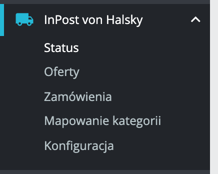

> **Masowe wystawianie ofert** uruchamia się z listy produktów w katalogu (akcja masowa **„Wystaw w InPost”**), a **Asystent atrybutów** — z nagłówka strony **Mapowanie kategorii**.

> **Cron jest wymagany.** Bez działającego crona (`inpost:cron:run`) żadne automatyczne synchronizacje nie będą się wykonywać. Panel **Status** pokazuje, kiedy cron uruchomił się ostatnio.

---

## 2 Połączenie z API InPost i ustawienia ofert

Przejdź do strony konfiguracji modułu:

**InPost von Halsky → Konfiguracja** (lub **Moduły → Menedżer modułów → InPost von Halsky → Konfiguruj**).

Strona konfiguracji jest podzielona na grupy widoczne w bocznej nawigacji: **Połączenie**, **Synchronizacja**, **Oferty i produkty**, **Wysyłka i płatność**, **E-maile**. Każdy panel ma własny przycisk **Zapisz**.

### Skąd wziąć credentials (Client ID / Client Secret)

**Client ID** i **Client Secret** generujesz samodzielnie w **Merchant Portalu InPost**: **[Merchant Portal](https://account.inpost-group.com/auth?client_id=merchant-portal&nrc=1)**. Szczegółowy przewodnik znajdziesz w **[dokumentacji API InPost](https://inpsa-api-portal.inpost-group.com/#)** — po wejściu kliknij pozycję **docs configuration**.

W skrócie: zaloguj się do Merchant Portalu, utwórz nowy zestaw credentials (klienta OAuth2), jako **Redirect URI** podaj adres wyświetlany na stronie konfiguracji modułu (patrz uwaga niżej), a następnie skopiuj wygenerowane **Client ID** i **Client Secret** do panelu modułu.

W grupie **Połączenie**, panel **Ustawienia API** (*API Settings*):

1. Wpisz **Client ID** i **Client Secret** — wygenerowane w Merchant Portalu. Ze względów bezpieczeństwa pole Client Secret nie jest nigdy wyświetlane ponownie — pozostaw je puste, jeśli nie chcesz go zmieniać. Kliknij **Zapisz** przed użyciem przycisków połączenia.
2. Sprawdź **Adres URL API** i **Adres URL usługi autoryzacji** — domyślnie wskazują na środowisko **staging**. Na produkcji zamień je na adresy produkcyjne (zobacz niżej).
3. Kliknij **Połącz przez OAuth2** — inicjuje przepływ OAuth2. Po połączeniu panel pokazuje zielony komunikat **„OAuth2 połączony”** i przycisk **Rozłącz OAuth2**.
4. Kliknij **Odśwież listę organizacji** — pobiera listę organizacji z API InPost.
5. Wybierz **Organizację** — to identyfikator organizacji, w ramach której wystawiasz oferty.
6. Kliknij **Testuj połączenie** — weryfikuje token i dostępność endpointów. Zielony komunikat = gotowość do pracy.
7. **Jeśli test połączenia nie jest pozytywny** — sprawdź **Client ID / Client Secret**, upewnij się, że **URL-e API** wskazują właściwe środowisko (staging/produkcja), i połącz się ponownie. Zobacz też [Najczęstsze problemy](#8-najczęstsze-problemy).

> **Redirect URI (OAuth2).** Panel wyświetla gotowy **Adres przekierowania OAuth2 (Redirect URI)** w postaci `https://twoj-sklep/module/inpostvonhalsky/callback`. Skopiuj go przyciskiem **Kopiuj** i wklej jako Redirect URI w Merchant Portalu — adres musi być **identyczny**, inaczej logowanie OAuth2 się nie powiedzie.

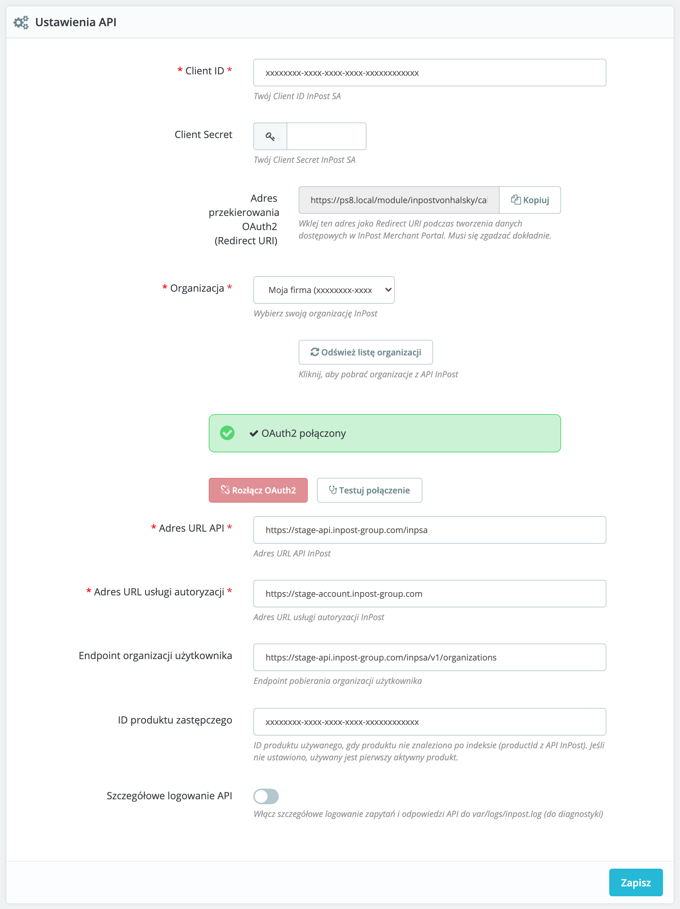

| Pole | Wartość domyślna (staging) |
|------|----------------------------|
| Adres URL API | `https://stage-api.inpost-group.com/inpsa` |
| Adres URL usługi autoryzacji | `https://stage-account.inpost-group.com` |
| Endpoint organizacji użytkownika | *(opcjonalne — endpoint listy organizacji użytkownika)* |

> **ID produktu zastępczego** i **Szczegółowe logowanie API** to pola opcjonalne. Produkt zastępczy (indeks produktu) jest używany w zamówieniu, gdy pozycji zamówienia nie da się dopasować do żadnego produktu sklepu. Szczegółowe logowanie zapisuje żądania i odpowiedzi API do `var/logs/inpost.log` (diagnostyka).

### Domyślne mapowanie pól produktu

W grupie **Oferty i produkty**, panel **Domyślne mapowanie pól produktu** (*Default product field mapping*) wskazuje, z jakich danych PrestaShop wypełniane są pola produktu **nowych** ofert. Każde pole wybierasz z listy — pole produktu albo cecha (Feature). Istniejące oferty się nie zmieniają.

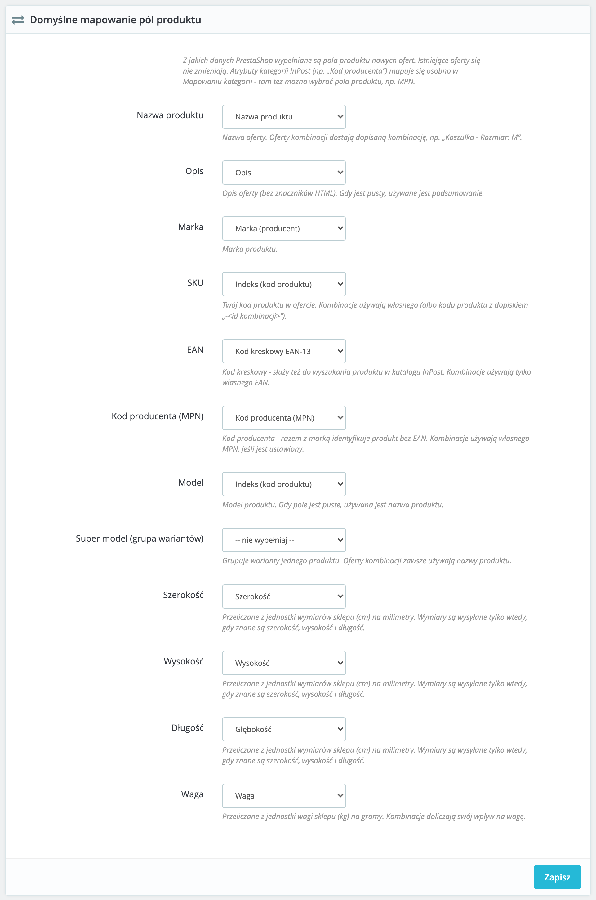

| Pole oferty | Domyślnie z | Uwagi |
|-------------|-------------|-------|
| Nazwa produktu | Nazwa produktu | Oferty kombinacji dostają dopisaną kombinację, np. „Koszulka - Rozmiar: M” |
| Opis | Opis | Bez znaczników HTML; gdy pusty — podsumowanie |
| Marka | Marka (producent) | |
| SKU | Indeks (kod produktu) | Kombinacje używają własnego indeksu albo indeksu produktu z dopiskiem `-<id kombinacji>` |
| EAN | Kod kreskowy EAN-13 | Kombinacje — tylko własny EAN |
| Kod producenta (MPN) | Kod producenta (MPN) | Kombinacje — własny MPN, jeśli ustawiony |
| Model | Indeks (kod produktu) | Gdy puste — nazwa produktu |
| Super model (grupa wariantów) | *nie wypełniaj* | Oferty kombinacji zawsze dostają nazwę produktu (grupuje warianty jednego produktu) |
| Szerokość / Wysokość / Długość | Szerokość / Wysokość / Głębokość | Przeliczane z jednostek sklepu na mm; wysyłane tylko, gdy znane są wszystkie trzy |
| Waga | Waga | Przeliczana na gramy; kombinacje doliczają swój wpływ na wagę |
| Czas wysyłki (dni) | *nie wypełniaj* | Cecha z liczbą dni, np. „3” albo „2-3 dni” (używana jest największa liczba). Stosowana przy każdym wysłaniu, także dla istniejących ofert bez własnej wartości |

> **Czas wysyłki (dni)** — kolejność: wartość wpisana na ofercie → cecha wybrana w tym mapowaniu → **Domyślny czas wysyłki (dni)** z panelu *Domyślne ustawienia ofert*. Gdy żadne źródło nie daje liczby, pole nie jest wysyłane.

> **Atrybuty kategorii InPost** (np. „Kod producenta”, „Rozmiar”, „Wiek dziecka”) mapuje się osobno — w [Mapowaniu kategorii](#źródła-wartości-atrybutów).

### Domyślne ustawienia ofert i GPSR

Panel **Domyślne ustawienia ofert** (*Offer Defaults*) zawiera **domyślną politykę zwrotów**, **domyślną politykę reklamacji** i **Domyślny czas wysyłki (dni)** — używane, gdy oferta nie ma własnych (czas wysyłki: zob. [Domyślne mapowanie pól produktu](#domyślne-mapowanie-pól-produktu)).

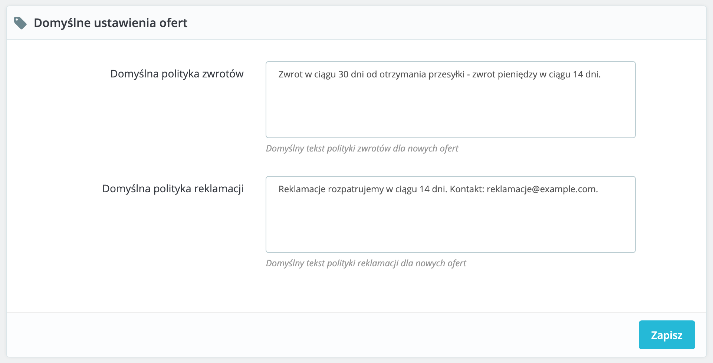

W tej samej grupie znajduje się panel **GPSR i dane producenta (globalne wartości domyślne)** — globalne dane producenta i informacje GPSR, używane gdy oferta nie ma własnych. Uzupełnij je raz, aby nie wpisywać ich w każdej ofercie: nazwa i adres producenta, e-mail, telefon (format E.164), 2-literowy kod kraju, oznaczenie CE, numer partii, informacje o bezpieczeństwie oraz przełącznik **Produkt nie wymaga informacji GPSR** (domyślnie: zwolniony z GPSR).

### Ceny w InPost

W grupie **Oferty i produkty**, panel **Ceny w InPost** (*InPost prices*) określa, jaką cenę moduł wysyła do InPost. **Ceny w Twoim sklepie się nie zmieniają.** Ceny są brutto, w PLN.

Cena oferty powstaje w trzech krokach:

1. **Cena bazowa** — cena dla wybranej **grupy klientów** (jej ceny specjalne, reguły cen katalogowych i zniżka grupy) albo zwykła cena sklepu, gdy grupa nie jest wybrana.
2. **Zmiana ceny (%)** — cena bazowa plus lub minus procent (np. `5` = o 5% drożej niż w sklepie, `-5` = o 5% taniej; zakres od -90 do 500).
3. **Zaokrąglenie** — *Brak*, *W górę do ,99* (104,20 → 104,99) albo *Do pełnych złotych* (104,49 → 104,00).

| Ustawienie | Domyślnie | Uwagi |
|------------|-----------|-------|
| **Grupa klientów cen w InPost** | *brak — cena sklepu* | Utwórz grupę (np. „InPost”) bez klientów i ustaw dla niej ceny InPost w Katalogu (ceny specjalne albo reguły cen katalogowych). Produkty bez takiej ceny dostają zwykłą cenę |
| **Zmiana ceny (%)** | 0 | |
| **Zaokrąglenie** | Brak | Stosowane po zmianie ceny |

Przykład: cena sklepu 100,00, +5%, zaokrąglenie do ,99 → cena w InPost 105,99.

- Domyślnie (brak grupy, 0%, brak zaokrąglenia) ceny w InPost są takie jak w sklepie.
- Po zapisie ustawień **wszystkie oferty są przeliczane** (pierwsza partia od razu, reszta przez cron synchronizacji ofert), a do InPost trafiają tylko te, których cena się zmieniła.
- Oferta z **ceną ręczną** (ustawioną na ofercie albo przez **Ustaw cenę** na liście — zob. [Cena oferty i masowa zmiana ceny](#cena-oferty-i-masowa-zmiana-ceny)) zachowuje ją — te ustawienia jej nie dotyczą.
- Cena specjalna lub reguła cen katalogowych zapisana w PrestaShop aktualizuje cenę w InPost odpowiednich ofert. Ceny koszyka (import zamówień InPost) i ceny pojedynczego klienta są ignorowane.

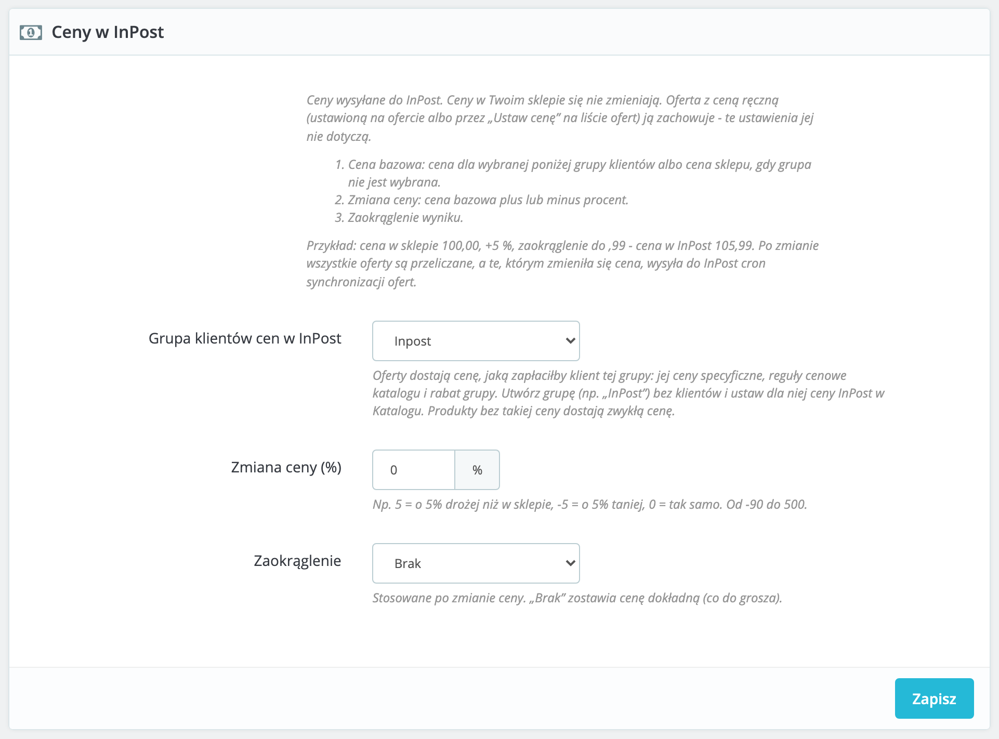

#### Grupa klientów jako cennik InPost — krok po kroku

Grupa klientów służy tu tylko jako **cennik**: nie przypisujesz do niej żadnych klientów, a moduł liczy ceny ofert tak, jakby kupował ktoś z tej grupy. Zwykli klienci sklepu nic z tego nie widzą.

**1. Utwórz grupę** — **Preferencje → Klienci**, zakładka **Grupy** (u góry strony) → **Dodaj nową grupę**.

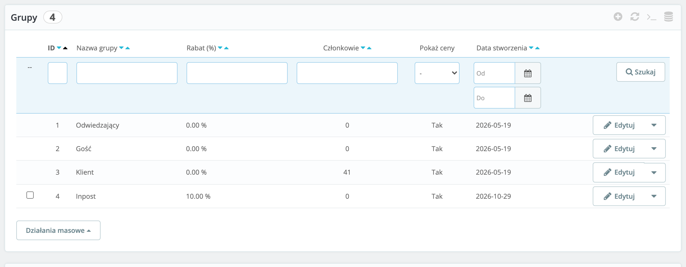

- **Nazwa**: np. „InPost”.
- **Rabat** (%): rabat na **wszystkie** produkty w InPost (np. `10` = wszystko o 10% taniej niż w sklepie). Zostaw `0`, jeśli ceny ustawiasz tylko dla wybranych produktów.
- **Metoda wyświetlania cen**, **Pokaż ceny**: bez znaczenia dla modułu — moduł zawsze liczy cenę brutto.

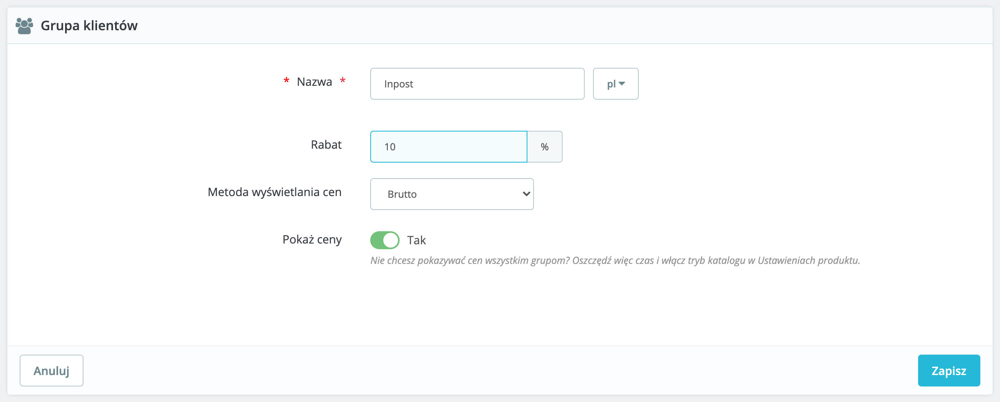

**2. Wybierz grupę w module** — panel **Ceny w InPost** → **Grupa klientów cen w InPost** → *InPost* → **Zapisz**. Oferty od razu się przeliczają.

**3. (Opcjonalnie) Ceny dla wybranych produktów** — **Katalog → Produkty** → produkt → zakładka **Ceny** → **Ceny specyficzne** → **Dodaj cenę specyficzną**:

- w **Warunkach** wybierz grupę **InPost** (oraz wariant, jeśli cena dotyczy jednej kombinacji),
- w sekcji **Wpływ na cenę** ustaw **rabat** (kwotowy lub %) albo włącz **Edytuj cenę specyficzną** → **Cena ostateczna (netto)**,
- opcjonalnie daty od–do (promocja czasowa).

> **Uwaga — netto.** **Cena ostateczna** w cenie specyficznej jest wpisywana **bez VAT**. Żeby w InPost wyszło 99,00 zł brutto przy 23% VAT, wpisz 80,49. (Cena ręczna na ofercie w module jest wpisywana **brutto**.)

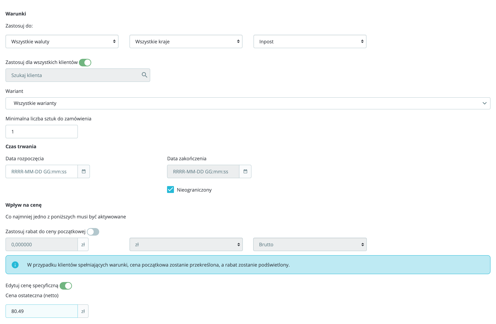

**4. (Opcjonalnie) Reguła dla całego katalogu** — **Katalog → Rabaty → Reguły cenowe katalogu → Dodaj nowy**: nazwa, **Grupa: InPost**, **Obniżka** (np. 10 %), opcjonalnie daty od–do. W PrestaShop 8.2 reguła obejmuje cały katalog (formularz nie ma warunków, np. kategorii) — do wybranych produktów użyj cen specyficznych.

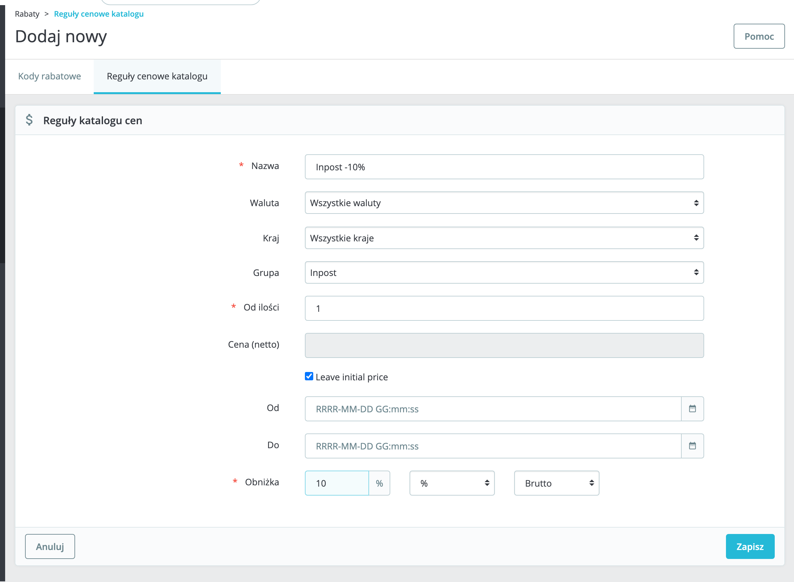

**Jak liczona jest cena produktu przy wybranej grupie:**

| Produkt | Ustawienie w PrestaShop | Cena w InPost |
|---------|-------------------------|---------------|
| A | cena specyficzna dla grupy InPost: cena ostateczna 80,49 netto | 99,00 zł brutto |
| B | cena specyficzna dla grupy InPost: −10% | cena sklepu −10% |
| C | nic dla grupy InPost | **zwykła cena sklepu** (z rabatem grupy, jeśli ustawiony) |
| D | promocja dla **Wszystkich grup** | promocja obowiązuje też w InPost |

Na wynik nakładana jest jeszcze **Zmiana ceny (%)** i **Zaokrąglenie** z panelu Ceny w InPost. Cena ręczna na ofercie ma pierwszeństwo przed wszystkim powyżej.

### Productization — automatyczne uzupełnianie danych oferty z katalogu InPost

Funkcja **Productization** uzupełnia pola oferty oraz atrybuty kategorii danymi z katalogu produktów InPost, na podstawie kodu **EAN** produktu (endpoint `/hints`). Działa przy ręcznym tworzeniu oferty i przy masowym wystawianiu.

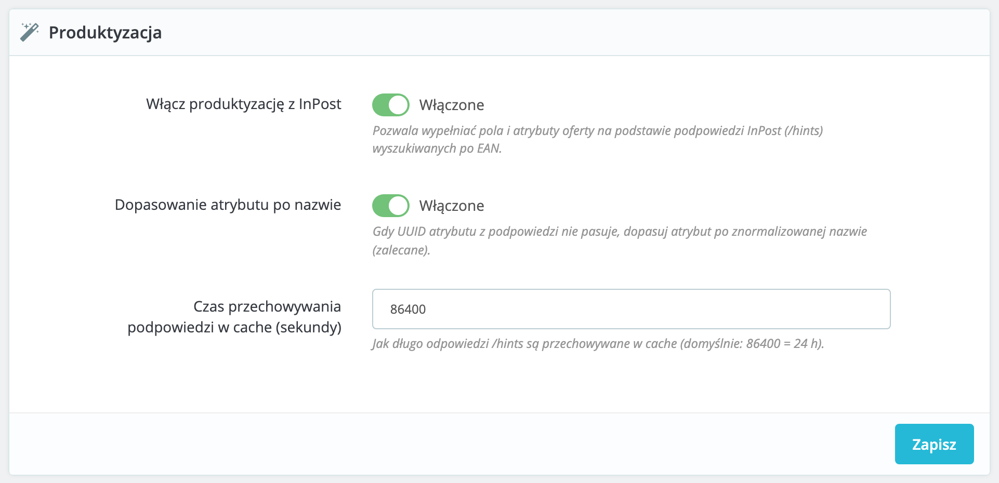

#### Włączanie i wyłączanie Productization

Funkcję kontroluje przełącznik **Włącz produktyzację z InPost** w panelu **Produktyzacja**:

- **Wyłączone (domyślnie)** — pola oferty uzupełniane są wyłącznie z danych PrestaShop (mapowanie pól produktu i źródła atrybutów). Włącz świadomie, jeśli chcesz korzystać z katalogu InPost.
- **Włączone** — przy tworzeniu oferty moduł odpytuje API InPost po EAN produktu i uzupełnia **puste** pola: nazwę, markę, model, opis, wymiary oraz atrybuty kategorii. Wartości można edytować przed wysłaniem.

> **Kolejność źródeł wartości atrybutów:** najpierw [źródło z PrestaShop](#źródła-wartości-atrybutów) (cecha / atrybut / pole produktu), potem podpowiedź z katalogu InPost (tylko dla atrybutów, które są jeszcze puste), na końcu wpis ręczny.

#### Dopasowanie atrybutów po nazwie (fallback)

Przełącznik **Dopasowanie atrybutu po nazwie** (domyślnie włączony) kontroluje dopasowanie atrybutów zwróconych przez `/hints` do atrybutów wybranej kategorii InPost:

- **Włączony (zalecane)** — najpierw po **UUID**, a jeśli to nie zadziała — po **znormalizowanej nazwie** (np. „Kolor”, „Rodzaj”). `/hints` często zwraca atrybuty z innej przestrzeni katalogu niż kategoria oferty — fallback po nazwie zapewnia, że wartości zostają uzupełnione.
- **Wyłączony** — wyłącznie dopasowanie po UUID.

**Czas przechowywania podpowiedzi w cache (sekundy)** — czas przechowywania odpowiedzi `/hints` w bazie (domyślnie `86400` = 24 h). Cache przechowuje trafienia i „brak wyniku”; błędy przejściowe API nie są buforowane.

#### Picker Productization na formularzu oferty

Przy włączonej funkcji na formularzu oferty pojawia się przycisk **Uzupełnij z katalogu InPost**:

1. Moduł szuka produktu w katalogu InPost po **EAN** (a jeśli brak — po nazwie).
2. Wyświetla listę dopasowań (nazwa, marka, EAN, liczba atrybutów).
3. Po wybraniu pozycji uzupełniane są **puste** pola oferty i atrybuty kategorii (zaznacz **Nadpisz istniejące wartości**, aby nadpisać już wypełnione).
4. Oferta pozostaje szkicem (DRAFT) — nic nie jest wysyłane do InPost automatycznie.

> **Auto-mapowanie kategorii.** Jeśli produkt nie ma jeszcze zmapowanej kategorii InPost, a dopasowanie z katalogu wskazuje na kategorię już zsynchronizowaną — moduł utworzy mapowanie kategorii automatycznie przy tworzeniu szkiców.

### Środowisko produkcyjne — zmiana URL-i API

Moduł domyślnie wskazuje na środowisko **staging** InPost. Przed przejściem na produkcję zamień adresy API w panelu **Ustawienia API**.

| Pole | Staging (domyślny) | Produkcja |
|------|--------------------|-----------|
| Adres URL API | `https://stage-api.inpost-group.com/inpsa` | `https://api.inpost-group.com/inpsa` |
| Adres URL usługi autoryzacji | `https://stage-account.inpost-group.com` | `https://account.inpost-group.com` |

**Procedura przejścia na produkcję:**

1. Zamień oba URL-e na adresy produkcyjne.
2. Kliknij **Zapisz**.
3. Kliknij **Połącz przez OAuth2** — nowy przepływ OAuth2 dla produkcji.
4. Kliknij **Odśwież listę organizacji** i wybierz organizację produkcyjną (może się różnić od staging).
5. Kliknij **Testuj połączenie**.
6. Wyłącz **Testowe podmienianie zdjęć**, jeśli było włączone (panel statusu przypomina o tym).

> **Uwaga:** token OAuth2 jest powiązany ze środowiskiem — po zmianie URL-i połącz się ponownie. Dokładne adresy produkcyjne potwierdź z InPost.

---

## 3 Kategorie i atrybuty

InPost posiada własne drzewo kategorii, a każda kategoria końcowa (liść) — własny zestaw **atrybutów** (np. „Rozmiar”, „Kolor”, „Materiał”, „Wiek dziecka”), niektóre wymagane. Cron pobiera kategorie i atrybuty automatycznie (domyślnie codziennie o 02:00). Twoja praca to:

1. wskazać, której kategorii InPost odpowiada każda kategoria sklepu ([Mapowanie kategorii](#mapowanie-kategorii), z pomocą [asystenta](#asystent-sklep--inpost)),
2. wskazać, skąd w PrestaShop brać wartość każdego atrybutu InPost ([Źródła wartości atrybutów](#źródła-wartości-atrybutów), z pomocą [asystenta atrybutów](#asystent-atrybutów)).

Potem oferty wypełniają się same.

### Mapowanie kategorii

**InPost von Halsky → Mapowanie kategorii** — widok **Drzewo InPost**

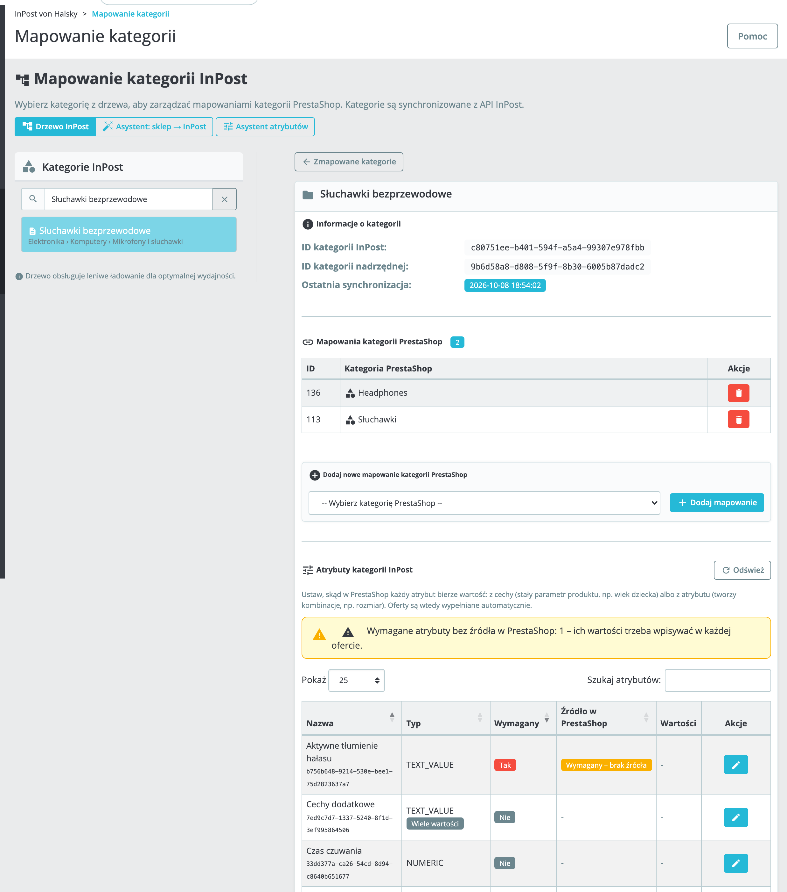

1. **Znajdź kategorię InPost** — w drzewie (panel lewy, ładowane leniwie) albo wyszukiwarką nad drzewem (min. 2 znaki; wynik pokazuje pełną ścieżkę). **Atrybuty istnieją tylko dla kategorii końcowych** — tylko je można mapować.
2. **Kliknij kategorię** → panel szczegółów: **Informacje o kategorii**, **Mapowania kategorii PrestaShop** i **Atrybuty kategorii InPost**.
3. W sekcji **Dodaj nowe mapowanie kategorii PrestaShop** wybierz kategorię sklepu i kliknij **Dodaj mapowanie**. Do jednej kategorii InPost możesz przypisać **wiele** kategorii PrestaShop.
4. Ustaw źródła atrybutów (sekcja **Atrybuty kategorii InPost**) — patrz [niżej](#źródła-wartości-atrybutów).

> **Kierunek i liczność:** każda kategoria PrestaShop wskazuje na **dokładnie jedną** kategorię InPost, ale jedna kategoria InPost może być celem **wielu** kategorii PrestaShop. O kategorii oferty decyduje **domyślna kategoria produktu**.

> **Kategorie osierocone.** Jeśli kategoria InPost przestanie istnieć w API, mapowania na nią są oznaczane jako **osierocone** — oferty z takich mapowań InPost odrzuci. Przepnij je na aktywną kategorię (istniejące oferty — przez [Zmianę kategorii](#zmiana-kategorii-oferty)).

### Asystent: sklep → InPost

Widok **Asystent: sklep → InPost** (przełącznik nad drzewem) pokazuje kategorie **Twojego sklepu** z podpowiedzianymi kategoriami InPost — na podstawie nazwy kategorii, jej ścieżki i nazw produktów w niej (z uwzględnieniem polskich odmian i synonimów PL/EN).

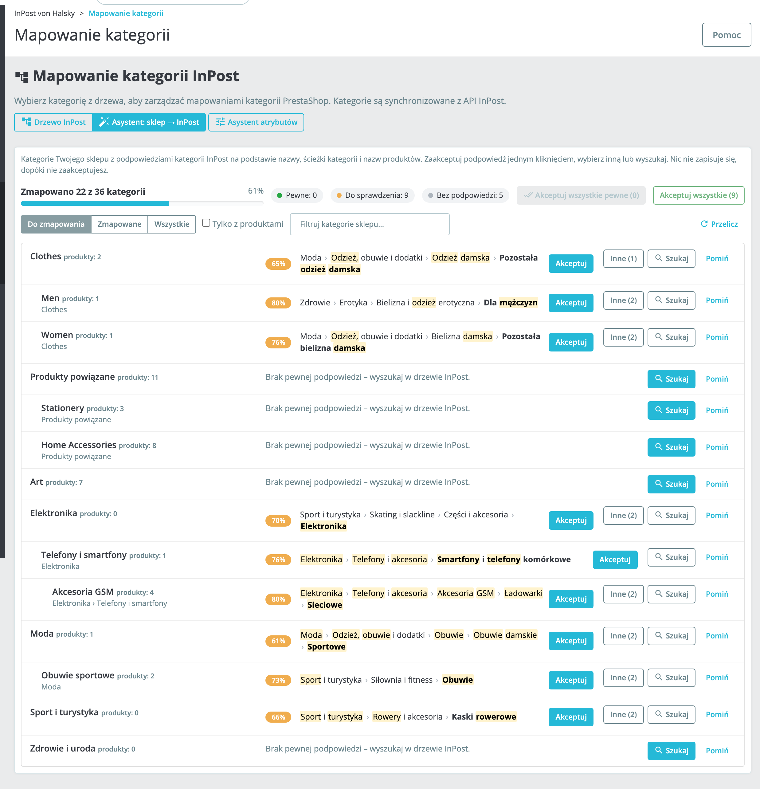

- Każda podpowiedź ma ocenę dopasowania: **pewne** (≥ 85%), **do sprawdzenia** (60–84%) albo brak podpowiedzi.
- **Akceptuj** zapisuje mapowanie, **Inne** pokazuje kolejne propozycje, **Szukaj** otwiera wyszukiwarkę kategorii InPost, **Pomiń** ukrywa kategorię.
- **Akceptuj wszystkie pewne** mapuje hurtowo wszystkie pewne podpowiedzi; **Akceptuj wszystkie** — także te do sprawdzenia.
- Filtry: **Do zmapowania / Zmapowane / Wszystkie**, **Tylko z produktami**, wyszukiwanie po nazwie.

> **Nic nie zapisuje się, dopóki nie zaakceptujesz.** Do sprawdzania podpowiedzi z linii poleceń służy `php bin/console inpost:mapping:suggest`.

### Źródła wartości atrybutów

W panelu szczegółów kategorii, w sekcji **Atrybuty kategorii InPost**, każdemu atrybutowi InPost wskazujesz, **skąd w PrestaShop ma brać wartość**. Tabela pokazuje dla każdego atrybutu typ, czy jest wymagany, **Źródło w PrestaShop** oraz pokrycie wartości słownikowych (np. „dopasowane 12/15”). Ostrzeżenie nad tabelą liczy **wymagane atrybuty bez źródła** — ich wartości trzeba byłoby wpisywać w każdej ofercie.

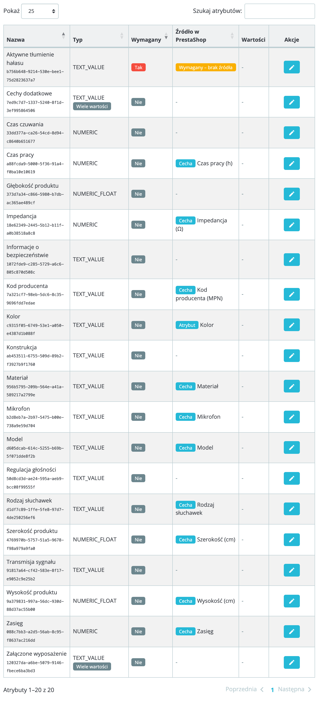

Kliknij ikonę edycji przy atrybucie — otwiera się okno **Źródło wartości**:

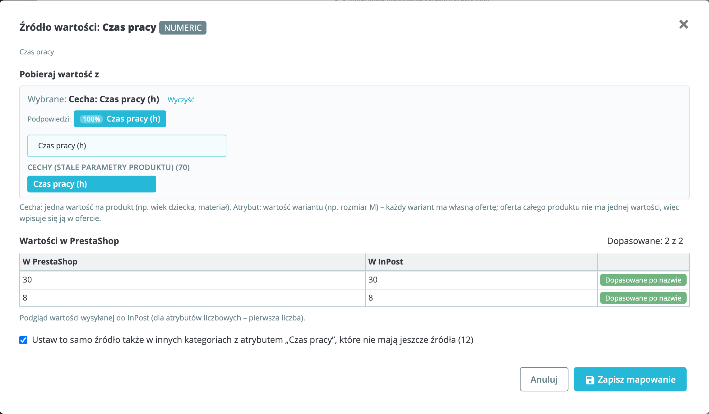

1. **Pobieraj wartość z** — wybierz źródło z listy (z filtrem):
   - **Cechy (stałe parametry produktu)** — np. wiek dziecka, materiał, pojemność,
   - **Atrybuty (kombinacje)** — np. rozmiar, kolor — wartość wariantu oferty,
   - **Pola produktu** — wbudowane pola: indeks, MPN, EAN, UPC, ISBN, indeks dostawcy, marka, nazwa, waga, szerokość, wysokość, głębokość (np. „Kod producenta” ← MPN).
2. **Podpowiedzi** — moduł proponuje źródła o podobnej nazwie (z oceną, np. 100%); źródło o tej samej nazwie jest wybierane od razu (komunikat **Sugestia** — zapisz, aby potwierdzić).
3. **Wartości w PrestaShop** — podgląd, jak wartości sklepu trafią do InPost. Dla atrybutów liczbowych moduł bierze pierwszą liczbę z tekstu (np. „5 lat” → `5`, „ok. 3 kg” → `3`); wartość bez liczby jest oznaczona jako **Niepoprawne**.
4. **Ustaw to samo źródło także w innych kategoriach…** — ten sam atrybut (np. „Rozmiar”) występuje w wielu kategoriach InPost; zaznaczone pole ustawia to samo źródło wszędzie tam, gdzie nie ma jeszcze źródła.
5. **Zapisz mapowanie**.

**Atrybuty słownikowe** (typ *DICTIONARY*) przyjmują tylko wartości z listy InPost. Okno pokazuje każdą wartość sklepu obok opcji InPost:

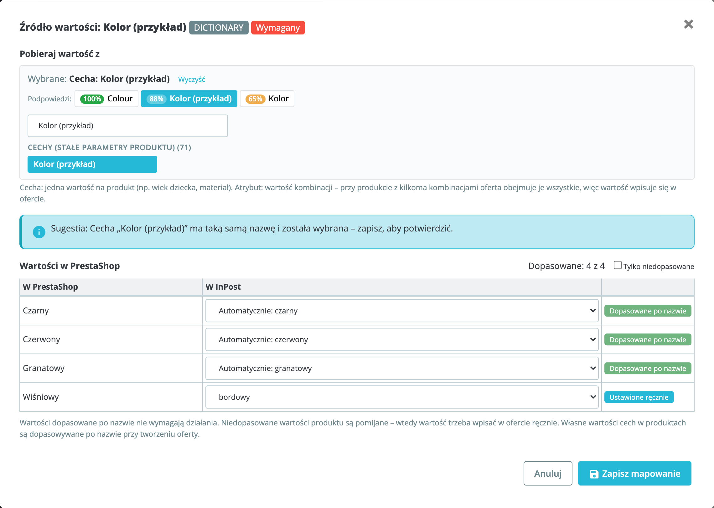

- **Dopasowane po nazwie** — wartość sklepu pasuje do opcji InPost (bez względu na wielkość liter) — nic nie trzeba robić,
- **Ustawione ręcznie** — wybierz opcję InPost dla wartości, której nazwa się różni (np. „Wiśniowy” → „bordowy”),
- **Niedopasowane** — wartość zostanie pominięta w ofercie (filtr **Tylko niedopasowane** pokazuje tylko takie).

Własne (niestandardowe) wartości cech w produktach są dopasowywane po nazwie przy tworzeniu oferty. Opcje słownika wycofane przez InPost nie są już proponowane ani akceptowane.

> **Co się dzieje dalej:** przy tworzeniu oferty (pojedynczo i masowo) wartości zmapowanych atrybutów wypełniają się same. Gdy zmienisz cechę lub kombinację produktu, moduł aktualizuje te wartości w ofertach i wysyła zmianę do InPost — **wartości wpisane ręcznie w ofercie nigdy nie są nadpisywane**.

> **Brak mapowania kategorii = brak możliwości wystawienia oferty.** Mapowanie atrybutów jest opcjonalne, ale wymagany atrybut bez wartości jest **błędem walidacji** — taka oferta nie zostanie wysłana, dopóki wartości nie uzupełnisz.

### Cecha czy atrybut?

- **Cecha (Feature)** — parametr, który produkt ma **jeden**: wiek dziecka, materiał, moc. Produkt prosty (bez kombinacji) z wiekiem dziecka „5 lat” → atrybut InPost „Wiek dziecka” mapujesz na **cechę**.
- **Atrybut (kombinacje)** — to, czym różnią się **warianty**: rozmiar, kolor. Koszulka w 5 rozmiarach to w PrestaShop jeden produkt z 5 kombinacjami; atrybut InPost „Rozmiar” mapujesz na **grupę atrybutów „Rozmiar”**, a każdy wariant staje się [osobną ofertą](#produkty-z-kombinacjami-warianty) z własną wartością.

> Oferta obejmująca **cały produkt** z kombinacjami (wszystkie warianty naraz) nie dostaje wartości atrybutu kombinacji — przy takim polu formularz wyjaśnia, że wartość trzeba wpisać ręcznie.

### Asystent atrybutów

**Mapowanie kategorii → Asystent atrybutów** — atrybuty InPost **wszystkich** zmapowanych kategorii w jednym miejscu, pogrupowane po nazwie (np. „Kolor” z 5 kategorii to jeden wiersz). Dla każdego asystent proponuje cechę, atrybut lub pole produktu sklepu (porównując nazwy i wartości).

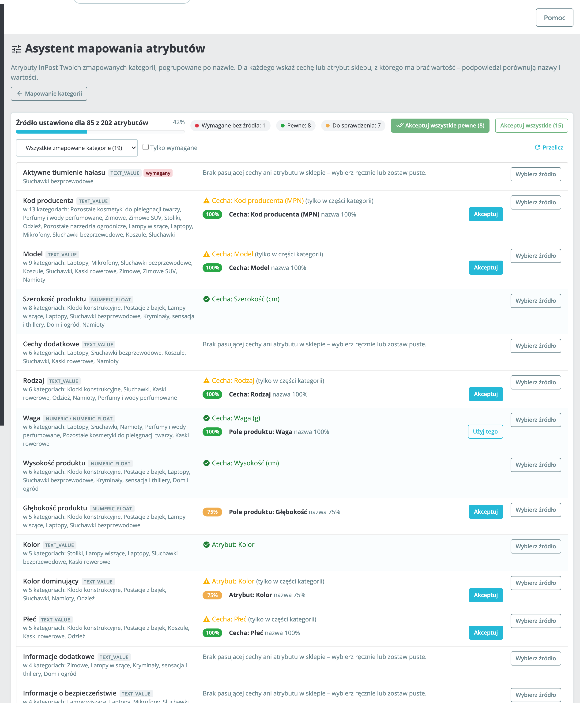

- **Akceptuj** ustawia podpowiedziane źródło we wszystkich kategoriach z tym atrybutem; **Wybierz źródło** — wybór ręczny.
- **Akceptuj wszystkie pewne** / **Akceptuj wszystkie** — hurtowo.
- Filtry: kategoria, **Tylko wymagane**. Pasek postępu pokazuje, ilu atrybutom ustawiono już źródło.

---

## 4 Publikacja oferty

Są dwie ścieżki tworzenia ofert. **Ścieżka A (masowa)** jest szybsza — szkice tworzone są automatycznie z danych produktów PrestaShop.

### Ścieżka A — masowe wystawienie z listy produktów („Wystaw w InPost”)

*Zalecana metoda.*

1. **Katalog → Produkty** — zaznacz produkty do wystawienia (checkboxy).
2. Z listy **Działania masowe** wybierz **„Wystaw w InPost”**. Otworzy się kreator.

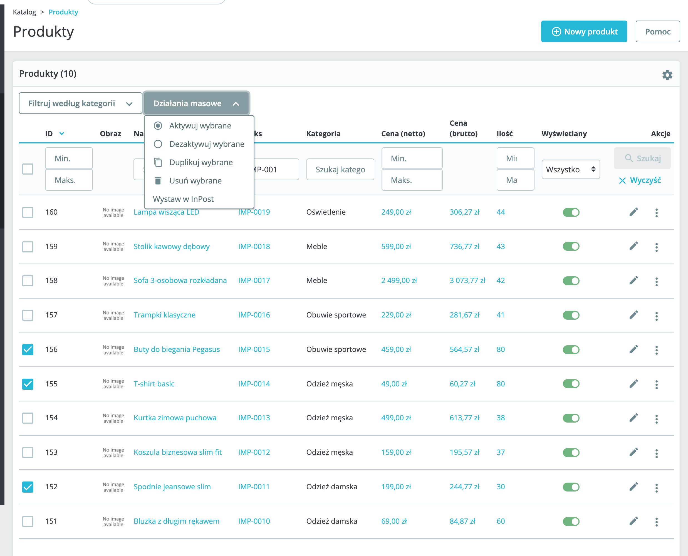

3. Kreator **od razu sprawdza** wybrane produkty i pokazuje listę z checkboxami. Każdy produkt (a produkt z kombinacjami — każdy wariant osobno) dostaje status:
   - **gotowy** — zostanie wystawiony,
   - **ostrzeżenie** — zostanie wystawiony mimo braków (powody w kolumnie *Szczegóły*),
   - **zablokowany** — pominięty.
   Warianty z EAN i stanem są **zaznaczone domyślnie**; checkbox w wierszu produktu zaznacza wszystkie jego warianty. Odznacz to, czego nie chcesz wystawiać. **Sprawdź ponownie** powtarza sprawdzenie (np. po poprawieniu produktu w katalogu).
4. **Utwórz szkice dla zaznaczonych produktów** — moduł tworzy oferty w statusie **DRAFT** w partiach (domyślnie po 25), każdą w osobnej transakcji (pojedynczy błąd nie przerywa reszty). Wyniki możesz skopiować jako CSV.
5. **Opublikuj utworzone oferty w InPost** — osobny krok publikuje utworzone szkice.

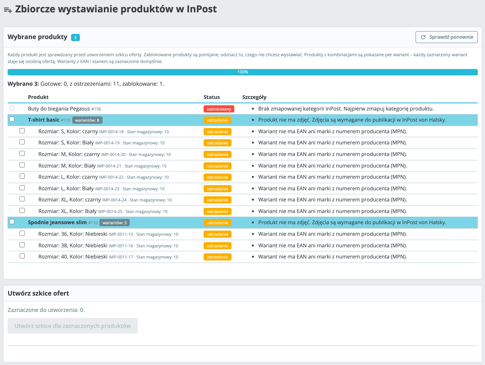

#### Reguły sprawdzenia

**Blokują** utworzenie oferty (*zablokowany*):

- **Oferta dla tego produktu / wariantu już istnieje.**
- **Produkt ma aktywną ofertę obejmującą wszystkie kombinacje** — warianty można wystawić osobno dopiero po jej zamknięciu (ten sam stan nie może sprzedawać się w dwóch ofertach).
- **Brak zmapowanej kategorii InPost.** *Wyjątek:* przy włączonej Productization i dopasowaniu po EAN do zsynchronizowanej kategorii — kategoria zostanie zmapowana automatycznie przy tworzeniu szkiców.

**Tylko ostrzegają** (*ostrzeżenie* — oferta i tak powstanie):

- zmapowana kategoria jest osierocona,
- produkt nie ma zdjęć (wymagane do publikacji),
- produkt / wariant nie ma EAN ani marki z kodem producenta (MPN),
- wariant jest niedostępny (stan 0),
- **wymagane atrybuty InPost bez wartości z PrestaShop** (lista nazw) — uzupełnisz je w szkicu albo zmapujesz na cechy.

### Ścieżka B — ręczne tworzenie pojedynczej oferty

**InPost von Halsky → Oferty → Utwórz nową ofertę**

W polu wyszukiwania wybierz produkt (po nazwie, indeksie lub EAN — min. 2 znaki). Wpisanie **własnego indeksu lub EAN wariantu** otwiera od razu ten wariant; produkt z kombinacjami najpierw pokazuje [listę wariantów](#produkty-z-kombinacjami-warianty).

Formularz oferty jest podzielony na zakładki:

| Zakładka | Co zawiera |
|----------|------------|
| **Szczegóły oferty** | Organizacja, produkt (i wariant — z linkiem **Zmień wariant**), kategoria jako „kategoria sklepu → kategoria InPost” z pełną ścieżką, status walidacji, przełącznik **Oznacz jako roboczy**, status publikacji |
| **Szczegóły produktu** | Nazwa, opis, SKU, EAN, marka, model, super model, kod producenta (MPN), **wymiary (mm) i waga (g)**, cena i stan (tylko odczyt — zawsze z PrestaShop) |
| **GPSR i dane producenta** | Dane producenta i informacje GPSR (dziedziczone z globalnych domyślnych, jeśli puste) |
| **Polityki i wysyłka** | Czas wysyłki (dni), URL produktu, polityka zwrotów i reklamacji (puste = domyślne z konfiguracji) |
| **Atrybuty InPost** | Pola atrybutów wybranej kategorii InPost — z informacją, skąd pochodzi każda wartość |
| **Zdarzenia** | Historia zdarzeń oferty (po wysłaniu do InPost) |

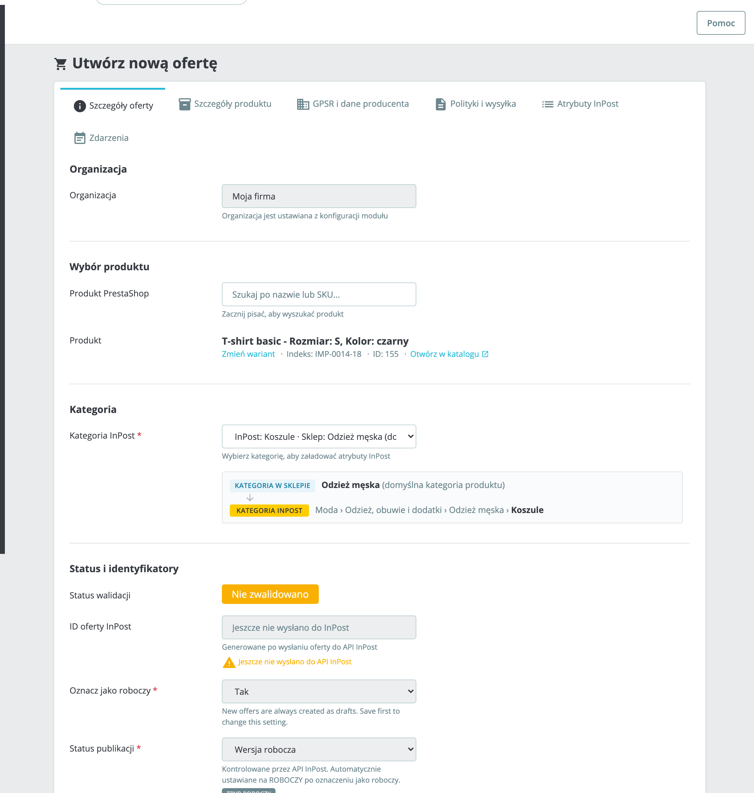

**Zakładka „Atrybuty InPost”.** Pod każdym polem moduł podpowiada, skąd jest wartość albo dlaczego jej brakuje:

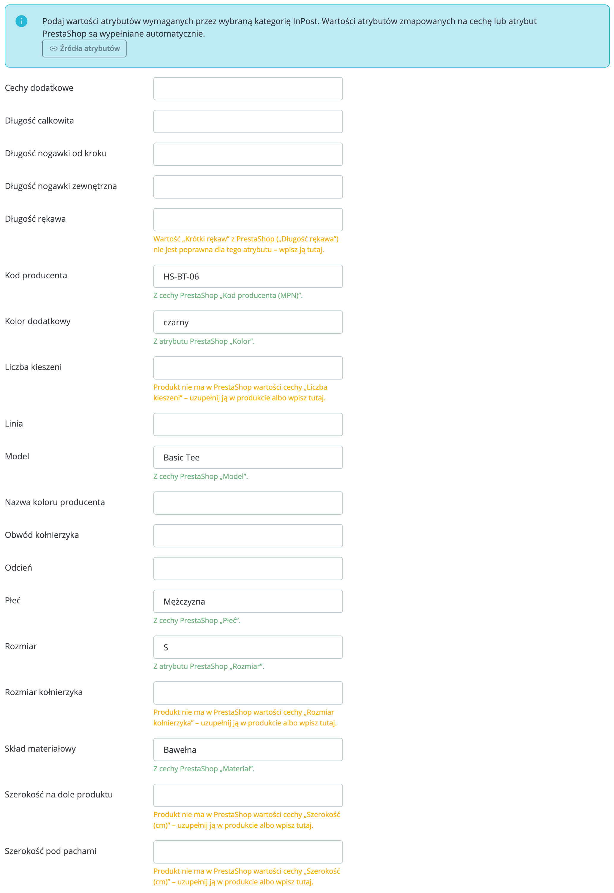

- na zielono: **Z cechy PrestaShop „…”** / **Z atrybutu PrestaShop „…”** — wartość z mapowania,
- na pomarańczowo: produkt nie ma wartości tej cechy, wartość nie pasuje do listy InPost albo nie jest poprawna dla atrybutu (np. tekst w polu liczbowym) — uzupełnij produkt albo wpisz wartość,
- atrybut bez źródła: wymagany — informacja, że źródło można ustawić w Mapowaniu kategorii (przycisk **Źródła atrybutów** otwiera mapowanie tej kategorii),
- wartość z podpowiedzi InPost lub wpisana ręcznie — opisana jako taka.

Atrybuty słownikowe dopuszczające wiele wartości mają pole wielokrotnego wyboru. W edycji oferty przycisk **Pobierz ponownie z PrestaShop** odświeża wartości z mapowania (wartości wpisane ręcznie zostają) — zapisz ofertę, aby je zachować.

> **Jak działa przełącznik „Oznacz jako roboczy”**
> - **Tak (szkic)** — oferta istnieje tylko lokalnie, nie jest wysyłana do InPost. Nowe oferty są **zawsze** tworzone jako szkice (przełącznik jest aktywny dopiero po pierwszym zapisie).
> - **Nie** — po zapisaniu oferta zostaje oznaczona do synchronizacji i wysłana do InPost przez cron `offer_sync`.

### Produkty z kombinacjami (warianty)

Każda kombinacja produktu może być **osobną ofertą InPost** z własnym stanem, ceną (z wpływem kombinacji), SKU, EAN, MPN, zdjęciami kombinacji i wartościami atrybutów (np. rozmiar „M”). Nazwa oferty to „Produkt - Rozmiar: M”, a nazwa produktu trafia do InPost jako *superModel* — grupuje warianty jednego produktu.

Po wybraniu produktu z kombinacjami (Oferty → Utwórz nową ofertę) pojawia się **jeden widok ze wszystkimi wariantami**:

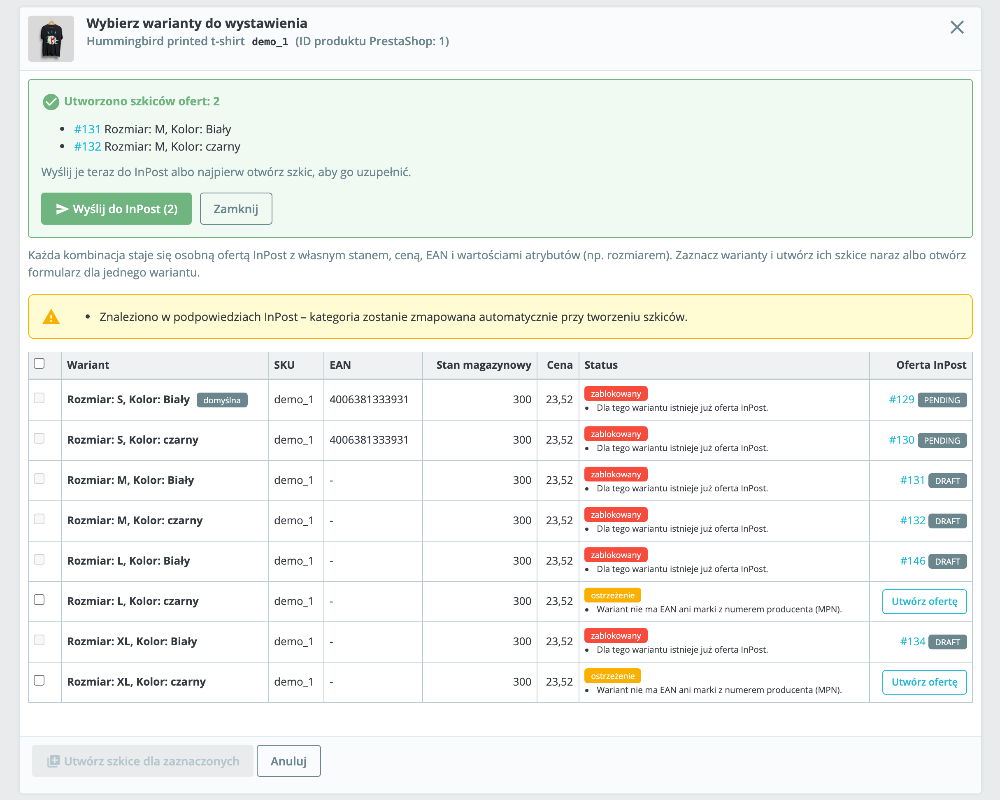

- Tabela pokazuje każdy wariant: SKU, EAN, stan, cenę, **status** (gotowy / ostrzeżenie / zablokowany z powodami) i istniejącą ofertę (link).
- Zaznacz warianty (domyślnie — te z EAN i stanem; **zaznacz wszystkie** w nagłówku) i kliknij **Utwórz szkice dla zaznaczonych** — szkice powstają od razu na tej stronie.
- Po utworzeniu pojawia się panel z listą nowych szkiców: **Wyślij do InPost (N)** wysyła je od razu, **Zamknij** wraca do listy ofert. Oferta, której nie da się wysłać (np. brak wymaganego atrybutu), zostaje szkicem, a powód jest wyświetlony.
- **Utwórz ofertę** przy wariancie otwiera formularz tylko dla niego.
- Na dole: **Zamiast tego jedna oferta na cały produkt** — niezalecane: kupujący nie wybierze wariantu, a oferta dzieli łączny stan wszystkich kombinacji.
- **X** w prawym górnym rogu zamyka widok.

> **Jeden stan nie sprzedaje się dwa razy.** Aktywna oferta na cały produkt blokuje oferty wariantów i odwrotnie; drugiej oferty dla tego samego wariantu nie da się utworzyć.

> **Stan, cena, zamówienia per wariant.** Zmiana stanu lub ceny kombinacji aktualizuje tylko ofertę tego wariantu. Usunięcie kombinacji w PrestaShop ustawia stan jej oferty na 0 (lista ofert pokazuje „Wariant usunięty w PrestaShop”). Zamówienie z InPost trafia do właściwej kombinacji.

### Wysyłanie oferty do InPost

| Przycisk „Wyślij do InPost” | Kreator masowy / widok wariantów | Automatycznie przez cron |
|-----------------------------|----------------------------------|--------------------------|
| W formularzu oferty — zapisz, a następnie kliknij **Wyślij do InPost**. | **Opublikuj utworzone oferty w InPost** w kreatorze lub **Wyślij do InPost (N)** po utworzeniu szkiców wariantów. | Cron `offer_sync` wysyła oferty z wyłączonym „Oznacz jako roboczy” (oznaczone do synchronizacji). |

Przed wysłaniem moduł waliduje ofertę (m.in. wymagane atrybuty, EAN, dane producenta, VAT). Tworzenie oferty w InPost jest **asynchroniczne** — patrz [Command Status](#command-status--status-polecenia-wysłania-oferty).

### Aktualizacja danych opublikowanej oferty

Ceny, stany, cechy i zdjęcia zmieniasz **w katalogu PrestaShop**, a moduł propaguje je automatycznie:

| Co zmienić | Gdzie to zrobić | Jak trafia do InPost |
|------------|-----------------|----------------------|
| **Cena / stan** | Katalog → produkt (lub jego kombinacja) | Hook oznacza ofertę (ofertę wariantu) do synchronizacji → cron `offer_sync`; cena i stan są odczytywane ponownie tuż przed wysłaniem |
| **Cechy / kombinacje** | Katalog → produkt | Wartości atrybutów z mapowania są aktualizowane (wpisane ręcznie zostają) |
| **Zdjęcia** | Katalog → produkt → zdjęcia | Oferta oznaczona do ponownej synchronizacji (oferta wariantu — zdjęcia kombinacji) |
| **Pozostałe pola oferty** | **InPost von Halsky → Oferty → edycja** | Zapis z wyłączonym „Oznacz jako roboczy” oznacza ofertę do synchronizacji |

> Zdjęcia muszą być dostępne pod adresem **HTTPS** — obrazy po HTTP InPost odrzuca. Na środowiskach testowych pomocny jest panel **Testowe podmienianie zdjęć** (patrz [Ustawienia dodatkowe](#10-ustawienia-dodatkowe)).

### Zmiana kategorii oferty

Istniejącą ofertę można przenieść do innej kategorii InPost: w edycji oferty kliknij **Zmień kategorię** przy kategorii.

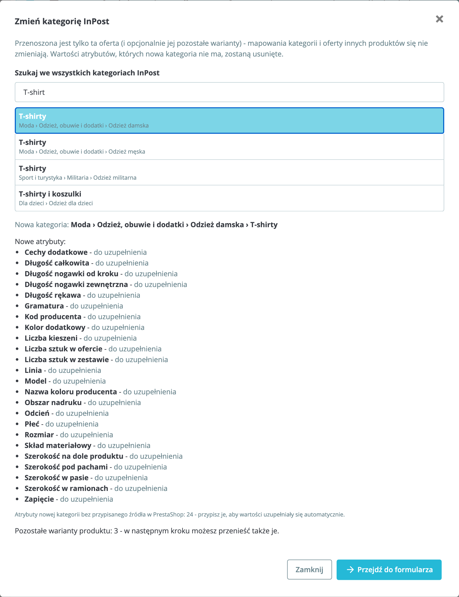

1. Wyszukaj kategorię (wszystkie aktywne kategorie końcowe InPost — powiązane z kategoriami produktu albo znalezione po nazwie).
2. Okno pokazuje, co się stanie z atrybutami: wartości **usuwane** (nowa kategoria ich nie ma), **zachowywane** i **nowe** atrybuty (uzupełnione z PrestaShop / katalogu InPost albo do uzupełnienia).
3. **Przejdź do formularza** — formularz pokazuje ofertę w nowej kategorii; zmiana zapisuje się dopiero przyciskiem **Zaktualizuj ofertę** — do tego czasu nic się nie zmienia.
4. Opcjonalnie w formularzu: **Przenieś też pozostałe warianty tego produktu** (ich atrybuty uzupełniają się automatycznie; wariant z brakującą wartością wymaganą nie zostanie wysłany, dopóki go nie uzupełnisz) oraz **Powiąż też kategorię sklepu „…” z nową kategorią InPost** (domyślna kategoria produktu; dotyczy tylko ofert tworzonych później — oferty innych produktów się nie zmieniają).

> Zmiana nie jest możliwa, gdy oferta czeka na wynik weryfikacji InPost (PENDING). Gdy InPost już ją odrzucił w walidacji (oferta PENDING z błędami walidacji, np. `CATEGORY_INCORRECT`), kategorię można zmienić — odrzucenie widać na liście **Błędy walidacji InPost**. Mapowania kategorii i oferty innych produktów się nie zmieniają; zmiana jest zapisywana w logu PrestaShop.

### Lista ofert i usuwanie

**InPost von Halsky → Oferty** — lista ofert z filtrami statusu i kategorii InPost, wyszukiwaniem (nazwa produktu, SKU, EAN) i wyborem liczby ofert na stronę (20 / 50 / 100). Akcje na zaznaczonych ofertach — **Zamknij zaznaczone**, **Otwórz ponownie zaznaczone**, **Usuń zaznaczone**, [edytuj atrybuty](#masowa-edycja-atrybutów) i [Ustaw cenę](#cena-oferty-i-masowa-zmiana-ceny) — wracają do listy z tymi samymi filtrami. Przyciski zamykania i wznawiania liczą i wysyłają tylko zaznaczone oferty o pasującym statusie (zamknąć można oferty opublikowane i wyprzedane, wznowić — zamknięte); w pozostałych przypadkach są nieaktywne. Oferty wariantów mają opis „Produkt PS #… · wariant: …”.

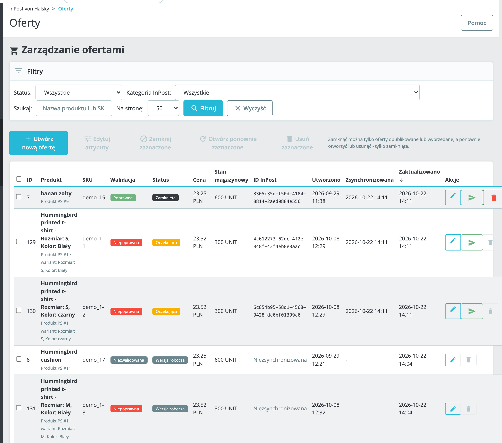

**Usuwanie.** Usunąć można **tylko oferty zamknięte (CLOSED)** — przyciskiem w wierszu, zaznaczając kilka i klikając **Usuń zaznaczone**, albo przyciskiem **Usuń** w edycji oferty. Przycisk usuwania każdej innej oferty jest nieaktywny, a usuwanie zbiorcze takie oferty pomija. Dotyczy to też szkiców i ofert ze statusem ERROR_NOT_CREATED.

**Zamknięta oferta istniejąca w InPost** — InPost nie pozwala usunąć oferty, więc jest usuwana **tylko z modułu**: w InPost pozostaje zamknięta, a jej stan i cena przestają być aktualizowane. Okno potwierdzenia mówi to wprost; każde takie usunięcie jest zapisywane w logu z identyfikatorem oferty InPost.

> **Chcesz zakończyć sprzedaż?** Najpierw **zamknij** ofertę (Close), dopiero potem ją usuń. Zamówienia z usuniętej oferty nadal trafiają do właściwego produktu.

### Masowa edycja atrybutów

Zmienia wartości atrybutów kategorii InPost (np. „Długość blatu”, „Kod producenta”, „Kolor”) w wielu ofertach naraz — bez otwierania każdej oferty. W jednym przebiegu można zmienić kilka atrybutów, każdy inną operacją, i od razu ustawić ich źródło w PrestaShop.

#### Krok 1 — zaznacz oferty

1. **InPost von Halsky → Oferty**. Zawęź listę filtrami: **Kategoria InPost**, **Status**, **Szukaj** (nazwa, SKU, EAN) i **Na stronę** (20 / 50 / 100).
2. Zaznacz oferty w pierwszej kolumnie (checkbox w nagłówku zaznacza całą stronę). Można łączyć oferty z różnych kategorii.
3. Kliknij **Edytuj atrybuty (N)** — N to liczba zaznaczonych ofert.

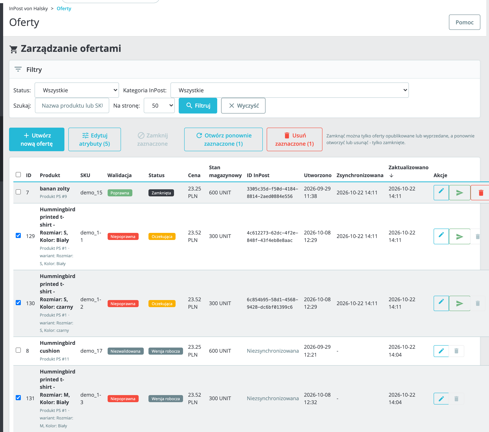

> Jednorazowo: do **200 ofert** i do **20 atrybutów**.

#### Krok 2 — wybierz atrybuty i operacje

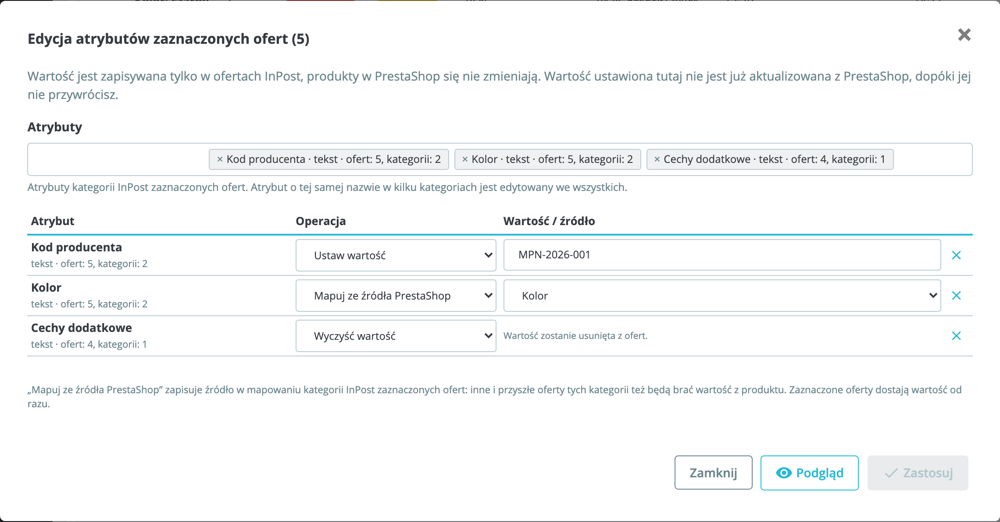

W polu **Atrybuty** wybierz jeden lub kilka atrybutów (pole ma wyszukiwarkę). Lista zawiera atrybuty kategorii InPost zaznaczonych ofert; przy każdym widać typ (*lista*, *liczba*, *liczba całkowita*, *tekst*, *link*, *data*), w ilu ofertach i kategoriach występuje oraz czy jest **wymagany**.

> InPost definiuje atrybut osobno w każdej kategorii. Atrybut o **tej samej nazwie i typie** w kilku kategoriach (np. „Kod producenta”) jest na liście jedną pozycją i zmienia się we wszystkich tych kategoriach. Ta sama nazwa z innym typem jest osobną pozycją.

Każdy wybrany atrybut dostaje wiersz z własną **operacją** (✕ usuwa wiersz):

| Operacja | Co robi | Co podajesz |
|---|---|---|
| **Ustaw wartość** | Wpisuje tę samą wartość do wszystkich ofert. Wartość staje się *ręczna* — synchronizacja z PrestaShop jej nie nadpisuje. | Pole zależne od typu: lista wartości InPost (przy atrybutach wielowartościowych wybór kilku — zastępują dotychczasowe), liczba całkowita, liczba (przecinek lub kropka), link, data, tekst (do 1024 znaków). |
| **Wyczyść wartość** | Usuwa wartość z ofert; atrybut znika z oferty w InPost. W module zostaje pusta wartość *ręczna*, żeby synchronizacja z PrestaShop nie uzupełniła jej ponownie. | — (niedostępne dla atrybutów wymaganych) |
| **Przywróć z PrestaShop** | Usuwa wartość ręczną — oferta znów bierze wartość ze źródła zmapowanego dla kategorii (cecha / atrybut / pole produktu). | — |
| **Mapuj ze źródła PrestaShop** | Zapisuje źródło w **mapowaniu kategorii InPost** zaznaczonych ofert i od razu wpisuje do ofert wartość z ich produktów (jako wartość *z PrestaShop*). | Źródło z listy: **Cechy**, **Atrybuty**, **Pola produktu** (np. MPN, EAN, waga). Podpowiadane jest źródło wspólne dla kategorii albo dopasowane po nazwie. |

> **Mapuj ze źródła PrestaShop zmienia mapowanie kategorii**, a nie tylko zaznaczone oferty: z tego źródła będą korzystać także pozostałe i przyszłe oferty tych kategorii InPost (to samo ustawienie co w [Źródłach wartości atrybutów](#źródła-wartości-atrybutów)). Wartości słownikowe są dopasowywane po nazwie; ręczne przypisanie wartości PrestaShop do wartości z listy InPost robi się w oknie źródła w **Mapowaniu kategorii**.

**Ustaw czy mapuj?** *Ustaw* — gdy wartość jest wspólna dla zaznaczonych ofert (np. „Materiał blatu: dąb” dla całej serii). *Mapuj* — gdy wartość jest różna dla każdego produktu i trzymasz ją w PrestaShop (MPN, kolor wariantu, wymiary).

#### Krok 3 — podgląd

**Podgląd** pokazuje skutki zmian — na tym etapie nic się nie zapisuje.

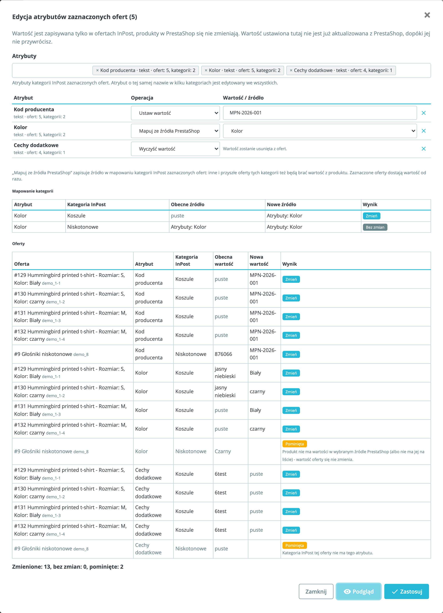

- **Mapowanie kategorii** (tylko przy *Mapuj ze źródła PrestaShop*) — dla każdej kategorii InPost obecne i nowe źródło. Przy źródle widać jego rodzaj (*Cechy*, *Atrybuty*, *Pola produktu*), bo nazwy mogą się powtarzać — np. cecha i pole produktu „Kod producenta (MPN)”.
- **Oferty** — wiersz na każdą ofertę i atrybut: obecna wartość (dopisek *z PrestaShop*, gdy pochodzi z mapowania), nowa wartość i wynik: **Zmiana**, **Bez zmian** albo **Pominięta** z powodem.

| Powód pominięcia | Co zrobić |
|---|---|
| Oferta jest weryfikowana przez InPost | Poczekaj na koniec weryfikacji. Oferty odrzucone w walidacji (status PENDING z błędami) można edytować. |
| Kategoria InPost tej oferty nie ma tego atrybutu | Nic — ta oferta go nie potrzebuje. |
| Wartości „…” nie ma na liście w tej kategorii | Listy wartości różnią się między kategoriami — edytuj te oferty osobno, z wartością z ich listy. |
| Wartość „…” jest niepoprawna dla tego atrybutu | Np. tekst w polu liczbowym — popraw wartość. |
| W kategorii tej oferty atrybut przyjmuje tylko jedną wartość | Wybierz jedną wartość. |
| Atrybut jest wymagany — nie można go wyczyścić | Ustaw inną wartość zamiast czyszczenia. |
| Atrybut nie ma zmapowanego źródła w PrestaShop | Użyj *Mapuj ze źródła PrestaShop* zamiast *Przywróć*. |
| Produkt nie ma wartości w wybranym źródle | Mapowanie kategorii i tak się zapisze, a oferta zachowuje dotychczasową wartość. Uzupełnij produkt w PrestaShop i dla tych ofert użyj **Przywróć z PrestaShop**. |
| Oferta nie ma kategorii InPost | Ustaw kategorię w edycji oferty. |

Pod tabelą jest podsumowanie: *Zmienione / bez zmian / pominięte*. Każda zmiana w formularzu czyści podgląd — **Zastosuj** jest aktywne dopiero po podglądzie z co najmniej jedną zmianą.

#### Krok 4 — zastosuj

1. **Zastosuj** pyta o potwierdzenie (liczba zmian i zmienianych mapowań). Przy zapisie wszystko jest sprawdzane jeszcze raz.
2. Lista ofert przeładowuje się z tymi samymi filtrami i pokazuje komunikaty: ile wartości zmieniono w ilu ofertach, ile ofert zostanie wysłanych do InPost, w ilu atrybutach kategorii zapisano źródło i ile ofert pominięto.
3. Oferty istniejące w InPost są wysyłane przez cron synchronizacji ofert w ciągu kilku minut (zob. [Wysyłanie oferty do InPost](#wysyłanie-oferty-do-inpost)); po wysłaniu InPost może ofertę ponownie zweryfikować. **Szkice** zmieniają się tylko w module — trafią do InPost przy publikacji.

> **Bez cofania.** Każda operacja jest zapisywana w logu PrestaShop (**Zaawansowane → Logi**: atrybut, operacja, oferty, zmienione mapowania). Wartość ręczną cofasz operacją **Przywróć z PrestaShop** albo ustawiając poprzednią wartość. Produkty w PrestaShop nigdy się nie zmieniają.

### Cena oferty i masowa zmiana ceny

Cena wysyłana do InPost wynika z ustawień [Ceny w InPost](#ceny-w-inpost) (cena sklepu lub grupy klientów, zmiana procentowa, zaokrąglenie). Dla pojedynczej oferty albo dla wielu ofert naraz możesz ją ustawić ręcznie. **Ceny w sklepie się nie zmieniają.**

**W formularzu oferty** — pole **Cena InPost**:

- **Automatyczna — ze sklepu** — cena z ustawień modułu; formularz pokazuje **Cenę w sklepie** i **Aktualną cenę w InPost**,
- **Ręczna** — wpisujesz **Cenę ręczną (brutto)** (kwota większa od 0, np. 99,99). Jest wysyłana dokładnie taka — zmiany ceny w sklepie i ustawienia cen modułu jej nie dotyczą, dopóki nie wrócisz do ceny automatycznej.

Zmiana ceny wchodzi do InPost przy najbliższej synchronizacji ofert.

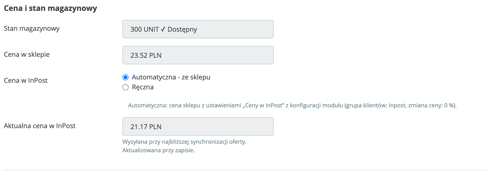

**Na liście ofert** — zaznacz oferty i kliknij **Ustaw cenę**. Okno oferuje trzy operacje:

| Operacja | Efekt |
|----------|-------|
| **Cena ręczna — taka sama dla wszystkich ofert** | Wszystkie zaznaczone oferty dostają wpisaną cenę brutto |
| **Cena ręczna — cena sklepu każdej oferty zmieniona o procent** | Cena sklepu każdej oferty ± procent (np. `5` lub `-3,5`), zapisana jako cena ręczna |
| **Cena automatyczna — ze sklepu z ustawieniami cen modułu** | Powrót do ceny automatycznej |

Podgląd pokazuje **aktualną** i **nową cenę** każdej oferty (albo powód pominięcia, np. produkt już nie istnieje w PrestaShop); potwierdzenie zawiera liczbę ofert, a oferty istniejące w InPost są tam wysyłane w ciągu kilku minut. W kolumnie ceny oferty z ceną ręczną są oznaczone słowem „ręczna”, a gdy cena różni się od ceny sklepu, widać też „sklep: …”.

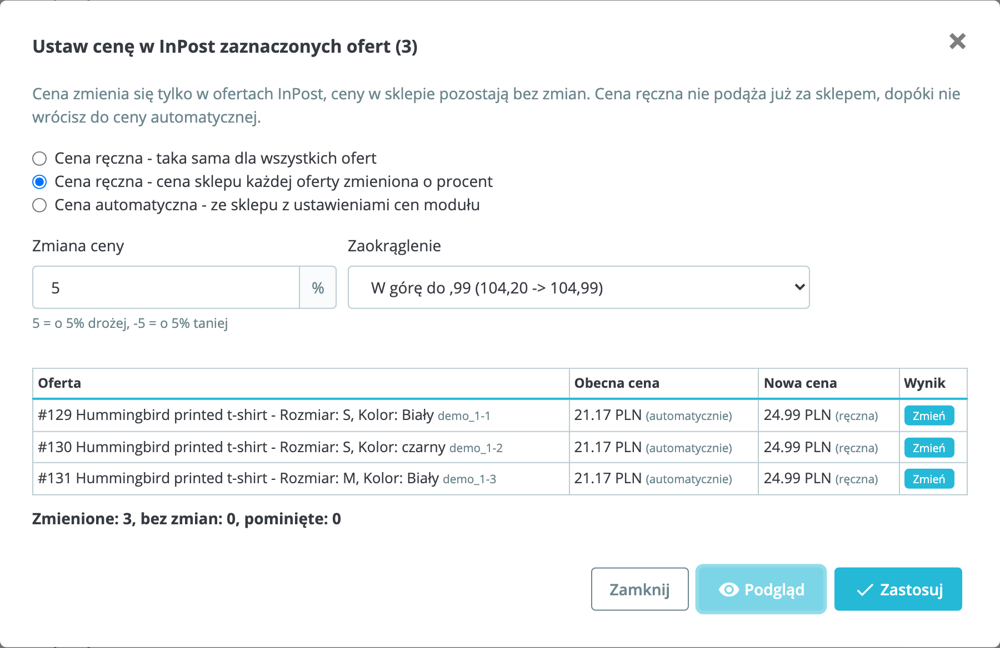

### Załączniki ofert

W formularzu oferty zakładka **Załączniki** (*Attachments*) pozwala dodać dokumenty pokazywane przy ofercie w InPost: instrukcje obsługi, etykiety energetyczne, certyfikaty, informacje o bezpieczeństwie i inne. Dozwolone są pliki **PDF, JPG lub PNG do 10 MB** (obrazy muszą mieć co najmniej 50×50 px i 1 kB).

1. Wybierz **Typ załącznika**: *Instrukcja obsługi*, *Instrukcja montażu*, *Etykieta energetyczna*, *Etykieta produktu*, *Certyfikat*, *Karta specyfikacji produktu*, *Karta gwarancyjna*, *Tabela rozmiarów*, *Dokument (np. informacje o bezpieczeństwie)* lub *Inne*.
2. Dodaj plik: **Własny plik** (z komputera) albo **Plik z PrestaShop** — jeden z plików dołączonych do produktu w **Katalog → Pliki**.
3. Kliknij **Dodaj plik**. Plik pojawia się na liście ze statusem.

| Status | Znaczenie |
|--------|-----------|
| **Oczekujące na wysłanie** | Plik czeka w kolejce (np. oferta jeszcze nie istnieje w InPost) |
| **Wysyłanie…** | InPost przetwarza plik |
| **W InPost** | Plik jest dołączony do oferty |
| **Błąd** | Powód zwrócony przez InPost lub walidację — popraw plik i użyj **Wyślij ponownie** |
| **Usuwanie…** | Plik jest usuwany w InPost |

- **Szkice:** dodane pliki czekają i są wysyłane automatycznie, gdy oferta zostanie utworzona w InPost.
- **Usuwanie** załącznika usuwa go także z oferty w InPost. Jeśli InPost jeszcze nie może go usunąć (np. trwa wysyłka), usunięcie jest ponawiane automatycznie.
- Oferta nie może mieć dwóch załączników o tej samej nazwie pliku (InPost zastąpiłby poprzedni) — zmień nazwę pliku albo usuń drugi.
- Wysyłkę kolejki, sprawdzanie wgranych plików i ponowienia usuwania wykonuje zadanie cron `offer_attachment_sync` (co 3 min).
- Diagnostyka: komenda `inpost:offer:attachments <id_oferty>` pokazuje załączniki modułu obok tych z InPost; `--sync` przetwarza kolejkę, `--add=PLIK --type=TYP` dodaje plik, `--remove=ID` usuwa.

> Pliki wgrane z komputera są zapisywane w katalogu `download/inpostvonhalsky/` sklepu. Limit rozmiaru wgrywanego pliku może być niższy niż 10 MB, jeśli ogranicza go konfiguracja PHP serwera (`upload_max_filesize`, `post_max_size`).

---

## 5 Odbiór zamówień

**InPost von Halsky → Zamówienia**

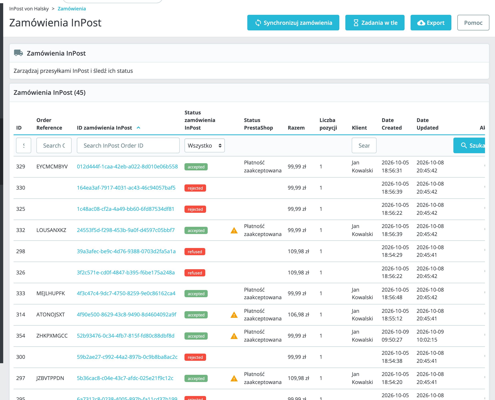

**Jak zamówienia trafiają do sklepu:**

- **Zdarzenia zamówień** (domyślnie co 15 min) — każde uruchomienie czyta wszystkie zdarzenia od poprzedniego i od razu synchronizuje zamówienia, których dotyczą. Nowe zaakceptowane zamówienie dostaje zamówienie w sklepie w ciągu jednego interwału; anulowane / odrzucone w InPost anuluje zamówienie w sklepie. Przełącznik **Twórz zamówienia z eventów** (domyślnie włączony) — po wyłączeniu zdarzenia tylko odświeżają już zaimportowane zamówienia, a nowe czekają na import.
- **Import zamówień** (domyślnie co 10 min) — przyrostowy: czyta zamówienia zmienione w InPost od ostatniego pełnego przebiegu; raz dziennie całą historię jako zabezpieczenie; za każdym razem ponawia do 10 zamówień jeszcze bez zamówienia w sklepie. **Zakres importu**: *Ciągły* (domyślnie) albo *Stałe okno* — zawsze zamówienia zmienione w ostatnich N dniach (domyślnie 30), stare nigdy nie są importowane.
- Przycisk **Synchronizuj zamówienia** wymusza import ręcznie (działa ok. 25 s; resztę dokończy następne kliknięcie lub cron). Import ręczny i cron nigdy nie działają jednocześnie. **Zadania w tle** pokazują postęp.

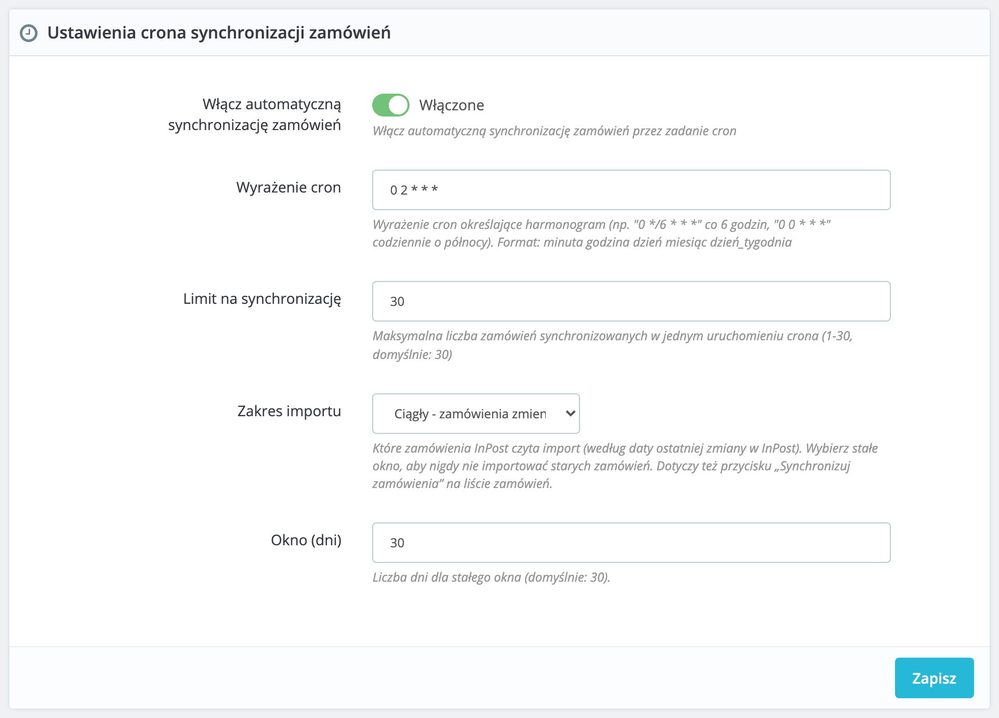

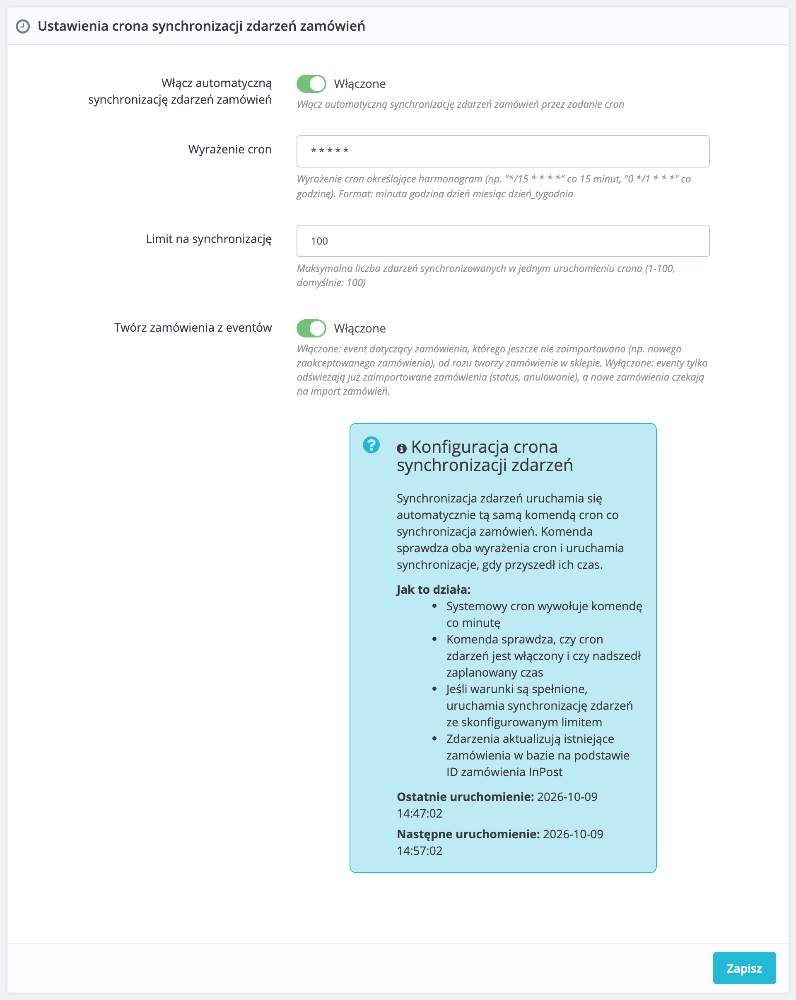

### Kolumny listy zamówień

| Kolumna | Opis |
|---------|------|
| ID | Identyfikator wewnętrzny |
| Order Reference | Numer zamówienia PrestaShop |
| ID zamówienia InPost | Identyfikator zamówienia w InPost (odnośnik do szczegółów) |
| Status zamówienia InPost | Status po stronie InPost |
| Status PrestaShop | Status zamówienia w sklepie; **ikona ostrzeżenia** z opisem, gdy zamówienie nie jest w PLN, ma pozycje bez VAT, produkty nieznalezione w sklepie lub sumę różną od InPost |
| Razem / Liczba pozycji | Wartość i liczba pozycji |
| Klient | Kupujący |
| Date Created / Updated | Daty |

Pasek narzędzi: **Synchronizuj zamówienia**, **Zadania w tle**, **Export** (CSV). Lupa w wierszu otwiera szczegóły.

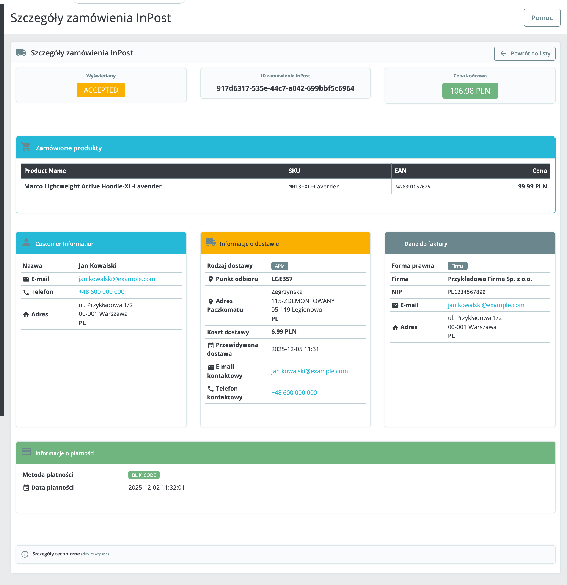

Szczegóły zawierają: zamówione produkty, dane klienta, **dostawę** (paczkomat / kurier, punkt odbioru, adres, koszt, przewidywaną datę), **Dane do faktury** (gdy kupujący poprosił o fakturę) oraz płatność.

> **Jak tworzone jest zamówienie PrestaShop.**
> - **Produkty i warianty** — pozycja zamówienia jest dopasowywana kolejno: po ofercie modułu, po `externalId` oferty (`ps_product_{id}` lub `ps_product_{id}_{kombinacja}`), po własnym indeksie kombinacji, po indeksie produktu. Pozycja, której nie da się dopasować, trafia na produkt zastępczy, a lista takich pozycji jest zapisywana w prywatnej notatce zamówienia.
> - **Ceny** — dokładnie z InPost (w tym **koszt dostawy InPost** w kosztach wysyłki zamówienia), więc suma zamówienia w sklepie zgadza się z InPost. Zamówienie powstaje także przy stanie 0 (jest już opłacone).
> - **Stany** — statusy InPost są mapowane na stany zamówień PrestaShop (opłacone, wysłane, dostarczone, anulowane).
> - Powód, dla którego zamówienie w sklepie nie powstało, jest zapisywany i widoczny w panelu statusu i zadaniach w tle.

### Dane do faktury i adresy

- **Adres dostawy nigdy nie jest adresem do faktury.**
- Gdy kupujący poprosił o fakturę, zamówienie dostaje osobny adres **„InPost Invoice”** z nazwą firmy, **NIP** (z prefiksem kraju, jeśli podany) i adresem do faktury — faktura PrestaShop jest wystawiana na firmę. E-mail do faktury trafia do prywatnej notatki zamówienia.
- Bez danych do faktury adresem do faktury jest adres klienta z InPost (adres **„InPost Customer”**).
- Numer mieszkania z adresów InPost trafia do drugiej linii adresu.
- Zamówienie, dla którego nie da się utworzyć adresu dostawy lub faktury, nie jest tworzone (czytelny błąd, ponowienie przy następnym przebiegu).

### Płatność InPost

Zamówienia z InPost są zapisywane z ukrytą metodą płatności **„InPost von Halsky”** — nigdy nie jest oferowana w koszyku sklepu i nie zależy od Twoich modułów płatności. Na zamówieniu i fakturze widać, jak kupujący zapłacił: „InPost - BLIK”, „InPost - Karta”, „InPost - Google Pay”, „InPost - Apple Pay”, „InPost - Pay by link”, „InPost - Limit zakupowy”, „InPost - Płatność odroczona”, „InPost - Za pobraniem”. Identyfikator płatności InPost jest zapisywany jako numer transakcji.

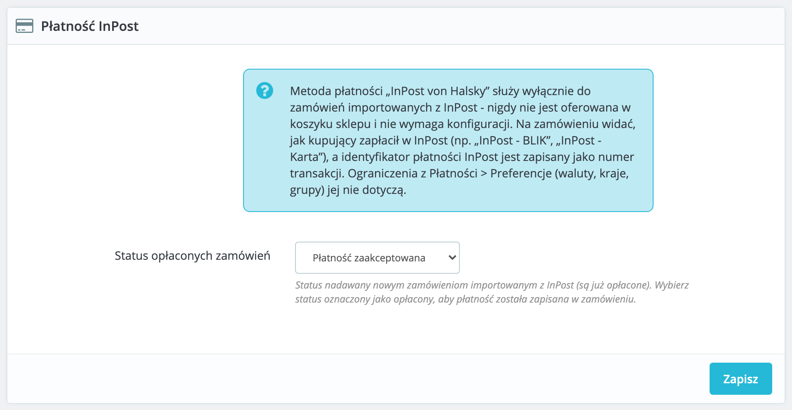

- **Status opłaconych zamówień** (grupa **Wysyłka i płatność**) — status nowych zamówień z InPost (domyślnie *Płatność zaakceptowana*).
- Zamówienia **za pobraniem** dostają status *Oczekiwanie na płatność przy odbiorze* (bez zapisanej płatności).

> **Wyłączanie e-maili do klienta.** InPost sam powiadamia kupującego. Aby PrestaShop nie wysyłał zdublowanych e-maili, włącz **Wstrzymuj e-maile do klientów dla zamówień InPost** (grupa **E-maile**) — patrz [Ustawienia dodatkowe](#10-ustawienia-dodatkowe).

---

## 6 Statusy ofert — co dalej

| Status | Znaczenie | Następna akcja |
|--------|-----------|----------------|
| **DRAFT** (Wersja robocza) | Oferta lokalna, niesynchronizowana z API | Uzupełnij pola i wyłącz „Oznacz jako roboczy” albo kliknij **Wyślij do InPost** |
| **PENDING** (Oczekująca) | Wysłano do InPost; InPost tworzy / weryfikuje ofertę | Poczekaj — cron zdarzeń i poller poleceń zaktualizują status |
| **PUBLISHED** (Aktywna w InPost) | Oferta widoczna dla kupujących | Aktualizuj ceny / stany w PrestaShop — cron wyśle zmiany automatycznie |
| **REJECTED** (Odrzucona przez InPost) | Oferta odrzucona przez moderację / walidację InPost | Otwórz ofertę → sprawdź **błędy walidacji InPost** → popraw → wyślij ponownie |
| **SOLDOUT** (Wyprzedana) | Stan magazynowy = 0 | Uzupełnij stan w PrestaShop — cron zaktualizuje ofertę |
| **CLOSED** (Zamknięta) | Oferta zamknięta | **Otwórz ponownie ofertę**, jeśli chcesz wznowić sprzedaż |
| **ERROR_NOT_CREATED** (Nieutworzona — błąd) | Tworzenie oferty nie powiodło się mimo ponowień | Popraw dane i wyślij ponownie (patrz Command Status) |

> **Status walidacji** jest osobny od statusu oferty: na liście ofert i w formularzu widać, czy oferta jest **Poprawna** / **Niepoprawna** (lokalna walidacja przed wysłaniem — m.in. wymagane atrybuty) oraz błędy walidacji zwrócone przez InPost.

### Zamknięcie i wznowienie oferty (Close / Reopen)

- **Zamknij ofertę** — dla oferty **PUBLISHED** albo **SOLDOUT**. Wysyła żądanie zamknięcia do API; status zostanie zaktualizowany z API.
- **Otwórz ponownie ofertę** — dla oferty **CLOSED**. Wznawia sprzedaż bez tworzenia nowej oferty.

Oba przyciski są w formularzu oferty i wymagają, aby oferta była wcześniej wysłana do InPost. Na liście ofert te same akcje działają zbiorczo (**Zamknij zaznaczone**, **Otwórz ponownie zaznaczone**). Tylko zamkniętą ofertę można usunąć (zob. [Lista ofert i usuwanie](#lista-ofert-i-usuwanie)).

### Command Status — status polecenia wysłania oferty

Tworzenie oferty w InPost jest **asynchroniczne**: po wysłaniu moduł zapisuje identyfikator polecenia i pilnuje jego zakończenia:

| Command Status | Znaczenie |
|----------------|-----------|
| **PENDING** | Polecenie wysłane — InPost jeszcze je przetwarza |
| **SUCCESS** | InPost potwierdził utworzenie oferty — status oferty zaktualizuje się automatycznie |
| **FAILURE** | InPost odrzucił polecenie — oferta **nie powstała**; powód jest zapisany przy ofercie |

#### Automatyczne ponawianie prób

Zadanie **pending_command_sync** (domyślnie co 3 min) monitoruje polecenia PENDING. Przy **FAILURE** czyści identyfikatory (oferta nie istnieje), zwiększa licznik prób i ponownie wysyła polecenie — maksymalnie **3 razy** (ustawienie **Maks. liczba ponowień tworzenia**). Błędy przejściowe (sieć/HTTP) nie zużywają prób. Oferty z trwałym błędem API (np. błędne dane) nie są wysyłane ponownie przy każdym przebiegu crona — wznowi je edycja lub ręczne wysłanie.

#### Status ERROR_NOT_CREATED

Po wyczerpaniu prób oferta dostaje status **ERROR_NOT_CREATED**. Zostaje w PrestaShop i wymaga interwencji:

1. Sprawdź powód (pole błędu przy ofercie, panel statusu, `var/logs/inpost.log`). Najczęściej: zdjęcia niedostępne po **HTTPS**, zbyt długie wartości pól, niekompletny adres producenta.
2. Popraw dane oferty.
3. Wyślij ponownie (lub wyłącz „Oznacz jako roboczy” i zapisz).

---

## 7 Status integracji i zadania w tle

**InPost von Halsky → Status** — jedna strona, która mówi, czy integracja działa i co poprawić. Nie łączy się z API InPost (pokazuje dane lokalne).

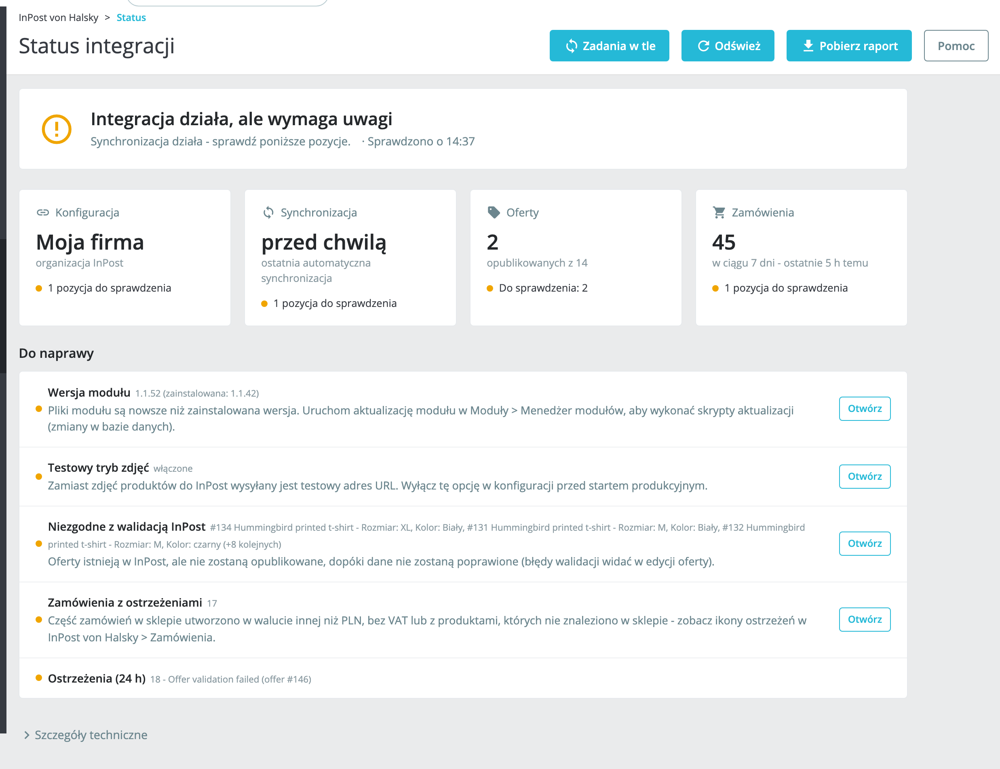

- **Baner** — ogólny stan (działa / wymaga uwagi / nie działa).
- **Kafelki** — konfiguracja (organizacja), synchronizacja (ostatni przebieg crona), oferty (opublikowane / wszystkie), zamówienia (7 dni).
- **Do naprawy** — konkretne pozycje z przyciskiem **Otwórz**, np.: niezgodna wersja modułu (uruchom aktualizację), włączone testowe podmienianie zdjęć, oferty niezgodne z walidacją InPost, zamówienia z ostrzeżeniami (waluta, VAT, nieznalezione produkty), liczba ostrzeżeń z ostatnich 24 h.
- **Szczegóły techniczne** (rozwijane) — środowisko (wersje, rozszerzenia PHP, SSL), połączenie InPost, harmonogram zadań (ostatnie/następne uruchomienie, czas trwania, wynik), kategorie i atrybuty, oferty, zdarzenia, zamówienia, najczęstsze błędy.
- **Pobierz raport** — eksport stanu do JSON (bez haseł i tokenów) do przekazania wsparciu.

Błędy i ostrzeżenia modułu są dodatkowo zapisywane w **dzienniku błędów** (30 dni) — panel liczy je i grupuje.

**Zadania w tle** (przycisk na stronie statusu i na liście zamówień) pokazują na żywo każde zadanie cron: postęp (przetworzone / wszystkie), czas, szacowany czas do końca, utworzone zamówienia, błędy i ostatni błąd, wynik ostatniego przebiegu i następne uruchomienie.

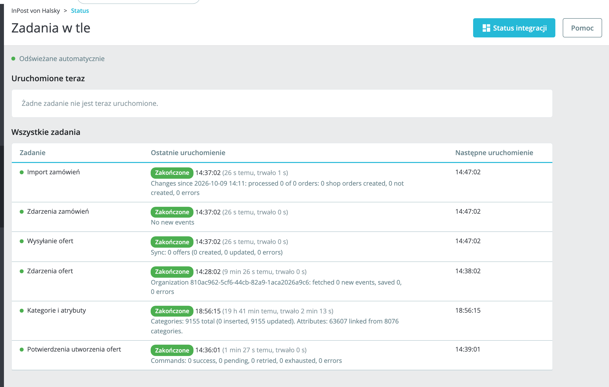

> Trwający import zamówień i zadanie zdarzeń zamówień można **zatrzymać** z tego panelu (zatrzymuje się po bieżącym zamówieniu). Zadanie przerwane w połowie jest oznaczone jako „nie odpowiada”. Dla dostępu wyłącznie przez powłokę (np. Rancher) jest skrypt `scripts/ivh-rescue.php` (status, zatrzymanie / uruchomienie importu, czyszczenie `ps_log`).

---

## 8 Najczęstsze problemy

Zacznij od panelu **[Status](#7-status-integracji-i-zadania-w-tle)** — większość problemów jest tam wymieniona z przyciskiem przejścia do miejsca, które trzeba poprawić.

| Problem | Rozwiązanie |
|---------|-------------|
| „No valid access token” / brak połączenia | Konfiguracja → Ustawienia API → sprawdź Client ID / Secret → połącz się ponownie |
| Brak kategorii w formularzu oferty | Poczekaj na cron kategorii (domyślnie 02:00) lub sprawdź, czy cron działa; produkt potrzebuje zmapowanej **domyślnej** kategorii |
| Oferty / zamówienia nie pojawiają się lub nie aktualizują | Sprawdź, czy cron `inpost:cron:run` działa co minutę (Status → Synchronizacja, Zadania w tle) |
| Oferta niepoprawna — „Wymagany atrybut … nie ma wartości” | Ustaw źródło atrybutu w Mapowaniu kategorii albo wpisz wartość w zakładce *Atrybuty InPost* |
| Wartość atrybutu z PrestaShop nie trafia do oferty | Zakładka *Atrybuty InPost* pokazuje powód: brak wartości cechy, wartość spoza listy InPost (dopasuj w oknie źródła) albo produkt z kombinacjami w ofercie na cały produkt |
| Oferta odrzucona (REJECTED) | Oferty → edycja → błędy walidacji InPost |
| Oferta ERROR_NOT_CREATED | Sprawdź powód przy ofercie / `var/logs/inpost.log`; najczęściej zdjęcia po HTTP zamiast HTTPS lub za długie pola |
| Zamówienie z InPost nie ma zamówienia w sklepie | Status / Zadania w tle pokazują powód (np. produkt niedostępny do zamówienia); import ponawia takie zamówienia |
| Moduł zgłasza niezgodną wersję | Moduły → Menedżer modułów → **Aktualizuj** przy InPost von Halsky |
| Zmiany konfiguracji nie działają | Wyczyść cache PrestaShop (Zaawansowane → Wydajność → Wyczyść cache) |
| Menu InPost von Halsky niewidoczne | Sprawdź uprawnienia profilu pracownika oraz czy moduł jest zainstalowany i włączony |

### Logi modułu

| Log | Zawartość |
|-----|-----------|
| Panel **Status** (dziennik błędów, 30 dni) | Pogrupowane błędy i ostrzeżenia modułu |
| `var/logs/inpost.log` | Szczegóły API po włączeniu **Szczegółowego logowania API** |
| Zaawansowane → Logi (`ps_log`) | Błędy hooków i crona, usunięcia ofert istniejących w InPost, zmiany kategorii ofert, wstrzymane e-maile |
| `var/logs/*-YYYY-MM-DD.log` | Standardowe logi aplikacji PrestaShop |

---

## 9 Zadania cron — harmonogram

Harmonogramy zadań ustawisz w konfiguracji modułu, w grupie **Synchronizacja** (każdy panel pokazuje ostatnie i następne uruchomienie). Wszystkie zadania uruchamia jedno polecenie `inpost:cron:run`, wywoływane co minutę.

| Zadanie (klucz) | Domyślny harmonogram | Co robi |
|-----------------|----------------------|---------|
| `category_sync` | codziennie 02:00 | Pobiera drzewo kategorii i atrybutów (z opcjami słowników) z API InPost; deaktywuje kategorie osierocone |
| `offer_event_sync` | co 20 min | Pobiera zdarzenia ofert i odświeża ich statusy oraz walidację z API |
| `offer_sync` | co 10 min | Wysyła oferty zmienione lokalnie (ceny, stany, zdjęcia, atrybuty) do API InPost |
| `order_sync` | co 10 min | Przyrostowy import zamówień z InPost i tworzenie ich w PrestaShop |
| `order_event_sync` | co 15 min | Zdarzenia zamówień: nowe zamówienia, zmiany statusów, anulowania |
| `pending_command_sync` | co 3 min | Finalizuje asynchroniczne polecenia tworzenia ofert (SUCCESS/FAILURE, ponowienia) |
| `offer_attachment_sync` | co 3 min | Wysyła załączniki ofert z kolejki, sprawdza wgrane pliki i ponawia nieudane usunięcia |

### Konfiguracja systemowego crona

Dodaj do crontab systemowego (zalecane — uruchamianie co minutę):

```bash
* * * * * cd /ścieżka/do/prestashop && php bin/console inpost:cron:run >> /var/log/inpost-cron.log 2>&1
```

Alternatywnie możesz użyć modułu **CronJobs** PrestaShop — moduł obsługuje hook `actionCronJob` i uruchomi `inpost:cron:run` wewnętrznie.

> **Uruchamianie ręczne / diagnostyka:**
> - `inpost:categories:sync` — pełna synchronizacja kategorii i atrybutów
> - `inpost:offer:sync` — pobranie statusów ofert z API
> - `inpost:offer-events:sync` — synchronizacja zdarzeń ofert
> - `inpost:orders:sync` — import zamówień z API
> - `inpost:command:sync` — diagnostyka/finalizacja poleceń asynchronicznych
> - `inpost:offer:attachments` — załączniki oferty (podgląd, `--sync`, `--add`, `--remove`)
> - `inpost:mapping:suggest` — podpowiedzi mapowania kategorii (`-a` — atrybutów, `-s "fraza"` — wyszukiwanie)
> - `inpost:cron:run --status` — podgląd zadań (włączone, interwał, ostatnie/następne uruchomienie), bez wykonywania

---

## 10 Ustawienia dodatkowe

### Wystawianie zbiorcze (grupa Oferty i produkty)

Panel **Wystawianie zbiorcze** — **Włącz wystawianie zbiorcze z listy produktów** (domyślnie włączone) dodaje akcję „Wystaw w InPost” do listy produktów; **Rozmiar paczki** (*Batch size*, domyślnie 25) to liczba produktów / wariantów przetwarzanych w jednej partii.

### Testowe podmienianie zdjęć (grupa Oferty i produkty)

Wyłącznie do testów: podmienia każdy URL zdjęcia oferty na stały, publicznie dostępny adres, aby InPost mógł pobrać zdjęcia, gdy sklep nie jest publicznie osiągalny (np. za VPN). Domyślnie wyłączone; panel statusu przypomina o włączonym podmienianiu.

### Wstrzymywanie e-maili do klienta (grupa E-maile)

Panel **E-maile do klientów** pozwala wstrzymać wybrane e-maile PrestaShop dla zamówień z InPost (InPost sam powiadamia kupującego):

- **Wstrzymuj e-maile do klientów dla zamówień InPost** — główny przełącznik (domyślnie wyłączony).
- **Wstrzymywane typy e-maili** — potwierdzenie zamówienia, zmiana statusu, wysyłka/śledzenie, korekta, komentarz do zamówienia, produkt wirtualny (domyślnie: potwierdzenie, zmiana statusu, wysyłka, korekta).
- **Loguj wstrzymane e-maile** — wpis w logu przy każdym wstrzymanym e-mailu (domyślnie włączone).

---

## Karty przewozowe — Kompatybilność z modułem ShipX

Ustawienia z grupy **Wysyłka i płatność** łączą zamówienia z InPost von Halsky z modułem przewozowym **InPost ShipX** (`inpostshipping`), który odpowiada za generowanie przesyłek i etykiet InPost.

**Panel „Integracja z InPost ShipX”**
- **Włącz integrację z ShipX** — dla przyjętych zamówień z InPost moduł tworzy w ShipX **rekordy wysyłki** i przygotowuje dane potrzebne do utworzenia przesyłki: **e-mail, adres i numer telefonu** odbiorcy (dla paczkomatu również identyfikator punktu odbioru).
- **Automatycznie twórz przesyłkę po przyjęciu zamówienia** — gdy włączone, proces przebiega **w pełni automatycznie**: moduł od razu tworzy przesyłkę ShipX wraz z etykietą. Gdy wyłączone (ale integracja włączona) — tworzy jedynie **rekord roboczy** przesyłki, który dokańczasz ręcznie w module ShipX.
- **Domyślny rozmiar paczki** — szablon ShipX (*Small = Gabaryt A*, *Medium = B*, *Large = C*, *X-Large*) dla przesyłek z zamówień. Domyślnie *Small*.

> Przy automatycznym tworzeniu moduł korzysta z **domyślnego nadawcy oraz metody nadania (paczkomat / kurier / punkt)** skonfigurowanych w module **ShipX**.

**Panel „Mapowanie wysyłki (InPost von Halsky → ShipX)”** — na którego przewoźnika ShipX kierować przesyłki:
- **Dostawa do Paczkomatu → przewoźnik**,
- **Dostawa kurierem → przewoźnik**.

> Metodę płatności zamówień z InPost opisuje panel [Płatność InPost](#płatność-inpost) (dawne ustawienie „Payment mapping” zostało usunięte w 1.1.37).

> **Wymagany moduł ShipX.** Integracja działa, gdy w sklepie zainstalowany jest moduł **InPost ShipX (`inpostshipping`)** i skonfigurowani są jego przewoźnicy. Integracja jest zweryfikowana z modułem **`inpostshipping` w wersji 2.16.2**. Konfigurację samego ShipX opisuje dokumentacja InPost: **[Dokumentacja InPost — PrestaShop](https://dokumentacja-inpost.atlassian.net/wiki/spaces/PL/pages/61669420/PrestaShop+1.7)**.
